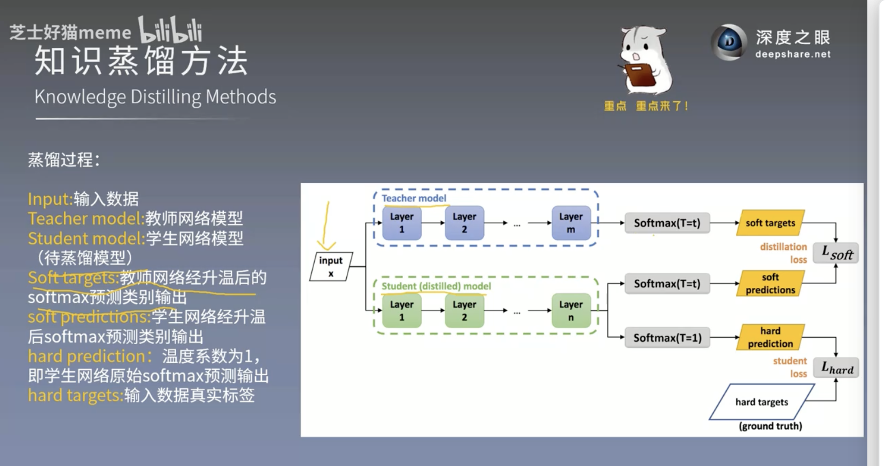

# 公共基础 19 · 知识蒸馏详解

> [!note] 这是**公共基础知识**
> KD 是 CV 里用了几十年的通用技术，任何"大模型教小模型""多模态教单模态""大模型教下游任务"的场景都用得上。
> 本文只是 KD 的一个**跨模态变体**。

> [!tip] 本篇目标
> 读完你能回答：
> 1. KD 到底改了模型的什么？（**不是**结构）
> 2. soft label 比 one-hot 标签多带了什么信息？
> 3. 温度 T 在干什么？为什么论文**没用**它？
> 4. 本文（CKD）和 Hinton 原版 KD 差在哪？

---

## 19.1 先把关系摆正：KD ≠ 压缩模型

| | 剪枝 / 量化 | **知识蒸馏** |
|---|---|---|
| 改什么 | 模型**结构**或**数值精度** | **训练目标（loss）** |
| 训完之后 | 模型变小了 ✅ | **模型大小一点没变** ❌ |
| 类比 | 把家具换成更小号的 | 换个更好的老师，**学生还是原来那么大的学生** |

> 🎯 **比喻**
> 剪枝/量化 = **换小号书包**，能少装点东西。
> 知识蒸馏 = **换个好老师教你同样的知识**，你背包一点没变小，但**装的东西更值钱了**。
>
> 所以论文说 KD 是 "model compression technique"（p1）严格讲不准确 —— KD 本身不压缩任何东西。
> 它只是让**同样的模型容量**装下更好的知识。**真正让本文的部署模型"变小"的是删掉 IR 分支这件事。**

---

## 19.2 KD 的本质：换考题，不换学生

传统训练（硬标签监督）：

$$
L_{hard} = -\sum_k y_k \log p_k
$$

`y` 是 one-hot 真值：货车这一位是 1，其它全是 0。**只有一个"对"，其余全是"错"。**

KD 训练（多了一个老师）：

$$
L_{KD} = \alpha \cdot L_{hard} + \beta \cdot L_{soft}
$$

`L_{soft}` 是"学生输出"向"老师输出"对齐的项。学生**结构一个字没改**，只是 loss 里多了一项。

> 🎯 **比喻**
> 硬标签 = 老师只说"第 1 题选 B"。
> 软标签 = 老师说"**第 1 题我选 B，但说实话 A 也有点像，C 也有点像**"。
>
> 考试时你只需记"选 B"（硬标签）；
> 但如果你记住了"**B 的把握最大，A 次之，C 最不像**"（软标签），
> 遇到一道和原题稍有不同的新题时，你就知道**该往哪个方向猜** —— 这就是泛化能力的来源。

---

## 19.3 Soft label 与 Dark knowledge（暗知识）

### 19.3.1 一句话定义

**暗知识（dark knowledge）＝ 老师模型输出的软标签中，错误类别之间的相对概率结构。**

注意它**不是**"老师模型答错的那部分知识"。它是"**老师差一点答错时表现出的犹豫程度**"，
而这种犹豫程度，恰好编码了数据本身隐含的**类间相似度**。

### 19.3.2 为什么叫"暗"？——它藏在 0 里面

one-hot 硬标签里，除了正确类，其余 N-1 个位置全是 0。
**暗知识就藏在这堆被压扁成 0 的数字里。**

| 类别 | 硬标签 | 老师（IR 检测器）的软标签 |
|---|---|---|
| 货车 | 1 | **0.83** |
| 轿车 | 0 | **0.11** |
| 卡车 | 0 | **0.05** |
| 巴士 | 0 | 0.01 |

- 硬标签只告诉你：**标准答案是货车**。
- 软标签还告诉你：**老师觉得它长得像轿车（11%），也有点像卡车（5%），跟巴士几乎不像（1%）**。

**"暗" ＝ 看不见（被压成 0），但恰恰是最有迁移价值的部分。**

可视化（把"看不见"变成"看得见"）：

```
硬标签 (one-hot)                     软标签 (soft)
货车 ███████ 1.00                    货车 ████████░░ 0.83
轿车 ░░░░░░░░ 0.00                    轿车 ░░░░░░░░░░ 0.11   ← 暗知识
卡车 ░░░░░░░░ 0.00                    卡车 ░░░░░░░░░░ 0.05   ← 暗知识
巴士 ░░░░░░░░ 0.00                    巴士 ░░░░░░░░░░ 0.01   ← 暗知识
                                     └──┬──┘
                                      相对大小 ≠ 绝对大小
```

被硬标签丢掉的，正是下面这行信息：
"**货车和轿车的相似度，比货车和巴士的相似度，高一个数量级。**"

> 🎯 **比喻**
> 硬标签 = 一张**答案卡**："选货车，改不改了。"
> 软标签 = 一张**带批注的答案卡**："我选货车，但我犹豫了 17%，主要因为它长得像轿车。"
> **批注（犹豫）才是真正能迁移到新题的东西。**

### 19.3.3 Hinton 原文的两个例子（原文 p.2 逐字核对）

**例一 · 数字 "2"**

> "one version of a 2 may be given a probability of 10⁻⁶ of being a 3 and 10⁻⁹ of being a 7
> whereas for another version it may be the other way around."

一个写得歪的 "2"，被判成 "3" 的概率是 10⁻⁶、被判成 "7" 的是 10⁻⁹；
另一个写得怪的 "2" 恰好相反。

**这句话的信息量在于"相对"**：
不是"2 像 3"这件事，而是"**这个 2 比那个 2 更像 3**" —— 这正是数据本身的相似性结构。

**例二 · BMW**

> "An image of a BMW, for example, may only have a very small chance of being mistaken
> for a garbage truck, but that mistake is still many times more probable than
> mistaking it for a carrot."

一张宝马的图片，被误判成垃圾车的概率虽小，
但**仍然远大于**被误判成胡萝卜的概率。

→ **只有相对大小才有信息。** 如果只看"绝对概率都很小"，两个错类就没有区别了。

### 19.3.4 暗知识到底值多少钱？（4 条）

1. **类间相似度是任务的内蕴结构**
   教模型"货车 ≈ 轿车 > 货车 ≈ 巴士"，面对训练集里没见过的组合也能合理推断。
   one-hot 完全没教过它这些。

2. **信息量更大**
   高熵软标签每个样本携带的信息远多于 one-hot（一个 1 + N-1 个 0 只表达"是"这个事实）。

3. **梯度方差更小 → 更好训**
   原文 p.2 原话："the soft targets provide ... **much less variance in the gradient
   between training cases**, so the small model can often be trained on much less data
   than the original cumbersome model and using a much higher learning rate."
   （→ 学生可以用更少的数据、更大学习率训练）

4. **不拉平就传不过去**
   10⁻⁶ 和 10⁻⁹ 在交叉熵里的贡献几乎为 0，暗知识在标准 CE 下**根本传不到学生**。
   这正是要引入温度 `T` 的原因（见 §19.4）。

### 19.3.5 术语小考：这个词到底从哪来？（词源核查）

这是本笔记系列的一贯原则：**能查证的就查证，查不到的就说不知道。**

- 结论：**"dark knowledge" 这个术语在知识蒸馏社区被普遍归给 Hinton et al. 2015
  （*Distilling the Knowledge in a Neural Network*）的蒸馏工作**，
  几乎所有中文/英文技术博客都这么写。
- 但是：**对 2015 原始论文全文做检索，"dark" 一词出现 0 次**（"knowledge" 出现 17 次）。
  该论文正文里**没有**这个词。
- 不过，**概念本身在原文 p.2 有完整、逐字的表述**（就是上面 19.3.3 引的那两段），
  说的正是"信息藏在极小概率的相对比值里"。
- 所以严格表述应该是：
  **概念出自 Hinton 2015；"dark knowledge" 这个叫法是社区后来的通俗化命名。**

### 19.3.6 ★ 本文（Cross-Modal UAV）里的暗知识

本文 API 模块的 KL 散度项，传的正是**暗知识**——只不过它是**跨模态的**暗知识。

| | 老师 | 学生 | 传的是谁的暗知识 |
|---|---|---|---|
| 同模态 KD（经典） | 大号 CNN | 小号 CNN | 同一个模态内部的类间相似度 |
| 本文 API | **冻结的 IR 检测器** | RGB 检测器 | **RGB↔IR 跨模态的类间相似度** |

KL 散度（Eq.7）逐项比对的是两个概率分布的**对应位置**，
因此它对**相对大小**（谁更接近谁）极其敏感 —— 传的就是暗知识本身。

> ⚠️ 但要注意：本文**全文没有出现 "temperature"（0 次）**，
> 其 KL 用的是原始 softmax 输出。这意味着本文的暗知识传递是
> **"未拉平"的传递**，只保留了老师输出中概率较大的那一部分结构。
> 详见 §19.8「反常识 ①」。

---

## 19.4 温度 T：调节老师说话的从容程度

$$
p_i^{(T)} = \frac{\exp(z_i / T)}{\sum_{j} \exp(z_j / T)}
$$

- `T = 1`：原始分布
- `T > 1`（常用 2~4）：分布被**拉平**，小概率被放大 → **暗知识更明显**
- `T → 0`：趋近 one-hot，退化成硬标签

### 为什么 `T>1` 有用？

one-hot 里那些"小概率"（0.05 的卡车）本来就携带**类间关系**信息，
但在 `T=1` 的分布里它们太小，KL 散度对它们的**梯度贡献几乎为零** —— 等于白教。
拉平之后，老师"我犹豫的那部分"才真正传得过去。

$$
L_{soft} = T^2 \cdot \text{KL}\left(p_{teacher}^{(T)} \,\|\, p_{student}^{(T)}\right)
$$

**`T^2` 是干什么的？**
温度把分布拉平的同时，也把**梯度**尺度缩小了约 `T^2` 倍。
不乘 `T^2` 的话，`T` 越大软标签损失的梯度越小，等于自动调小了软标签权重 `β`。
乘上 `T^2` 就能让"**`T` 控制分布形状**"和"**`β` 控制强弱**"**解耦**。

> 🎯 **比喻（抓住"说话方式"这个点）**
> 同一个老师，同样一句"这大概是货车"，三种说法：
> - **斩钉截铁**（`T→ 0`）："货车。" → 学生只学到"是货车"
> - **正常**（`T=1`）："货车 0.83…" → 学生学到大部分
> - **从容不迫**（`T=4`）："货车……不过说实话也有点像轿车" → **学生连犹豫一起学走了**
>
> 温度不是改老师的知识，是改**老师愿意说出多少犹豫**。
> 而那点犹豫，恰恰是最值钱的部分。

---

### ★★ 配图精读：一张图看懂经典 KD 框架



> 来源：深度之眼 bilibili 课程《知识蒸馏方法》配图，即 Hinton 2015 蒸馏框架的标准流程图。
> 这张图**没有硬伤**，但省略了三个决定成败的细节。

#### 图的结构（ASCII 复刻）

```
input x ──┬──→ Teacher: Layer1 → Layer2 → … → Layer m   （通常更大，蒸馏阶段冻结）
          │
          └──→ Student: Layer1 → Layer2 → … → Layer n   （要训练的那个）
                     │
                     ├──→ Softmax(T=t) → soft predictions ──┐
                     │                                      ├──→ L_soft
Teacher → Softmax(T=t) → soft targets ─────────────────────┘
                     │
                     └──→ Softmax(T=1) → hard prediction ─────┐
                                                            ├──→ L_hard
                            hard targets（真实标签 one-hot）──┘
```

**三句话概括：**
1. 同一份输入 `x` 同时喂给老师和学生；
2. 老师用**高温** softmax 吐出"带批注的答案"（`soft targets`，含暗知识），
   学生也用**同一个温度** `t` 产出 `soft predictions` 去对齐它 → `L_soft`；
3. 学生**同一份 logits** 再过一次 `T=1` 的 softmax 得到 `hard prediction`，
   与真实标签对齐 → `L_hard`；两项加权求和。

> 🎯 **比喻**
> 学生拿到卷子上老师的"批注版答案"（`soft targets`），先按批注学（`T=t`，看清犹豫）；
> 但考卷上印的是标准答案（`hard targets`），还得按标准答案再校一遍（`T=1`）。
> **两道题都要做，加权总分才是成绩。**

#### 四个术语对照表（新手最糊的地方）

| 术语 | 谁产生的 | 温度 | 用在哪个损失 | 一句话 |
|---|---|---|---|---|
| `soft targets` | **老师** | `T=t` | `L_soft` | 老师的**带批注答案**（暗知识载体） |
| `soft predictions` | **学生** | `T=t` | `L_soft` | 学生的**带批注答案**（要被拉去对齐老师） |
| `hard prediction` | **学生** | `T=1` | `L_hard` | 学生的**原始答案** |
| `hard targets` | 数据集 | — | `L_hard` | **真实标签**（one-hot） |

> ⚠️ **命名坑**：`targets` = 目标（老师的输出），`predictions` = 预测（学生的输出）。
> 只有 `hard targets` 是"真值"，`soft targets` 是"假的目标"。

#### 🔴 缺失点 ①：`T²` 因子 —— 图里最严重的省略

Hinton 原文 p.3 逐字：

> "Since the magnitudes of the gradients produced by the soft targets scale as **1/T²**
> it is important to **multiply them by T²** when using both hard and soft targets.
> This ensures that the relative contributions of the hard and soft targets remain
> roughly unchanged if the temperature used for distillation is changed."

真实的总损失应该是：

$$
\mathcal{L} \;=\; \alpha \cdot T^{2} \cdot \mathcal{L}_{\text{soft}} \;+\; (1-\alpha) \cdot \mathcal{L}_{\text{hard}}
$$

图里的 `L_soft` 应理解为 **`T² · L_soft`**。

> 🎯 **比喻**
> 降温（`T` 变大）会把所有概率"压平"，同时也把梯度尺度缩小约 `T²` 倍 —— 像把麦克风音量调小。
> 你要提高温度来听清老师的犹豫，就得**同时把音量旋钮 `T²` 拧上去**，否则听到的是一片寂静。

#### 🔴 缺失点 ②：权重 `α`，而且方向常被搞反

Hinton 原文 p.3：

> "We found that the best results were generally obtained by using a
> **considerably lower weight on the second objective function**."

"第二个目标函数" = 硬标签交叉熵（`L_hard`）。即：

> **硬标签那一项的权重，应当明显小于软标签那一项。**

这与直觉相反（"真值最可靠，应该给大头"）。Hinton 的经验是：
**软标签（暗知识）是主力，真值只是防止学生跑偏的锚。**

#### 🟡 缺失点 ③：推理时用 `T=1`

> "The same high temperature is used when training the distilled model,
> **but after it has been trained it uses a temperature of 1.**"

高温只在**训练时**用来传知识；**部署时学生用 `T=1`**。
图是训练图，所以没标，但写代码时必须记住。

#### ⭐ 与本文（Cross-Modal UAV）的偏离对照

这张图是"**标准模板**"，论文二在这个模板上做了**三处偏离**：

| | 这张标准图 | 论文二（Cross-Modal UAV） | 影响 |
|---|---|---|---|
| **老师是谁** | 更大的同模态网络 | **冻结的 IR 检测器**（另一模态，非更大） | 传的是**跨模态**暗知识 |
| **有没有温度 `T`** | 有，`T=t`，还要乘 `T²` | **全文 "temperature" 出现 0 次**，用原始 softmax | 暗知识**未拉平**传递，只保留概率较大的结构 |
| **蒸馏形式** | 只有输出层 CE | 输出层 **API**（KL）+ 特征层 **SFI**（图里完全没有） | 多层蒸馏 |

```
        标准 KD 框架                      论文二 CCFA-Net
   ┌────────────────────┐           ┌────────────────────────────┐
   │ Teacher(大/同模态)  │           │ Teacher = 冻结 IR 检测器      │
   │   ↓ Softmax(T=t)     │           │   ↓ 原始 softmax（无温度）     │
   │ soft targets        │           │   ↓ KL 散度        ← API      │
   │   ↓ CE(T² 加权)     │           │                             │
   │ Student             │           │ Student = RGB 检测器          │
   │   ↓ Softmax(T=1)     │           │   ↓ SFI（特征层对齐）          │
   │ hard pred           │           │                             │
   │   ↓ CE              │           │                             │
   └────────────────────┘           └────────────────────────────┘
```

> 💡 **这就是 §19.8「反常识 ①」的技术根因**：
> 通行教程（包括这张图）都说"温度是知识蒸馏的灵魂"，
> 但本文直接扔掉温度，只靠 KL 散度 + 逐目标 IoU 加权（`w_ciou`）传跨模态暗知识。
> **这正是可以切入的研究点。**

#### 一句话记住整张图

> **老师用高温吐批注，学生用高温对齐批注（蒸馏损失，`T²` 加权、大头），
> 再用常温对齐真值（学生损失、小头），两者加权求和；训完部署用常温。**

---

## 19.5 KL 散度 vs 交叉熵：为什么蒸馏用 KL

| | 交叉熵 `L_CE` | KL 散度 `L_KL` |
|---|---|---|
| 比较谁和谁 | 预测 vs **真值标签** | 预测 vs **老师输出** |
| 目标分布 | one-hot（硬） | 概率分布（软） |
| 惩罚什么 | 只惩罚"偏离唯一正确答案" | 惩罚"**整个分布形状**不一样" |

$$
\text{KL}(P \| Q) = \sum_k P_k \log \frac{P_k}{Q_k}
$$

注意 **KL 不对称**：`KL(P|Q) ≠ KL(Q|P)`。
论文里 **老师在前、学生在后**（`p^{IR} log frac{p^{IR}}{p^{RGB}}`）——
顺序**有讲究**，写反了就变成反向 KL，行为明显不同。

$$
L_{cls} = \rho \cdot L_{KL} + (1 - \rho) \cdot L_{CE}
$$

> [!tip] 这一行是本文的"标准 KD 配方"
> 对照 Hinton 原版 `L = α L_{hard} + β L_{soft}`：
> 这里的 `ρ` 就是 `β` 的角色（软标签权重），`(1-ρ)` 就是 `α` 的角色（硬标签权重）。
> 论文 p7 明确给出定位蒸馏率 **`λ = 0.5`**。

---

## 19.6 蒸馏搬到哪一层：三个层次

| 层次 | 蒸馏什么 | 优点 | 缺点 | 本文 |
|---|---|---|---|---|
| **输出层** | 最后的类别概率 | 实现最简单、稳 | 只能传"结论" | ✅ **API** |
| **特征层** | 中间特征图 | 信息更丰富 | 对齐难（跨模态尤其难） | ✅ **SFI** |
| **关系层** | 特征间的相似度/关系图 | 与具体数值无关 | 抽象、难解释 | ❌ |

> 🎯 **比喻**
> - 输出层蒸馏 = 只抄老师的**答案**
> - 特征层蒸馏 = 抄老师的**草稿/中间思考过程**
> - 关系层蒸馏 = 抄老师的**思路结构**（"这类题该这么想"）

本文两个都用上了：**SFI 抄草稿（特征层），API 抄答案（输出层）**。

---
## 19.7 ★ 本文怎么用 KD：SFI + API 全景

> [!abstract] 本文总损失（Eq.14，原文）
> 
> L = L_f + L_{cls} + L_{loc}
> 
> - `L_f` ：SFI 特征蒸馏（Eq.5）
> - `L_{cls}` ：API 分类蒸馏（Eq.9）
> - `L_{loc}` ：API 定位蒸馏（Eq.13）

### SFI —— 特征层（Eq.2~5）

**Step 1. 算相似度图**（逐像素位置的余弦相似度）

$$
M = \frac{F_{IR} \cdot F_{RGB}}{\|F_{IR}\| \cdot \|F_{RGB}\|}
$$

**Step 2. 反相似度图**

$$
\bar{M} = 1 - M
$$

**Step 3. 拆成共性 / 残差**

$$
F_{com} = M \odot F, \qquad F_{res} = \bar{M} \odot F
$$

**Step 4. 分别蒸馏，两个权重**

$$
L_f = \pi_1 \| F^{com}_{IR} - F^{com}_{RGB} \|^2 + \pi_2 \| F^{res}_{IR} - F^{res}_{RGB} \|^2
$$

> 🎯 **这是本文最核心的一个公式，务必记住结构**
> "**先拆开，再分别加权对齐**"。
> 对齐共性部分用权重 `π_1`，对齐残差部分用权重 `π_2`；
> 论文实验最优是 `π_1 = 0.3`（即残差权重更大）。

### API —— 输出层（Eq.6~13）

**Step 1. 用跨模态 IoU 当"信任度旋钮"**

$$
w_{ciou} = \frac{|D_{RGB} \cap D_{IR}|}{|D_{RGB} \cup D_{IR}|}
$$

**Step 2. 分类蒸馏（软标签 + KL）**

$$
L_{KL} = \frac{1}{N} \sum_i w_{ciou} \cdot \sum_k p_k(X_i^{IR}) \log \frac{p_k(X_i^{IR})}{p_k(X_i^{RGB})}
$$

**Step 3. 定位蒸馏（旋转框四顶点 + 尺度归一）**

$$
L^{ts}_{loc} = w_{ciou} \cdot \| R_{IR} - R_{RGB} \|^2
$$

$$
L_{loc} = \lambda \cdot L^{ts}_{loc} + (1-\lambda) \cdot L^s_{loc}
$$

其中 `L^s_{loc}` 是用真值 `R_{RGB}` 算的 smooth-L1 损失（论文 Eq.11-12）。

> [!important] `w_{ciou}` 是**逐目标**的权重，不是全局常数
> 这就是 "**Adaptive**" 三个字的含义：
> - IR 和 RGB 都看到了同一个目标 → `w_{ciou}` 大 → **狠狠学**
> - RGB 压根看不见、只有 IR 看到 → `w_{ciou} ≈ 0` → **基本不学**
>
> 论文原文：暗夜环境下 "some objects are more visible in IR images than in RGB images.
> These objects are annotated in IR images, yet **neglected in RGB images**."
> —— **硬学老师 = 学坏**，`w_{ciou}` 就是防这个的旋钮。

---
## 19.8 ★★ 本文 KD 的两个反常识点

### 反常识 ①：本文**没有用温度 T**

全文检索 **"temperature" 出现 0 次**。

论文 Eq.(7) 直接用了**未经温度处理**的 KL：

$$
L_{KL} = \frac{1}{N} \sum_i w_{ciou} \sum_k p_k(X_i^{IR}) \log \frac{p_k(X_i^{IR})}{p_k(X_i^{RGB})}
$$

**为什么这样也说得通？**（这是你的分析题）
- Hinton 用 `T>1`，是因为 one-hot 真值会让分布**太平**，暗知识传不过去；
- 但本文的老师输出**本身就是连续分布**（IR 检测器的 softmax），不是 one-hot；
- 而且本文真正的问题不是"暗知识传不过去"，而是"**模态鸿沟 + 标注错位**"；
- 对症下药的是 `w_{ciou}`（信任度旋钮）和共性/残差分解，不是温度。

### 反常识 ②：老师**不是更大的模型**，而是**另一个模态**

| | Hinton 原版 | 本文 CKD |
|---|---|---|
| 老师/学生结构 | 不同（大/小） | **完全相同**（都是 Oriented-RCNN） |
| 老师多知道什么 | 更多层、更宽 → **容量** | **红外能看见彩色看不见的** |
| 蒸馏的"知识" | 容量差 | **模态差** |
| 训练时 | 老师要一起训 | **老师冻结**（p7："we fix the parameters of the IR detector"） |

> 🎯 **一句话**
> 传统 KD：**博士生教小学生**（老师懂得多）。
> 本文 CKD：**闭上左眼用右眼看**（老师看得见你不看得见的）。

### 两个 KD 模块的分工一览

| | SFI | API |
|---|---|---|
| 层次 | 特征层 | 输出层 |
| 蒸馏什么 | 特征图（拆共性/残差） | 类别概率 + 旋转框顶点 |
| 核心机制 | 相似度图 `M` 分解 | 跨模态 IoU `w_ciou` 加权 |
| 解决什么 | **模态鸿沟**（怎么对齐） | **标注错位**（该学谁） |
| 类比 | 抄老师的**草稿** | 抄老师的**答案** |

---

## 19.9 易混淆速查

| 说法 | 对不对 |
|---|---|
| "KD 能让模型变小" | ❌ 结构不变，大小不变 |
| "温度 T 是用来放大梯度的" | ❌ T 放大**分布的平坦度**；`T²` 才是**把梯度尺度补回来** |
| "KL 散度是对称的" | ❌ 不对称，前向/反向 KL 行为不同 |
| "本文用了温度 T" | ❌ **全文 0 次** |
| "`w_ciou` 是全局常数" | ❌ **逐目标**计算 |
| "SFI 和 API 都是输出层蒸馏" | ❌ SFI=**特征层**，API=**输出层** |
| "SFI/API 用 L2 直接对齐特征就行" | ❌ SFI 必须**先拆共性/残差**再加权 |

---

## ❓ 自测

1. KD 改了模型的什么？为什么说"KD 不压缩模型"？
2. soft label 比 one-hot 多带了哪一类信息？用论文里的类别举例说明。
3. 温度 `T` 调到 4，老师的输出分布会怎么变？为什么这有助于传暗知识？`T^2` 又是干嘛的？
4. 为什么说"本文没用温度也说得通"？给出至少一条理由。
5. `w_{ciou}` 在 API 里扮演什么角色？如果去掉它，夜间场景会发生什么？

> **如果第 4 题答不上来**，回看 §19.8；这条是区分"读过论文"和"读懂论文"的分水岭。

---

## 🔗 本文（Cross-Modal UAV）用在哪

- [[paper-notes/论文精读/2-Cross-Modal-UAV精读/02-第1讲-知识蒸馏与模态鸿沟]] — KD 基础 + 模态鸿沟
- [[paper-notes/论文精读/2-Cross-Modal-UAV精读/04-第3讲-SFI选择性特征模仿]] — Eq.2~5
- [[paper-notes/论文精读/2-Cross-Modal-UAV精读/05-第4讲-API自适应预测模仿]] — Eq.6~13
- [[paper-notes/论文精读/2-Cross-Modal-UAV精读/06-第5讲-总目标训练流程与部署]] — Eq.14 总损失 + Algorithm 1

---

## 🔗 方向脉络里的位置

- [[paper-notes/论文精读/2-Cross-Modal-UAV精读/公共基础知识/01-模型压缩全景]] — KD 在压缩坐标系里的位置
- [[paper-notes/论文精读/1-CCFA-Net精读/01-公共基础知识/10-损失函数]] — 损失函数是 KD 的载体
- [[paper-notes/论文精读/1-CCFA-Net精读/01-公共基础知识/09-梯度下降与反向传播]] — 梯度怎么流回学生

---

## 📖 出处

- Hinton, Vinyals, Dean, *"Distilling the Knowledge in a Neural Network"*, arXiv:1503.02531, 2015 —— KD 原始论文（温度、软标签）
- 本文 Eq.(2)-(14) —— 所有论文公式的出处
- 本文 p7 原文："In the training phase, **we fix the parameters of the IR detector (teacher)**"

---

**← 上一篇** → [[paper-notes/论文精读/2-Cross-Modal-UAV精读/公共基础知识/01-模型压缩全景]] ｜ **索引 →** [[paper-notes/论文精读/2-Cross-Modal-UAV精读/00-索引 MOC]]
