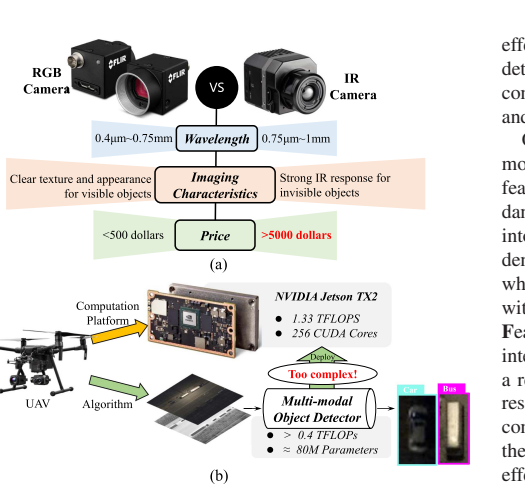
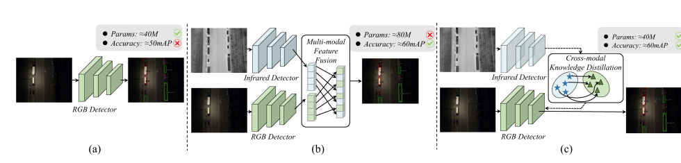
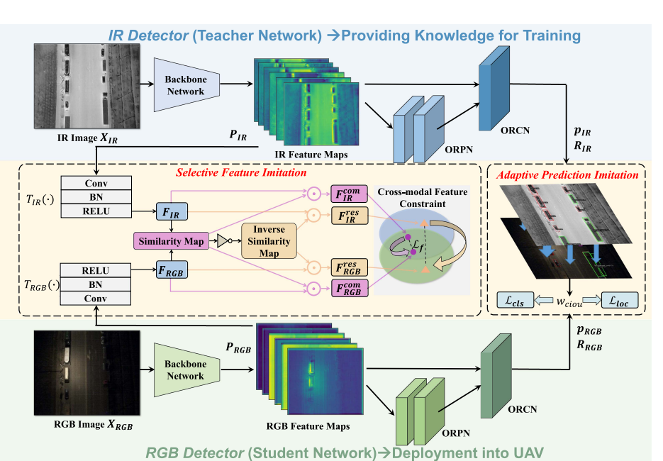
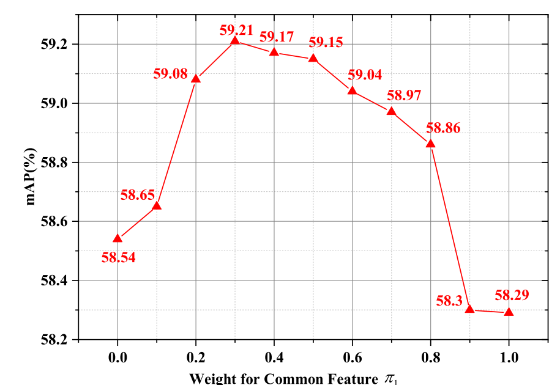
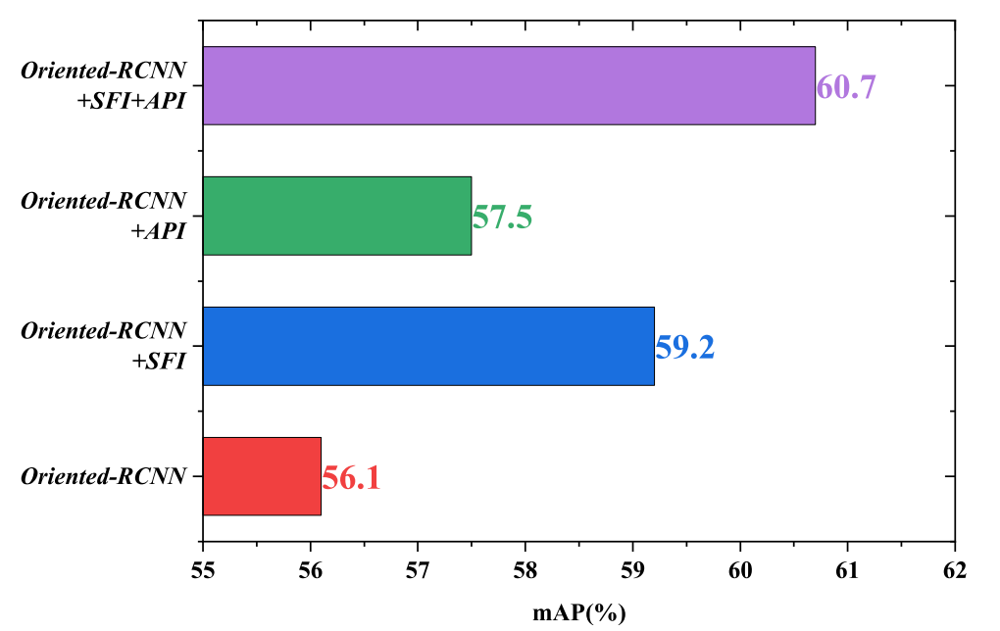
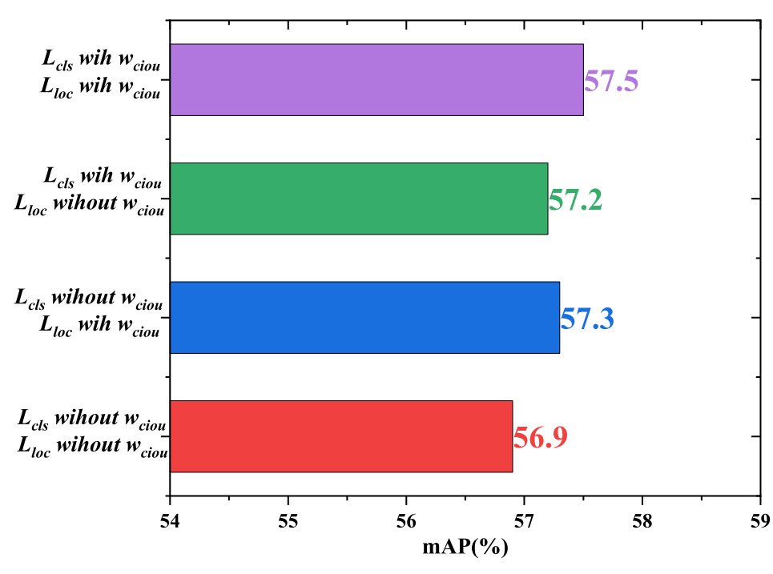
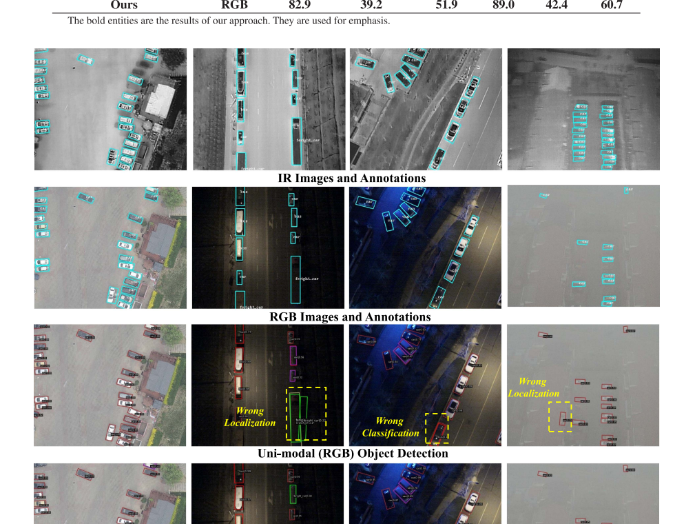

# Cross-Modal Object Detection via UAV — 完整讲解

> **论文**：Ang Li, Shouxiang Ni, Yanan Chen, Jianxin Chen, Xin Wei, Liang Zhou, Mohsen Guizani.
> *"Cross-Modal Object Detection via UAV."* IEEE Transactions on Vehicular Technology, Vol. 72, No. 8, pp. 10894–10905, Aug. 2023.
> DOI: [10.1109/TVT.2023.3262129](https://doi.org/10.1109/TVT.2023.3262129)
>
> 单位：南京邮电大学宽带无线通信与传感器网络技术教育部重点实验室 / MBZUAI
> 关键词：Unmanned aerial vehicles, cross-modality, object detection, knowledge distillation

---

## 目录

- [零、先给你一张全景图](#零先给你一张全景图)
- [一、研究背景和问题](#一研究背景和问题)
- [二、研究目的和创新点](#二研究目的和创新点)
- [三、研究方法和实验设计](#三研究方法和实验设计)
- [四、主要结果和结论](#四主要结果和结论)
- [五、潜在意义和未来工作方向](#五潜在意义和未来工作方向)
- [附录 A：公式速查表](#附录-a公式速查表)
- [附录 B：术语表](#附录-b术语表)
- [附录 C：自测题与参考答案](#附录-c自测题与参考答案)
- [附录 D：延伸阅读](#附录-d延伸阅读)

---

# 零、先给你一张全景图

**这篇论文只干了一件事：让无人机只装一个普通彩色摄像头，也能像装了"夜视仪"一样在黑夜里找出车辆。**

## 核心类比

想象你是个新手司机。驾校的车装了夜视辅助系统，教练用它在漆黑的隧道里陪你练——你因此学会了"黑夜里前方有障碍物"这种判断。考试时你开的是普通车，没有夜视仪，但**你脑子里的那套判断还在**。

论文里的角色对应关系：

| 现实角色 | 论文组件 | 说明 |
|---|---|---|
| 教练 + 夜视仪 | **IR 检测器（老师）** | 训练时才存在，参数量冻结 |
| 普通车 + 你的技能 | **RGB 检测器（学生）** | 最终部署到无人机上的东西 |
| 教练的陪练 | **知识蒸馏（KD）** | 训练机制的统称 |
| 黑暗中只听老师一句话就画框 → 学坏 | **API 的动机** | 用 IoU 决定"该不该信老师" |
| 老师只教你会的东西 | **SFI 的动机** | 只重点教学生不会的"残差" |

## 系统流程图

```text
【训练阶段】需要红外相机 + 两个模型（成本高无所谓）
 ┌──────────┐  X_IR   ┌───────────────────┐
 │ 红外图像  │ ──────► │ IR 检测器 (老师)   │  参数冻结 🧊
 └──────────┘         └───────────────────┘        │
                                                     │  知识
 ┌──────────┐  X_RGB  ┌───────────────────┐        ▼
 │ 彩色图像  │ ──────► │ RGB 检测器 (学生)  │ ◄───────┘
 └──────────┘         └───────────────────┘  训练参数 ✏️
                              ▲ SFI(搬特征) + API(搬预测)

【部署阶段】只要彩色相机 + 一个模型
 ┌──────────┐  ┌───────────────────┐  ┌──────────┐
 │ 彩色图像  │─►│ RGB 检测器 (学生)   │─►│ 目标框+类别│
 └──────────┘  └───────────────────┘  └──────────┘
             IR检测器 / SFI / API 全部删掉 ✅
```

> **为什么这个思路值得做？** 因为"训练时多花钱、部署时省钱"在工程上非常划算。你不会为了省训练成本，而牺牲部署时的重量、功耗和成本。

---

# 一、研究背景和问题

## 1.1 基础概念：什么是"目标检测"

| 任务 | 输入 | 输出 | 一句话 |
|---|---|---|---|
| 图像分类 | 一张图 | 一个标签 | "这图里有车" |
| **目标检测** | 一张图 | 一堆「框 + 类别」 | "这图里有 3 辆车，左下一个、右下一个、中上两个" |

> **类比**：分类是"这屋里有家具吗？"；检测是"有，在哪个角落，是什么家具"。无人机要的是后者——因为它得知道**往哪个方向飞过去拍**。

## 1.2 UAV 场景的特殊性

无人机做交通监控、灾害救援、异常监测，有两个天然约束：

**约束一：视角很刁。** 飞机在 80~120 米高空俯拍，车在图里只有几十个像素，而且**大部分是长条形的**（车、卡车、货轮）。

**约束二：机载算力很小。** 论文用的 NVIDIA Jetson TX2 只有 **1.33 TFLOPS**（这是它全部的 AI 算力）。

## 1.3 为什么需要"多模态"？因为单一模态有致命盲区

| 模态 | 白天的优点 | 夜晚的短板 |
|---|---|---|
| **RGB 彩色** | 颜色、纹理、车道线、车牌清晰 | **基本瞎了**——路灯都看不见 |
| **IR 红外（热成像）** | 黑夜能看热源，车还是热的 | 看不清颜色和纹理 |

> **类比**：RGB 像"白天戴眼镜看世界"，IR 像"夜里靠手电筒和热感"。两个眼睛各有盲区，凑一起才完整。

所以学术界的主流做法是**多模态检测器**：同时吃 RGB 和 IR，把两者特征融合起来一起预测。效果确实好。

## 1.4 论文指出的两个"硬伤"

作者在 Fig. 1 里用两张图说明：**多模态方案在无人机上根本装不下**。



**硬伤①：贵。**
论文 Fig.1(a) 的标注：普通 RGB 相机 **< 500 美元**，IR 相机 **> 5000 美元**——**差 10 倍**。原因是 IR 相机要用特殊的玻璃镜头、探测器阵列和电路板。

> 💡 这是很多小白会忽略的点：论文的动机不是"算法不够好"，而是**硬件成本 + 算力预算**这两个硬约束。

**硬伤②：重。**
论文 Fig.1(b) 的数字：

- 多模态检测器计算量 **> 0.4 TFLOPs**，参数量 **> 80M**
- Jetson TX2 算力 1.33 TFLOPS → 实际只能跑 **4 fps**

> **4 fps 是什么概念？** 4 帧/秒 = 0.25 秒才更新一次画面。无人机在移动时，这基本等于"看东西全是 lag 的"，达不到实时要求。

## 1.5 真正的研究缺口

> **既然多模态效果好但太重，能不能只在训练阶段用多模态，部署阶段只用轻量的单模态，同时还比普通单模态更准？**

这正是本文要回答的问题。但它没那么简单，因为有个隐藏的障碍——

### ⚠️ 隐藏障碍："模态鸿沟"（modality barrier）

先讲**知识蒸馏（Knowledge Distillation, KD）**是什么（如果你是第一次听）：

> **知识蒸馏**：让一个笨重的大模型（老师）当"教练"，把它的"经验"教给一个小模型（学生）。学生模仿老师的输出，精度大涨但参数不涨。Hinton et al. 2015 年提出。

传统 KD 的前提是：**老师和学生看的是同一张图**（同模态）。比如大模型看猫、学生也看猫。

**但本文的场景是：老师看红外图，学生看彩色图。** 两者的特征分布天差地别——红外图上"一辆车"是一团热斑，彩色图上"一辆车"是有轮胎的车身轮廓。

> **如果你直接强行把两边的特征拉近**（普通特征蒸馏的做法），会发生什么？
>
> **类比**：你想让一个学中文的人和一个学法文的人"用同一种方式表达同一个概念"。中文说"桌子"，法文说"table"。你硬把两个人的大脑内部神经活动拉近，结果两边都学乱了。**共同的部分（都在看一张桌子）本来就各自会了，硬拉近纯属浪费；真正该拉近的是"中文特有的东西"和"法文特有的东西"的映射关系。**

这就是论文第 II-B 节提出的核心洞察：**跨模态蒸馏不能无差别地拉近，必须区分"共性特征"和"残差特征"。**

---

# 二、研究目的和创新点

## 2.1 研究目的

提出一个叫 **CKD（Cross-modal Knowledge Distillation，跨模态知识蒸馏）** 的范式：

> **训练阶段用 IR-RGB 图像对 + 两个检测器；推理阶段只用 RGB 图像 + 一个检测器。**

## 2.2 和现有方案的区别（论文 Fig. 2）



| | (a) 传统单模态 | (b) 传统多模态 | (c) 本文 CKD |
|---|---|---|---|
| 训练输入 | RGB | IR + RGB | IR + RGB |
| **推理输入** | RGB | **IR + RGB** | **RGB** ✅ |
| 参数量 | ~40M | ~80M | ~40M |
| 精度 | ~50 mAP ❌ | ~60 mAP ✅ | ~60 mAP ✅ |
| 需要红外相机 | 否 | **是** | **否** ✅ |

**看第 (b) 列和第 (c) 列最下方的差别**：传统多模态方案，**推理时还需要红外相机**，所以那 5000 美元躲不掉；而本文推理时只要普通彩色相机。

> **类比**：
> - 传统多模态 = 上班必须同时戴眼镜**和**助听器，少一样就听不清/看不清
> - 本文 = 上班时用助听器辅助学习，把功夫下够了，回家后**光靠眼睛**也能开会

## 2.3 三个创新点（论文原文列的四条）

### 创新点 ① CKD 范式本身

把多模态从"部署负担"翻转成"训练资源"。

### 创新点 ② SFI（Selective Feature Imitation，选择性特征模仿）

把多模态特征空间**拆成"共性部分"和"残差部分"**，然后**只对残差部分加大权重**。

> **类比**：老师身上有"两种人共有的知识"（都会用筷子）和"只有老师才有的知识"（会用筷子夹西餐）。你不需要在"用筷子"上死磕，多花力气在"夹西餐的姿势"上。
>
> 论文的消融实验（Fig. 6）直接验证了这一点：给"共性"的权重 π₁ 和给"残差"的权重 π₂，**π₂ > π₁ 时效果最好**。

### 创新点 ③ API（Adaptive Prediction Imitation，自适应预测模仿）

用**跨模态 IoU** 实时评估"老师这次说得对不对"，据此**动态调节蒸馏强度**。

> **为什么需要？** 想象老师（红外）在夜里看到一辆车，但学生（彩色）那边根本看不见这辆车，而且**标注数据集里也没有标它**（标注员也看不见）。这时候老师硬要学生"在那个位置也画个框"，学生会被教坏。
>
> API 的做法：**两个模态都同意**（IoU 大）→ 老师可信，多学；**两个模态有分歧**（IoU 小）→ 老师这次不可信，少学。

## 2.4 🔥 一个必须注意的"反直觉"点

初学者最容易误解的地方，看清楚：

**本文的老师和学生，网络结构是完全一样的**（都是 Oriented R-CNN + ResNet50+FPN），**参数量一样、容量一样**。

所以这里蒸馏的"知识"**不是**来自"模型更大"或"更多层"，而是来自**"我看到了不同的东西"**。

| | 传统 KD | 本文 CKD |
|---|---|---|
| 老师 vs 学生 | 大 vs 小 | **同构** |
| 知识来源 | 模型容量/深度 | **模态差异** |
| 目的 | 压模型大小 | **省掉红外相机 + 融合模块** |

> **类比**：传统 KD 是"博士生教小学生"；本文是"你闭上一只眼，用另一只眼当老师"。

---

# 三、研究方法和实验设计

## 3.1 基线：为什么用 Oriented R-CNN（旋转框检测器）

### 为什么需要"旋转框"？

普通检测器输出的是**水平框**（axis-aligned，就是横平竖直的矩形）。但航拍图里的车是长条形、还可能斜着停。

**具体例子**：一辆货车在图上是斜 30° 的，长 10 米、宽 2.5 米。

- **水平框**：要框住整个斜车身，框的面积远超车身，**塞满了车周围一大片空地**
- **旋转框**：沿着车身方向转 30°，**严丝合缝**

**为什么这会伤精度？** 检测器第二步要从框里提取特征来分类。框里混入大量背景 → 特征被污染 → 分类置信度下降。

> **类比**：给一个斜靠在沙发上的长条沙发套一块正方形框布，浪费布料还挡视线；顺着沙发摆就正好。

所以无人机场景普遍用**任意方向目标检测（Arbitrary Oriented Object Detection）**，输出四边形框。

### Oriented R-CNN 的三个部件

```text
输入图像 X   │
┌──▼─────────────────┐
│ ① Backbone 骨干网络 │ ResNet50 + FPN
│   图片 → 多尺度特征图 │  输出 P（多层特征）
└──┬─────────────────┘
   │
┌──▼─────────────────┐
│ ② ORPN 旋转候选框网络│  生成大量"可能的目标框"
│   分类路径 + 回归路径│  → 一堆带角度的候选框
└──┬─────────────────┘
   │
┌──▼─────────────────┐
│ ③ ORCN 旋转分类网络  │  精修每个框 + 判定类别
│   RoI 对齐 → 全连接 │  → 最终输出框+分数
└──┘
```

**锚框（anchor）与中点偏移表示**：ORPN 会在特征图每个像素上放一堆预设的框（不同宽高比/尺寸），然后让网络回归"这个框该往哪挪、该转多少角度"，得到候选框。

论文 Eq.(1) 里的 $(\delta_x, \delta_y, \delta_w, \delta_h, \delta_\alpha, \delta_\beta)$ 就是这个：

- 前 4 个：中心点位置 + 宽高
- 后 2 个：**$\delta_\alpha$、$\delta_\beta$ 是相对外接框"上边中点"和"右边中点"的偏移量**，用两个数就能唯一确定角度和宽度

作者强调这种表示"几乎零成本"（不需要枚举不同角度的旋转锚框），所以 Oriented R-CNN 在 DOTA 等数据集上优于很多竞品。

> 📌 **重点**：本文**没有改动 Oriented R-CNN 的结构**。所有创新都在"训练时怎么把老师的知识搬给学生"上。IR 检测器和 RGB 检测器**各自就是一个完整的 Oriented R-CNN**。

---

## 3.2 SFI：选择性特征模仿（核心创新 ①）



### 一句话目标

> **只缩短"残差特征"之间的距离，并且给它更大的权重；同时让"共性特征"的距离别太离谱（否则训练不稳）。**

### Step 1：维度对齐（为什么需要）

IR 和 RGB 两个 backbone 输出的特征图，通道数/维度可能不一致，没法直接算距离。

论文的做法（Fig. 3 里的 $T_{IR}(\cdot)$ / $T_{RGB}(\cdot)$）：用一个**可学习的 3×3 卷积 + BatchNorm + ReLU** 小模块，把两边特征映射到同一空间。

**为什么不用现成的 ReLU？** 论文说：ReLU 这类无参数激活函数**映射范围有限**，会造成"信息丢失"（负数被截断）。用可学习卷积，能和损失一起端到端训练。

> **类比**：两个语言不通的人要交换信息，需要一个"翻译器"。ReLU 是个只会说 "Yes/No" 的翻译官；可学习卷积是能根据内容调整译法的翻译官。

### Step 2：算相似度图 M

论文 Eq.(2)：

$$
M = \frac{F_{IR} \cdot F_{RGB}}{\lVert F_{IR} \rVert \cdot \lVert F_{RGB} \rVert}
$$

细节：先把 $(C, H, W)$ reshape 成 $(HW, C)$，然后在**每一个空间位置**上，算两个模态特征向量的**余弦相似度**。

- 余弦相似度衡量"方向有多一致"，范围大约 $[-1, 1]$，这里相当于"这两个模态在**这个位置**看到的东西有多像"
- M 是一张 $HW$ 的图，每个像素一个值

> **类比**：把 RGB 图和 IR 图**逐像素对齐**摆在一起，每一格打个分："这格两边长得像（1.0）"还是"完全不像（0.0）"。
>
> 想象夜里的停车场：马路上的位置两边都黑 → 相似度高；一辆车所在的位置，IR 是热斑、RGB 是黑 → 相似度低。

### Step 3：反相似度图 M̄ = 1 − M（Eq.3）

保留"不一样"的部分 → **残差特征**。

### Step 4：分解（Eq.4）

$$
\begin{cases}
F^{com}_{IR} = M \cdot F_{IR}, & F^{res}_{IR} = \bar{M} \cdot F_{IR} \\
F^{com}_{RGB} = F_{RGB} \cdot M, & F^{res}_{RGB} = F_{RGB} \cdot \bar{M}
\end{cases}
$$

> 打个比方：**投影**。两个模态的特征各自被拆成两束——"大家都有的那束"和"只有我有那束"。

### Step 5：加权损失（Eq.5）⭐

$$
\mathcal{L}_f = \pi_1 \lVert F^{com}_{IR} - F^{com}_{RGB} \rVert_2 + \pi_2 \lVert F^{res}_{IR} - F^{res}_{RGB} \rVert_2
$$

实际取值 **π₁ = 0.3（共性）、π₂ = 0.7（残差）**。

**这是整篇论文最重要的一行公式。** 它同时表达了两件事：

| 想法 | 公式体现 | 为什么 |
|---|---|---|
| 残差更重要 | π₂ (0.7) > π₁ (0.3) | 残差才是学生缺的 |
| 训练要稳 | 共性部分也拉近（π₁ ≠ 0） | 不拉近的话两个空间完全脱节，训练会震荡 |

**论文 Fig. 6 直接验证了这一点**（π₁ + π₂ 固定为 1，扫描 π₁）：



| π₁ | 0.0 | 0.1 | 0.2 | **0.3** | 0.4 | 0.5 | 0.6 | 0.7 | 0.8 | 0.9 | 1.0 |
|---|---|---|---|---|---|---|---|---|---|---|---|
| mAP | 58.54 | 58.65 | 59.08 | **59.21** | 59.17 | 59.15 | 59.04 | 58.97 | 58.86 | 58.30 | 58.29 |

读法：

- **π₁ = 0**（只学残差）→ 58.54
- **π₁ = 0.3**（最优）→ **59.21**
- **π₁ = 1**（只学共性）→ 58.29 ← **最差**

> **结论**：残差确实比共性有价值（58.54 > 58.29），但最好的是**两者都要，只是残差权重更高**（59.21）。这正好对应论文的论证：残差信息量更大，但共性部分是"骨架"，完全丢掉会让训练不稳。

---

## 3.3 API：自适应预测模仿（核心创新 ②）

### 为什么需要 API？

SFI 搬的是**特征**（稠密的、逐像素的）。但检测器真正的产出是**预测**：框在哪、是什么类别（离散的、可能出错的）。

**跨模态预测为什么会打架？**

论文原话讲得很清楚：

> *"对于一些极其嘈杂的图像（例如暗夜），真实目标完全被遮挡，导致一个模态的预测知识对另一个模态可能没有价值。"*

**具体证据**：DroneVehicle 数据集里，**IR 图上标了 316,411 个目标，RGB 图上只标了 286,793 个**（训练集）。差的那近 3 万个，在 RGB 图上根本看不见（太暗），标注员自然没标。

**如果老师硬教**：老师（IR）说"这儿有辆车"，学生（RGB）那边"这儿"看着啥也没有，梯度强推学生去"幻觉"出一个不存在的车 → **学生学坏**。

### 解法：用跨模态 IoU 当"信任度旋钮"

论文 Eq.(6)：

$$
w_{ciou} = \frac{|D_{RGB} \cap D_{IR}|}{|D_{RGB} \cup D_{IR}|}
$$

- $D_{RGB}$：学生检测到的框；$D_{IR}$：老师检测到的框
- 这就是标准 **IoU（交并比）**：重叠面积 ÷ 并集面积，取值 $[0, 1]$
- **两个模态越同意 → w 越大 → 老师越可信 → 蒸馏越强**

> **类比**：两个独立证人（红外目击者和监控目击者）对同一件事的描述**越一致**，你就越相信这个证词，抄录时也越用力；两人说法完全冲突时，你就打个折扣，多参考别的证据。

### 分类知识怎么搬（Eq.7–9）

$$
\mathcal{L}_{KL} = w_{ciou} \cdot \frac{1}{N}\sum_{i=1}^{N}\sum_{k=1}^{K} p^k_{IR}(X^i_{IR}) \log \frac{p^k_{IR}(X^i_{IR})}{p^k_{RGB}(X^i_{RGB})}
$$

$$
\mathcal{L}_{CE} = -\frac{1}{N}\sum_{i=1}^{N}\sum_{k=1}^{K} y^k(X^i_{RGB}) \log p^k_{RGB}(X^i_{RGB})
$$

$$
\mathcal{L}_{cls} = \rho \mathcal{L}_{KL} + (1-\rho) \mathcal{L}_{CE}, \qquad \rho = 0.7
$$

**逐层拆解（第一次看 KL 散度请慢一点）：**

1. **$p^k_{IR}(X^i_{IR})$** = 老师对第 $i$ 张图、第 $k$ 个类别的**概率分数**（不是 0/1 的硬标签，可能是 0.93 属于"货车"、0.04 属于"轿车"）→ 这叫 **soft label（软标签）**，它携带了"模型有多确定"的信息。

2. **KL 散度**衡量"两个概率分布有多不像"。这里的方向是让**学生的分布逼近老师的分布**。

   > **类比**：老师傅说"这大概是辆货车，80% 把握"。学生不是简单地记"是货车"，而是学"师傅判断货车时，会把 80% 的信心给货车"。这比死记硬背一个标签有用得多。
   >
   > **为什么是 KL 而不是直接 L1？** 因为 L1 只关心"数值差多少"，KL 关心"整个形状像不像"。对概率分布来说，形状才是本质。

3. **L_CE（交叉熵）用真实标注 y** —— 这是**硬标签**（就是"是货车"或"不是货车"）。

   > **为什么必须有 L_CE？** 因为如果只有 KL，学生会**连老师的错误一起学**（老师把货车认成轿车，学生也跟着错）。真实标注是"标准答案"，起到兜底作用。ρ = 0.7 意味着：70% 信老师（软知识），30% 信标准答案（硬知识）。

4. **w_ciou 乘在 KL 前面** —— 这就是"自适应"三个字的落点：老师不可信时，这项损失自动被压小。

### 定位知识怎么搬（Eq.10–13）

框的表示：论文用 4 维向量 $R = (r^1, r^2, r^3, r^4)$，表示外接框**四个顶点的坐标**。

$$
\mathcal{L}^{ts}_{loc} = w_{ciou} \lVert R_{IR} - R_{RGB} \rVert_2^2 \qquad \text{（老师拉学生）}
$$

$$
\mathcal{L}^{L}_{loc} = \frac{1}{4}\sum_{j=1}^{4} z_j, \qquad
z_j = \begin{cases}
0.5 (r^j_{RGB} - r^j)^2, & |r^j_{RGB} - r^j| < 1 \\
|r^j_{RGB} - r^j| - 0.5, & |r^j_{RGB} - r^j| \ge 1
\end{cases}
$$

$$
\mathcal{L}_{loc} = \lambda \mathcal{L}^{ts}_{loc} + (1-\lambda) \mathcal{L}^{L}_{loc}, \qquad \lambda = 0.5
$$

- `ts` = teacher-student（蒸馏项），`L` = ground-truth Label（监督项）
- 同样是**一半听老师、一半听真值**，并且老师那半也乘了 $w_{ciou}$

**Smooth L1 是什么？** 论文 Eq.(12) 那个分段函数就是它：

- 误差**小**的时候用 **0.5z²**（平方）→ 梯度平滑，训练稳定
- 误差**大**的时候用 **|z| − 0.5**（线性）→ 防止某个离谱的框主导整个梯度

> **类比**：教小孩投篮。偏一点点时用"轻轻推一下"（平方，力度小但精确）；偏到离谱时用"直接把他挪回位置"（线性，力度大但不失控）。

---

## 3.4 总损失与训练流程

$$
\mathcal{L} = \mathcal{L}_f + \mathcal{L}_{cls} + \mathcal{L}_{loc}
$$

```text
              ↑ ↑          ↑
          特征搬运      分类搬运    定位搬运
```

**Algorithm 1（每个训练迭代做一遍）：**

1. 取一批 IR 图和对应的 RGB 图
2. 老师前向 → 拿到 $\{F_{IR}, p_{IR}, R_{IR}\}$（**参数冻结，不更新** 🧊）
3. 学生前向 → 拿到 $\{F_{RGB}, p_{RGB}, R_{RGB}\}$
4. 用上面 4 个量算总损失 $\mathcal{L}$
5. 只更新学生参数：$\theta_{RGB} \leftarrow \theta_{RGB} - \eta \cdot \partial \mathcal{L}/\partial \theta_{RGB}$

> **类比**：标准的"老师-学生"流程。老师是已经毕业的高徒，**不再学习**（冻结），只负责指点；学生每节课都在更新。

## 3.5 部署阶段

论文 Sec. III-E 原文：

> *"我们移除 IR 检测器、SFI 模块和 API 模块的所有参数，只把 RGB 图像喂给 RGB 检测器做实时检测。"*

不需要安装任何红外相机或传感器。训练好的 RGB 检测器直接塞进无人机。

## 3.6 实验设置

### 数据集：DroneVehicle

| 项目 | 数值 |
|---|---|
| 图像对总数 | 28,439 对 IR-RGB |
| 训练 / 测试 | 17,990 / 10,449 对 |
| 类别 | car、truck、bus、van、freight car（5 类） |
| 拍摄角度 | 15°、30°、45°、90° |
| 飞行高度 | 80 m、100 m、120 m |
| 光照条件 | 白天、夜晚、**暗夜** |

### Table II 的目标框统计（这张表很关键，它解释了为什么需要 API）

| | 训练集 RGB | 训练集 IR | 测试集 RGB | 测试集 IR |
|---|---|---|---|---|
| Car | 246,700 | 270,350 | 143,079 | 157,736 |
| Truck | 13,685 | 15,833 | 8,438 | 10,127 |
| Bus | 10,421 | 11,334 | 4,912 | 5,256 |
| Van | 7,275 | 7,701 | 4,660 | 5,007 |
| Freight Car | 8,712 | 11,193 | 4,688 | 5,980 |
| **Total** | **286,793** | **316,411** | **165,777** | **184,106** |

> 👀 注意：**IR 标注总是比 RGB 多**（训练集差 29,618 个，测试集差 18,329 个）。这些"差"就是 RGB 里看不见、红外能看见的目标。**这正是 API 存在的实证依据**——老师的知识在这些地方是不可靠的。

### 超参数

| 参数 | 值 | 含义 |
|---|---|---|
| 主干网络 | ResNet50 + FPN | |
| π₁ / π₂ | 0.3 / 0.7 | 共性 / 残差 权重 |
| ρ | 0.7 | 分类蒸馏 vs 分类监督 的比例 |
| λ | 0.5 | 定位蒸馏 vs 定位监督 的比例 |
| 输入尺寸 | resize 到 840×712 | |
| 数据增强 | 水平翻转 p = 0.5 | |
| 优化器 | SGD, lr = 0.001, momentum = 0.9, wd = 0.0005, 50 epoch, 每 20 epoch lr×0.1 | |
| batch size | 8 | |
| 框架 | PyTorch | |
| **硬件** | **2× Intel Xeon E5-2695 v4 + 8× NVIDIA Tesla P100** | ⚠️ 不是 Jetson TX2 |

### 评价指标

mAP（mean Average Precision），IoU > 0.5 记为真正例。

### 参与对比的基线

论文挑了 9 个**只用 RGB** 的旋转框检测器做对比（因为本文推理时也是纯 RGB，必须同条件比）：
RRLN、RRPN、FA-FPN、ROI-Transformer、SCRDet、Gliding-Vertex、CenterMap、S2A-Net、ReDet，外加 **Oriented R-CNN** 作为同结构基线。

另外自建了一个**真正的多模态基线**：把 RGB Oriented R-CNN 和 IR Oriented R-CNN 的预测结果做后处理融合（交叉 IoU > 0.5 的框合并、概率相加）。

---

# 四、主要结果和结论

## 4.1 主结果（Table III）

| 方法 | 模态 | Car | Freight Car | Truck | Bus | Van | **mAP** |
|---|---|---|---|---|---|---|---|
| RRLN | RGB | 66.0 | 22.0 | 22.7 | 65.9 | 19.3 | 38.4 |
| RRPN | RGB | 67.9 | 26.3 | 38.6 | 67.0 | 23.2 | 44.6 |
| FA-FPN | RGB | 68.4 | 28.7 | 42.4 | 69.3 | 25.5 | 46.0 |
| ROI-Transformer | RGB | 68.1 | 29.1 | 44.2 | 70.6 | 27.6 | 47.9 |
| SCRDet | RGB | 72.6 | 29.7 | 46.1 | 72.6 | 28.2 | 48.3 |
| Gliding-Vertex | RGB | 74.6 | 31.2 | 47.5 | 77.9 | 29.5 | 50.2 |
| CenterMap | RGB | 74.9 | 32.8 | 48.5 | 81.0 | 31.9 | 54.2 |
| S2A-Net | RGB | 75.8 | 33.7 | 50.8 | 81.5 | 31.0 | 54.3 |
| ReDet | RGB | 76.3 | 34.7 | 51.9 | 81.8 | 34.7 | 55.6 |
| Oriented-RCNN（基线） | RGB | 79.4 | 33.2 | 51.4 | 87.0 | 35.8 | 56.1 |
| Oriented-RCNN 多模态 | **RGB+IR** | 84.4 | 51.8 | 53.4 | 91.2 | 44.8 | **63.2** |
| **Ours** | **RGB** | **82.9** | **39.2** | **51.9** | **89.0** | **42.4** | **60.7** |

**三个关键读数：**

**① 比同结构单模态基线高 4.6 个点**：56.1 → **60.7**
而且**全面超过 Table III 里所有 11 个 RGB-only 基线**（最强对手 ReDet 55.6，Oriented-RCNN 56.1）。

**② 逼近真正的多模态模型**：多模态（RGB+IR，参数量 2 倍 + 需要红外相机）= 63.2，本文 = 60.7，**只差 2.5 个点**。

> **类比**：多模态方案相当于"两个人一起看同一块黑板"，效率高但要占两个工位。本文相当于"一个人看一块黑板，但被训练过怎么在暗处也能看"。**一个人干两个人的活，效率打了点折，但省下了一整个工位。**

**③ 分类别增益很有意思**（论文正文明确列出）：

| 类别 | 基线 | 本文 | 增益 |
|---|---|---|---|
| Car | 79.4 | 82.9 | +3.5 |
| **Freight Car（货车）** | 33.2 | 39.2 | **+6.0** |
| Truck | 51.4 | 51.9 | +0.5 |
| Bus | 87.0 | 89.0 | +2.0 |
| **Van（厢式车）** | 35.8 | 42.4 | **+6.6** |

**为什么货车和厢式车收益最大，而卡车几乎没提升？**

- 货车、厢式车**又长又暗**，在夜里 RGB 几乎完全看不到轮廓 → 红外正好补的就是这个 → 收益最大
- 卡车（Truck）本身**体积大、特征明显**，RGB 学生本来就学得不错，老师没什么可教的 → 提升只有 0.5

> 这说明 **CKD 的价值集中在"RGB 看不见的类别"上**——非常符合直觉。

## 4.2 消融实验（Fig. 5）



| 配置 | mAP | 增量 |
|---|---|---|
| Oriented-RCNN（纯单模态基线） | 56.1 | — |
| Oriented-RCNN + **SFI** | 59.2 | **+3.1** |
| Oriented-RCNN + **API** | 57.5 | **+1.4** |
| Oriented-RCNN + **SFI + API** | **60.7** | **+4.6** |

**三个结论：**

1. **特征蒸馏的贡献（3.1）明显大于预测蒸馏（1.4）**——论文引用 [52] 说"特征知识比分类知识信息量更大"，这里得到了实证支持。
2. **两个模块不冲突**：单独的增量 3.1 + 1.4 = 4.5，组合起来是 4.6，还略高一点点。
3. 论文明确写道：*"SFI 的参数优化效果与 API 不冲突，使 'Oriented-RCNN+SFI+API' 优于 'Oriented-RCNN+API' 和 'Oriented-RCNN+SFI'。"*

## 4.3 消融实验（Fig. 7）：`w_ciou` 到底有没有用？



| 配置 | mAP |
|---|---|
| L_cls 用 w_ciou + L_loc 用 w_ciou | **57.5** |
| L_cls 用 w_ciou + L_loc 不用（w=1） | 57.2 |
| L_cls 不用 + L_loc 用 w_ciou | 57.3 |
| 两个都不用（w=1） | 56.9 |

**读法**：全用最好（57.5），全不用最差（56.9），差 0.6 个点。
**诚实地说，这个增益是偏小的**——论文自己也只敢说 "demonstrate that w_ciou is a powerful tool"，没有夸大。

## 4.4 定性对比（Fig. 4）



论文放了 4 组样例（每组 = IR 图+标注、RGB 图+标注、单模态结果、本文结果）：

- **第 1、2 列（夜景）**：单模态出现 **Wrong Localization**（框歪了）、**Wrong Classification**（类别错了）；本文的框更准、类别更对
- **第 3 列（黄昏/阴影）**：单模态 **Wrong Classification**，本文多检出目标
- **第 4 列（雾天）**：单模态**几乎啥都没检出来**（原文：*"due to the inference of fog, the uni-modal framework only detects few RGB objects"*），本文通过 CKD 检出了更多潜在目标

> 这一栏是论文最有说服力的地方：证明了改进不是"数值游戏"，而是在**真正困难的场景**里起作用。

## 4.5 作者的结论（Sec. V，三条）

> **(i)** 目标检测器的检测性能可以通过**特征知识蒸馏和预测知识蒸馏**得到显著提升。
>
> **(ii)** 探索**模态相关性**对于高效的跨模态信号处理、冗余消除和表示学习是必要的。
>
> **(iii)** CKD 是一种有用的**模型压缩技术**，适用于需要长时间执行任务的 UAV。

## 4.6 🧐 作为研究者的批判性评价

论文读到这里，你已经能独立评价它了。我把几个**你应该自己想到的问题**列出来：

### ① 最大的缺口：没有在目标硬件上验证

论文开篇用 "Jetson TX2 只有 1.33 TFLOPS，多模态只能跑 4 fps" 来论证动机，然后……**全部实验都在 8 张 Tesla P100 上跑**。全文没有一个 Jetson TX2 的 FPS / 延迟 / 功耗 / 能耗数字。

> 核心主张是"能部署到无人机"，却没在无人机算力上验证。这是**主张与证据之间的落差**。

### ② "模型压缩"这个说法被弱化了

传统 KD 是大模型教小模型，参数真的减半。本文老师学生**完全同构**，省下的是"红外相机 + 融合模块 + 推理时多一个模态"，不是参数。

> 更准确的定位是 **"部署时的模态裁剪"**，而不是"模型压缩"。论文标题里的 "model compression technique" 这个表述有点蹭热点。

### ③ 训练成本翻倍，论文没提

训练时要跑**两个**完整的 Oriented R-CNN 前向。教师虽是冻结的，但前向计算量实打实多了一倍。论文没报告训练开销对比。

### ④ 缺少与真正的同模态 KD 基线对比

论文没有和 FitNet、Attention Transfer 这类经典特征蒸馏方法比。所以我们**无法知道 SFI 相对普通特征蒸馏到底净增了多少**——3.1 个点里，有多少来自"跨模态"、多少来自"加权"、多少只是"多了一个蒸馏损失"？

### ⑤ 只有一个数据集、5 个类别

超参（π=0.3/0.7、ρ=0.7、λ=0.5）换到别的数据集还成立吗？不知道。

### ⑥ 相似度图 M 的计算开销未报告

$(HW \times C)$ 的全通道余弦相似度矩阵，对大特征图来说是实打实的显存和计算负担。这跟"省算力"的初衷有点冲突。

### ⑦ 定性实验样本量小

只有 4 组样例，"雾天"这类最难的场景只展示了 1 张。

---

# 五、潜在意义和未来工作方向

## 5.1 这篇论文的真正意义

### 意义 ①：把多模态从"负担"翻成了"资源"

这是本文最可复用的思想，可以叫 **"训练期特权信息"（privileged information）** 范式：

> 训练时可以动用一切资源（老师、超大数据、多模态），部署时只留最精简的那一份。

**类比：**

- **飞行员**：在带飞行模拟器的环境里练（可以练各种极端天气），上真机时啥也不带，但判断力已经长在身上了
- **医学影像 AI**：训练时用 CT + MRI 配对，部署时只用 CT（更便宜、更普及）
- **自动驾驶**：训练时用激光雷达 + 多摄像头，量产车可能只留摄像头

### 意义 ②：提供了两个可迁移的**设计原语**

| 原语 | 作用 | 可迁移到 |
|---|---|---|
| **共性/残差分解 + 加权** | 跨模态蒸馏时"该学什么" | RGB-深度、RGB-LiDAR、RGB-事件相机、RGB-SAR、多模态医学影像、跨语言 |
| **基于一致性（IoU）的自适应强度** | "什么时候该信老师" | 域适应、教师-学生协作学习、噪声标签学习 |

### 意义 ③：方法论上的"降本"思路

论文其实在示范一种思考方式：**当某个能力必须在训练期获得、但不值得带进部署时，就用蒸馏把它"固化"进一个小模型里。**

> 这跟"直接把大模型剪枝量化"是互补的：剪枝量化是"减法"（把大模型变小），CKD 是"换源"（从另一个信息通道获取知识）。两者可以叠加。

### 意义 ④：实际落地价值

交通监控、无人机巡检、灾害救援、夜间安防——中国在这些场景的无人机部署量极大，但单个无人机挂两台相机（尤其 IR）的成本和功耗都很难批量化。**本文让"只用 RGB 也能夜间检测"成为可能，是可以直接落地的。**

## 5.2 未来工作方向

论文自己留的线索是第 (ii) 条结论："探索模态相关性是必要的"。基于这个方向 + 我看到的缺口，我建议：

### 方向 1：多教师 / 多模态协同蒸馏

现在的老师只有 IR 一个眼睛。可以让 IR + Depth + LiDAR + 事件相机一起当老师（多教师 KD），学生同时接收多路"被过滤过的"知识。难点：怎么避免多个老师互相打架（这正好又可以用 $w_{ciou}$ 那套"一致性"机制扩展）。

### 方向 2：非配对 / 弱配对的跨模态蒸馏

本文假设 IR-RGB 是**严格配对且对齐**的。现实中未必。论文自己也引用了 EvDistill（用无配对无标注数据做 CKD），这是活跃的前沿方向。

### 方向 3：在真实边缘硬件上做端到端验证（最该补的）

在 Jetson TX2 / Orin NX / 无人机 SoC 上实测：FPS、单帧延迟、显存峰值、**每帧功耗**（直接决定续航）、模型体积、量化后的精度损失。

> **可以引出一个漂亮的论文**：CKD 之后接 INT8 量化 / 剪枝，"训练期奢侈、部署期吝啬"这条链就完整了。

### 方向 4：解决"训练成本翻倍"

- **自蒸馏 + 跨模态蒸馏结合**：让模型先在 RGB 上自蒸馏出一个"小而强"的老师，再用 IR 教它
- **异步/离线蒸馏**：把 IR 数据单独预计算成"知识包"，RGB 训练时按需加载

### 方向 5：更细粒度的模态感知权重

现在是**全局标量**（π、ρ、λ 各一个数）。可以升级为：

- **按空间位置**：每个像素动态决定"这里该多学残差还是多学共性"
- **按类别**：货车多学残差（+6.0），卡车少学（+0.5）——可以按类别设权重
- **按场景**：暗夜加权，白天降权

### 方向 6：更强的相似度度量

M 用的是简单逐位置余弦相似度。可以换成：

- 通道级注意力 / SE 模块
- 对比学习（InfoNCE）学一个可训练的相似度函数
- 跨注意力（cross-attention）让两个模态的特征图直接对齐

### 方向 7：扩展到其他下游任务

检测 → 分割、跟踪、姿态估计。跨模态蒸馏的"训练期特权信息"思路在这些任务上同样成立。

### 方向 8：更好的对齐 / 相似度图构造

DroneVehicle 是对齐的，但真实无人机上 RGB 和 IR 的视场、光学中心都不同。可以引入空间校正 + 相似度图的自适应平滑。

## 5.3 如果你想继续深入，按这个顺序读

| 顺序 | 文献 | 为什么读它 |
|---|---|---|
| 1 | Hinton et al., *Distilling the Knowledge in a Neural Network*, 2015 | KD 的开山之作（原始 KD / soft label） |
| 2 | Romero et al., *FitNet*, 2015 | 特征蒸馏（中间层匹配），SFI 的直接前身 |
| 3 | Zagoruyko & Komodakis, *Attention Transfer*, 2017 | 注意力迁移，另一种特征蒸馏 |
| 4 | Wang et al., *EvDistill*, 2021 | **跨模态**蒸馏 + 非配对数据，本文引用了它 |
| 5 | Xie et al., *Oriented R-CNN*, ICCV 2021 | 本文基线的原论文（旋转框检测） |
| 6 | Sun et al., *DroneVehicle*, IEEE T-ITS 2022 | 数据集原论文（含采集细节） |
| 7 | Li et al., *Cross-modal Transmission Strategy*, IEEE TCSVT 2022 | 同一课题组的前作（通信视角的跨模态） |

---

# 附录 A：公式速查表

| 编号 | 公式 | 作用 |
|---|---|---|
| (1) | $\Delta\alpha = \delta_\alpha w$, $\Delta\beta = \delta_\beta h$, $w = a_w e^{\delta_w}$, $h = a_h e^{\delta_h}$, $x = \delta_x a_w + a_x$, $y = \delta_y a_h + a_y$ | 锚框 → 旋转候选框的中点偏移表示 |
| (2) | $M = \dfrac{F_{IR} \cdot F_{RGB}}{\lVert F_{IR}\rVert \lVert F_{RGB}\rVert}$ | 相似度图 |
| (3) | $\bar{M} = 1 - M$ | 反相似度图 |
| (4) | $F^{com} = M \cdot F$, $F^{res} = \bar{M} \cdot F$ | 共性/残差分解 |
| (5) | $\mathcal{L}_f = \pi_1\lVert F^{com}_{IR} - F^{com}_{RGB}\rVert_2 + \pi_2 \lVert F^{res}_{IR} - F^{res}_{RGB}\rVert_2$ | SFI 损失 |
| (6) | $w_{ciou} = \dfrac{|D_{RGB} \cap D_{IR}|}{|D_{RGB} \cup D_{IR}|}$ | 跨模态 IoU = 蒸馏强度 |
| (7) | $\mathcal{L}_{KL} = w_{ciou}\cdot\frac{1}{N}\sum_i\sum_k p^k_{IR}\log\frac{p^k_{IR}}{p^k_{RGB}}$ | 分类蒸馏（软标签） |
| (8) | $\mathcal{L}_{CE} = -\frac{1}{N}\sum_i\sum_k y^k \log p^k_{RGB}$ | 分类监督（硬标签） |
| (9) | $\mathcal{L}_{cls} = \rho\mathcal{L}_{KL} + (1-\rho)\mathcal{L}_{CE}$ | 分类总损失 |
| (10) | $\mathcal{L}^{ts}_{loc} = w_{ciou}\lVert R_{IR} - R_{RGB}\rVert_2^2$ | 定位蒸馏 |
| (11)(12) | $\mathcal{L}^{L}_{loc} = \frac{1}{4}\sum_j z_j$，$z_j$ 为 smooth L1 | 定位监督 |
| (13) | $\mathcal{L}_{loc} = \lambda\mathcal{L}^{ts}_{loc} + (1-\lambda)\mathcal{L}^{L}_{loc}$ | 定位总损失 |
| (14) | $\mathcal{L} = \mathcal{L}_f + \mathcal{L}_{cls} + \mathcal{L}_{loc}$ | 总损失 |

**超参一览**：π₁ = 0.3, π₂ = 0.7, ρ = 0.7, λ = 0.5

---

# 附录 B：术语表

| 术语 | 英文 | 解释 |
|---|---|---|
| 模态 | Modality | 不同的信息形式。RGB = 可见光，IR = 红外/热成像 |
| 旋转框 | Oriented Bounding Box | 四边形，贴合长条形目标；水平框会包含大量背景 |
| mAP | mean Average Precision | 综合衡量"找得准 + 分得对"的指标 |
| IoU | Intersection over Union | 交并比 = 重叠面积 / 并集面积 |
| 知识蒸馏 | KD | 强模型（老师）把"经验"传给弱模型（学生） |
| 软标签 | Soft Label | 概率分布形式的标签，携带"置信度"信息 |
| KL 散度 | KL Divergence | 衡量两个概率分布差异的非负量 |
| 交叉熵 | Cross Entropy | 硬标签的标准分类损失 |
| Smooth L1 | — | 小误差用平方、大误差用线性，兼顾稳定与鲁棒 |
| 共性特征 | Common Feature | 两模态都"看见"的相同信息 |
| 残差特征 | Residual Feature | 只属于某一模态的独有信息 |
| 模态鸿沟 | Modality Barrier | 不同模态特征分布差异过大，直接对齐会互相伤害 |
| 锚框 | Anchor | 预设在特征图上、供网络回归的候选框 |
| FPN | Feature Pyramid Network | 生成多尺度特征金字塔 |
| ORPN / ORCN | Oriented RPN / ORCN | Oriented R-CNN 的候选框网络与分类网络 |

---

# 附录 C：自测题与参考答案

### C.1 基础概念

**Q1. 为什么无人机上不能直接用多模态检测器？**
> A. 两个硬约束：(1) **成本**——IR 相机 > 5000 美元，是 RGB 相机的 10 倍；(2) **算力**——多模态检测器 > 0.4 TFLOPs、> 80M 参数，在 Jetson TX2（1.33 TFLOPS）上只能跑 4 fps，达不到实时要求。

**Q2. "模态鸿沟"为什么让普通特征蒸馏失效？**
> A. 普通特征蒸馏假设师生看同一张图，直接最小化特征距离即可。但跨模态时 IR 和 RGB 的特征分布差异巨大：无差别拉近会 (a) 浪费算力去学学生本来就会的共性信息；(b) 强行对齐导致训练不稳定甚至互相伤害。正确做法是只重点对齐"残差"部分。

**Q3. 本文和传统多模态检测器最根本的部署差别是什么？**
> A. 传统多模态方案**推理时也需要 IR 相机**（成本 > 5000 美元 + 双份推理开销）；本文**推理时只需 RGB 相机和一个检测器**，IR 相关的全部模块在部署时被移除。

**Q4. 为什么"老师和学生结构完全相同"值得特别注意？**
> A. 因为这意味着本文蒸馏的知识**不是**来自"模型容量更大"，而是来自"模态不同"。因此它的本质是"部署时的模态裁剪"，而非传统意义上的"模型压缩"。作者在结论中称其为 model compression technique，这个表述其实被弱化了。

### C.2 方法细节

**Q5. 相似度图 M 是怎么算的？算出来"大"代表什么？**
> A. 先把 $(C,H,W)$ reshape 成 $(HW \times C)$，然后在每个空间位置计算 IR 与 RGB 特征向量的余弦相似度：$M = \frac{F_{IR}\cdot F_{RGB}}{\lVert F_{IR}\rVert\lVert F_{RGB}\rVert}$。M 大表示该位置两种模态"看到的东西相似"，即**共性信息**；M 小表示差异大，即**残差信息**（$\bar M = 1 - M$）。

**Q6. 为什么残差权重 π₂ 要大于共性权重 π₁？**
> A. 因为学生（RGB）本来就能从自己的输入学到共性特征（轮廓、位置），而残差特征（IR 独有的热辐射信息）是学生看不到、老师独有的部分。学共性是重复劳动且可能造成梯度冲突；学残差才是真正补齐短板。但消融显示**两者都要、只是残差权重大**才最优（π₁=0.3 时 59.21，π₁=0 时 58.54，π₁=1 时 58.29），因为完全丢掉共性会让两个特征空间脱节、训练不稳。

**Q7. $w_{ciou}$ 在 API 里起什么作用？去掉会怎样？**
> A. 它是**蒸馏强度旋钮**。$w_{ciou}$ = 老师和学生检测框的交并比，取值 [0,1]，衡量"两个模态对同一目标的判断有多一致"。一致 → 老师可信 → 蒸馏损失放大；有分歧（如夜间 RGB 根本看不见老师检测到的目标）→ 自动降权，避免把老师的幻觉教给学生。去掉（即固定 w=1）后 mAP 从 57.5 掉到 56.9。

**Q8. 为什么分类蒸馏里同时需要 KL 和 CE？**
> A. KL 项用老师的 soft label（概率分布），传递"类别之间的相对置信度"这类暗知识，但**会连老师的错误一起传**；CE 项用真实标注（硬标签）兜底，保证学生至少不比真值差。两者按 ρ=0.7 混合：70% 信老师 + 30% 信真值。

**Q9. Smooth L1 为什么要分段？**
> A. 误差小时用平方项 0.5z²，梯度随误差线性变化，训练平稳；误差大时用线性项 |z|−0.5，使梯度有上界，避免个别离谱的框主导整个 batch 的梯度。

### C.3 结果解读

**Q10. 本文方法（60.7）和真正的多模态方法（63.2）差多少？换来什么好处？**
> A. 差 2.5 个 mAP 点。换来的是：参数量减半（80M → 40M）、**不需要红外相机**（省 > 5000 美元）、推理时单模态单次前向（速度与功耗减半）。这是典型的"用一点点精度换巨大部署收益"的工程取舍。

**Q11. 货车提升 6.0 而卡车只提升 0.5，为什么？**
> A. CKD 的价值集中在"RGB 看不见的目标"上。货车（freight car）和厢式车（van）又长又暗，夜里 RGB 几乎完全丢失轮廓，而红外能清楚看到热源——这正是老师能补的部分。卡车（Truck）本身体积大、轮廓明显，RGB 学生本来就学得好，老师没什么可补的。

**Q12. SFI 和 API 的贡献哪个大？两者会冲突吗？**
> A. SFI 贡献更大（+3.1 vs +1.4），符合论文引用的"特征知识比分类知识信息量更大"的结论。两者不冲突：单独增量合计 4.5，组合后 4.6，论文明确指出 "Oriented-RCNN+SFI+API" 优于任一单独组合。

**Q13. 如果你是审稿人，只让作者补一个实验，你要什么？**
> A. **在 Jetson TX2（或同类无人机 SoC）上实测 FPS / 延迟 / 功耗，并报告 SFI 模块中相似度图计算本身带来的额外开销。**
> 理由：本文全部动机建立在"部署友好"上，但所有证据都在服务器 GPU（8× Tesla P100）上取得；论文用 TX2 跑不动多模态来论证必要性，却没有证明自己的方法在 TX2 上跑得动。同时 $(HW\times C)$ 的余弦相似度矩阵开销未报告，与"省算力"的叙事存在潜在冲突。

---

# 附录 D：延伸阅读

**本文引用的关键文献（原文编号）**

| 编号 | 文献 | 关系 |
|---|---|---|
| [7] | Sun et al., *Drone-based RGB-infrared cross-modality vehicle detection via uncertainty-aware learning*, IEEE T-ITS, 2022 | DroneVehicle 数据集 |
| [11]–[14] | Zhou et al., 跨模态通信系列工作 | 方法论基础（通信视角的跨模态） |
| [22] | Xie et al., *Oriented R-CNN for object detection*, ICCV 2021 | 本文的基线框架 |
| [32] | Hinton et al., *Distilling the Knowledge in a Neural Network*, 2015 | KD 原始论文 |
| [34] | Romero et al., *FitNet*, 2015 | 特征蒸馏 |
| [35] | Zagoruyko & Komodakis, *Attention Transfer*, 2017 | 注意力蒸馏 |
| [37] | Chen et al., *Learning efficient object detection models with knowledge distillation*, AAAI 2017 | 定位蒸馏 |
| [44] | Albanie et al., *Emotion recognition in speech from cross-modal transfer*, ACCV 2018 | 跨模态迁移先驱 |
| [45] | Wang et al., *EvDistill*, CVPR 2021 | 非配对跨模态蒸馏 |
| [52] | 论文引用 | "特征知识比分类知识信息量更大"的依据 |

---

*本文档由 Codex 基于原论文 PDF（12 页，IEEE TVT 2023）逐页阅读整理，图表从原文渲染裁切。*
