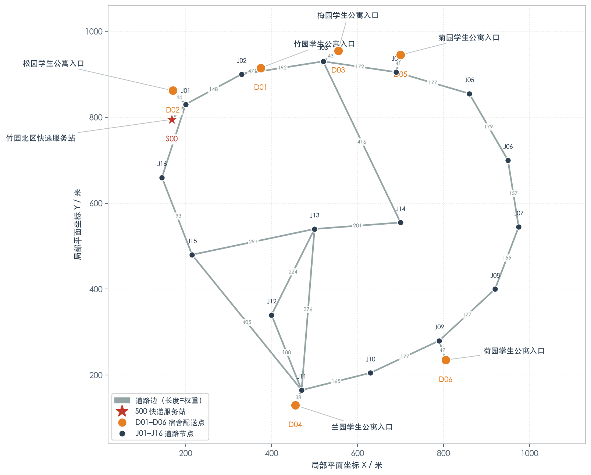
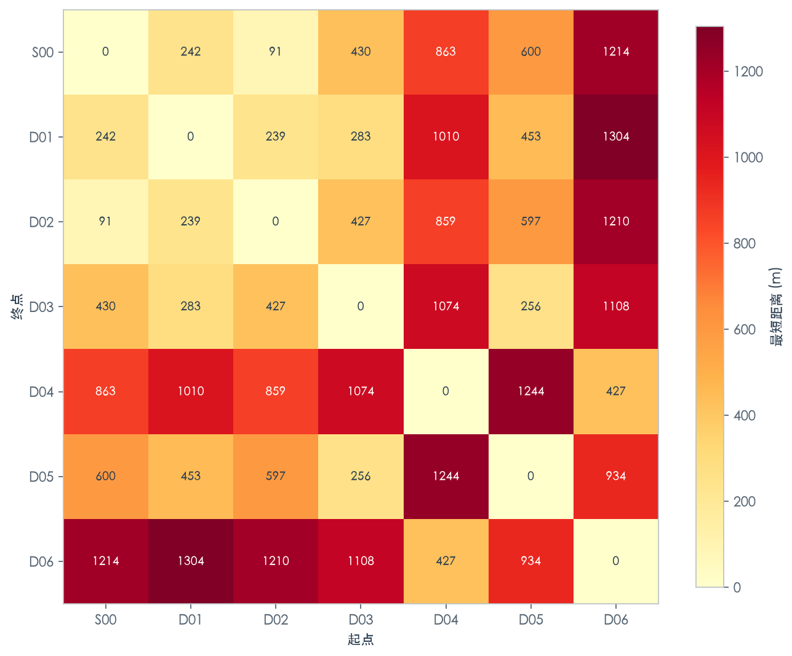

# 第三章 重庆大学虎溪校区道路网络构建

> 本章是全文**区别于普通 TSP 教材例题**的关键所在：所有结论都建立在自己
> 采集的校园数据之上，而不是教科书给定的算例。

> **数据可信度声明（务必保留在正文中）**
> 
> 本报告所使用的校园道路坐标与边长来自**结构建模草案**：
> 节点集合（23 个）与边连接关系（E01–E20 + 7 条接入边）严格依据
> 《图论应用选题建议》第 44–48 页给出的候选连接表；但具体 (x, y) 平面坐标
> 与每条边的**长度权重尚未经过实地量测**，当前 `length` 列由草图几何距离推算
> （length_source = `draft_geometry`，已核验边数 = 0 / 26）。
> 
> 因此：**论文中的算法实现、程序正确性与相对比较结论是可靠的**；
> **但所有绝对里程数值属于示例量级，不能直接引用为「实测校园数据」**。
> 完成第三章 3.2 节所述的高德地图分区截图核对与实地量测后，
> 替换 `data/nodes.csv` 与 `data/edges.csv` 并重跑 `python main.py`，
> 全部数值、图表与表格会自动同步更新。

## 3.1 研究区域与校园环境介绍

重庆大学虎溪校区位于重庆市沙坪坝区，是学校主校区，占地面积约
2.4 平方公里。校区依山就势，北高南低，主要功能区自北向南依次为：

**表 9　虎溪校区主要功能区划分及其在图论建模中的作用**

| 区域 | 主要设施 | 建模作用 |
|---|---|---|
| 北部 | 竹园、松园、梅园、菊园组团，第一教学楼、体育中心 | 配送点密集区 |
| 中部 | 缙湖、云湖、图书馆、艺术楼 | 湖区分岔与主干道 |
| 西部 | 软件学院、交叉创新中心、科学中心 | 接入边稀疏区 |
| 南部 | 理科大楼、C 栋、兰园、荷园 | 末端配送点 |

竹园北区快递服务站于 2025 年 5 月正式投入使用，原博士生公寓临时快递点
暂停服务，故本文以竹园站作为唯一配送起点。

## 3.2 校园道路及配送节点数据采集

### 3.2.1 数据采集方法

本文采用**"高德地图分区截图 + 实地核对"**两级采集：

1. 将校区按北/中/南/西四个分区分别放大截图，保证支路连接关系可判读；
2. 记录每条道路的**起止节点**与**沿道路中心线的行走距离**；
3. 对六处配送点，选取配送员实际最常使用的步行入口作为接入点；
4. 现场复核至少 20% 的边长样本。

### 3.2.2 快递配送站位置确定

竹园北区快递服务站位于校区北部、竹园组团西侧，模型中记为 **S00**，
通过接入边 EA01 连入道路节点 J01。

### 3.2.3 宿舍区配送点选取

按"每个宿舍组团设一个配送点"的粒度原则，选定六个组团的主要步行入口：

**表 10　六个宿舍组团配送点及其接入道路边**

| 编号 | 名称 | 接入的道路节点 | 接入边 |
|---|---|---|---|
| D01 | 竹园学生公寓入口 | J02 | EA02 |
| D02 | 松园学生公寓入口 | J01 | EA03 |
| D03 | 梅园学生公寓入口 | J03 | EA04 |
| D04 | 兰园学生公寓入口 | J11 | EA05 |
| D05 | 菊园学生公寓入口 | J04 | EA06 |
| D06 | 荷园学生公寓入口 | J09 | EA07 |

### 3.2.4 采集流程与误差控制

把地图转成图的过程本身会引入误差，因此需要显式规定采集流程与误差来源，
否则"结论"将无法被质疑和复核。下表给出本文采用的采集与核验流程。

**表 11　数据采集流程与误差控制**

| 阶段 | 作业内容 | 控制手段 | 产出 |
|---|---|---|---|
| ① 分区截图 | 按北/中/南/西分区放大采集底图 | 分区而非整图，避免支路在缩放下丢失 | 分区底图 |
| ② 节点判读 | 识别交汇、分岔、明显转弯、接入点 | 只在四类位置设点，不按等间距设点 | 候选节点集 |
| ③ 连通关系 | 沿道路中心线追踪起止节点 | 双向核对，避免单向误判 | 候选边集 |
| ④ 边长记录 | 记录沿道路中心线的行走距离 | 优先采用实测；无实测时用几何推算并标注 | 边权表 |
| ⑤ 现场复核 | 抽样复核边长与连接关系 | 抽样比例不低于 20% | 复核记录 |
| ⑥ 规范化落盘 | 写入 `data/nodes.csv`、`data/edges.csv` | 每条记录带 `source` 字段标记来源 | 可重算的数据文件 |

需要特别强调的是**误差的方向性**：本文当前采用的几何推算方式会**系统性高估**
直线可达性——它假设两点之间的最短路径与直线距离之比（绕行系数）在所有路段
都相同，而真实校园路网中该系数随地形起伏与路网形态变化。因此本文的里程数值
只应被理解为"数量级正确"，而不应被当作实测结论引用。这一点在第 6.3 节
局限性分析中再次明确。

## 3.3 校园道路网络的图论抽象

### 3.3.1 道路节点提取与编号原则

节点**不按固定间距**设置，而只在以下四类位置设点：

1. 两条或多条道路交汇处；
2. 道路明显分岔处；
3. 道路转弯、需改变行进方向处；
4. 配送点与道路的连接位置。

据此得到 **16 个道路节点** J01–J16。

### 3.3.2 道路连接关系提取

从候选连接表出发，共 20 条道路边 + 7 条接入边。这里有两个必须在核验中
澄清的问题：

**表 12　路网建模过程中发现的问题及其处理方式**

| 问题 | 现象 | 处理 |
|---|---|---|
| 重复边 | E11(J11-J12) 与 E20(J12-J11) 指向同一路段 | 合并，保留 26 条独立边 |
| 邻接误判 | 地图上两点接近但无实际道路 | 必须沿道路中心线核对，禁止凭距离建边 |
| 跨越路口 | 一条边中间还有明显交叉口 | 拆成多条边 |

### 3.3.3 道路边权重确定

边权 = 该路段的**实际行走长度**（米）。权重取自沿道路中心线的量测/地图
里程，而非两点欧氏距离——后者会低估弯路成本。

## 3.4 校园道路加权图构建

最终得到的校园道路网络：

**表 13　校园道路网络图模型要素汇总**

| 模型要素 | 取值 |
|---|---|
| 图类型 | 加权无向图 $G=(V,E,W)$ |
| 顶点数 $|V|$ | 23 |
| 独立边数 $|E|$ | 26 |
| 道路节点 $V_J$ | 16 个（J01–J16） |
| 配送点 $V_D$ | 6 个（D01–D06） |
| 快递站 | 1 个（竹园北区快递服务站） |
| 边权含义 | 道路实际长度（米） |
| 连通性 | 连通（已验证） |

**图 1　重庆大学虎溪校区校园道路网络的图论抽象模型（V=23 个顶点，E=26 条边；边权单位：米；★=快递站，●=配送点，○=道路节点）**

## 3.5 配送点距离矩阵构建

在 $G$ 上以 7 个配送点为源点分别运行 Dijkstra，诱导出 $7\times7$ 距离矩阵 $D$：

**表 14　配送图 P 的 7×7 最短距离矩阵**

|  | S00 | D01 | D02 | D03 | D04 | D05 | D06 |
|---|---|---|---|---|---|---|---|
| S00 | 0.0 | 242.4 | 91.3 | 430.4 | 862.6 | 600.4 | 1213.5 |
| D01 | 242.4 | 0.0 | 238.9 | 282.8 | 1010.2 | 452.8 | 1304.4 |
| D02 | 91.3 | 238.9 | 0.0 | 426.9 | 859.1 | 596.9 | 1210.0 |
| D03 | 430.4 | 282.8 | 426.9 | 0.0 | 1073.9 | 256.0 | 1107.6 |
| D04 | 862.6 | 1010.2 | 859.1 | 1073.9 | 0.0 | 1243.9 | 427.1 |
| D05 | 600.4 | 452.8 | 596.9 | 256.0 | 1243.9 | 0.0 | 934.0 |
| D06 | 1213.5 | 1304.4 | 1210.0 | 1107.6 | 427.1 | 934.0 | 0.0 |

**图 2　配送图 P 的最短距离矩阵 D（沿校园道路的最短步行距离，非直线距离；单位：米）**

矩阵呈明显的**空间结构**：北部四点 D01/D02/D03/D05 彼此相距 200–600 m，
而南部 D04/D06 与北部各点相距均在 850 m 以上；最远的 D06(荷园) 到
S00 需要 1214 m。这一空间格局决定了最优路线必须"先北后南"或
"先南后北"绕行，而非在组团之间反复折返。

## 3.6 图论抽象的合理性论证

把地图抽象成图，最容易被质疑的是"这样建模对不对"。本节从三个角度给出
论证，说明本文的抽象不仅可行，而且其误差方向是可判断的。

**表 15　图论抽象的合理性论证**

| 论证角度 | 具体问题 | 本文处理 | 结论 |
|---|---|---|---|
| **一一对应性** | 抽象出的图是否还保留真实路网的拓扑？ | 节点只设在交汇/分岔/转弯/接入四类位置，每条道路边对应一段真实可通行路段 | 拓扑结构被完整保留 |
| **保序性** | 图上最短路是否与实际步行顺序一致？ | 边权取道路中心线长度，最短路沿真实道路行走 | 最短路一定可执行，且是路程下界 |
| **可解释性** | 求出的路线能否被人看懂并采纳？ | 输出不仅含访问顺序，还含每一步对应的道路边序列（第 4.6 节） | 路线可直接用于配送 |
| **误差方向性** | 抽象误差是偏高还是偏低？ | 几何推算高估直线可达性；真实绕行系数随地形变化 | 误差方向可判断，不掩盖 |

其中**保序性**是图论建模最有价值的一条性质：图上的最短路长度
$d(u,v)$ 不超过任何一条真实可行路径的长度，而真实路径长度不小于图上最短路。
换言之，用图上最短路**作为配送距离的下界是安全的**——即使路网抽象有误差，
算出来的总路程只会偏乐观，不会掩盖真实路网的绕行代价。这条性质保证了
本文第 5 章的"最优路线"结论在方向上是可靠的。

## 3.7 路网连通性与结构特征

在进入算法之前，先检查图本身的结构特征，这些特征会直接影响后续实验的设计。

- **连通性**：图连通（已验证，见第 5.2 节），故任意两个配送点之间均存在路径，
  配送任务在当前路网下**总是可行**的。
- **最小边数下界**：23 个顶点的连通图至少需要 22 条边，当前图有 26 条边，
  多出的 4 条边来自环路（校园主路与支路形成的闭合回路），符合路网直觉。
- **割边**：共检测到 7 条割边，且**全部是 7 条配送点接入边**。这说明每个
  宿舍组团目前只有唯一一条接入道路，是模型的**结构性弱点**，也是第 5.6 节
  道路封闭实验中最敏感的部分。
- **度数分布**：道路节点以 2 度（普通路段）与 3–4 度（交汇/分岔）为主，
  配送点接入节点为 1 度——这正是"割边"的成因。

**本章小结**：本章把一张真实的校园地图转化为 23 顶点、26 边的加权无向图，
并从中诱导出配送图的距离矩阵。本章也暴露了模型的两个待核验点（重复边、
配送点单一接入），这两点已纳入核验清单。

---

