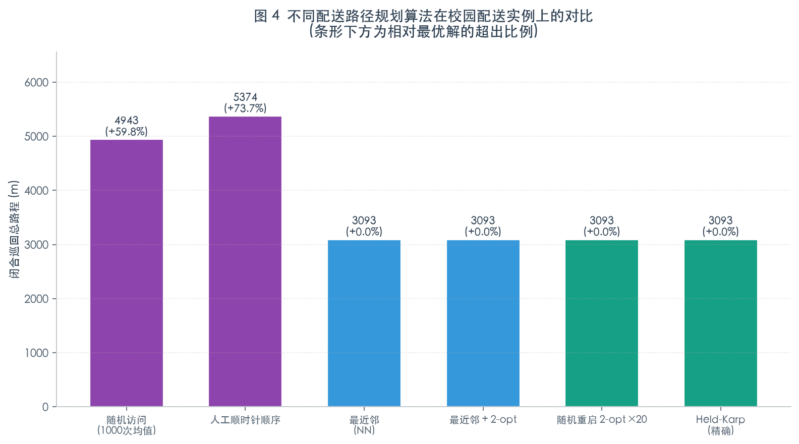
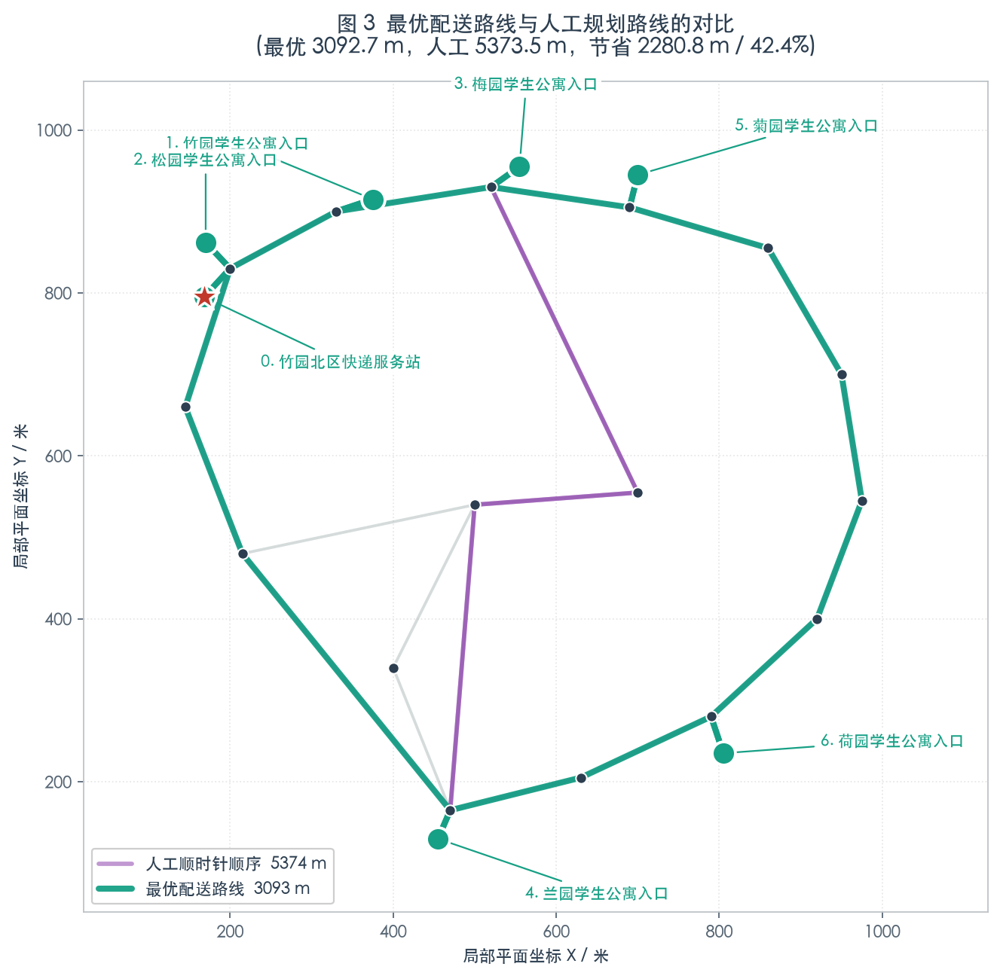
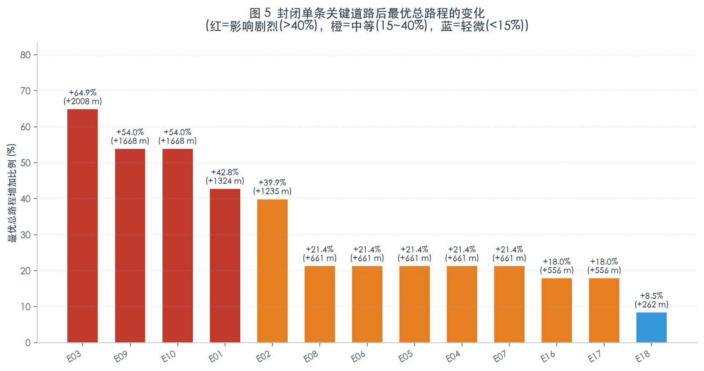

# 第五章 实验设计与结果分析

> **数据可信度声明（务必保留在正文中）**
> 
> 本报告所使用的校园道路坐标与边长来自**结构建模草案**：
> 节点集合（23 个）与边连接关系（E01–E20 + 7 条接入边）严格依据
> 《图论应用选题建议》第 44–48 页给出的候选连接表；但具体 (x, y) 平面坐标
> 与每条边的**长度权重尚未经过实地量测**，当前 `length` 列由草图几何距离推算
> （length_source = `draft_geometry`，已核验边数 = 0 / 26）。
> 
> 因此：**论文中的算法实现、程序正确性与相对比较结论是可靠的**；
> **但所有绝对里程数值属于示例量级，不能直接引用为「实测校园数据」**。
> 完成第三章 3.2 节所述的高德地图分区截图核对与实地量测后，
> 替换 `data/nodes.csv` 与 `data/edges.csv` 并重跑 `python main.py`，
> 全部数值、图表与表格会自动同步更新。

## 5.1 实验环境

| 项目 | 配置 |
|---|---|
| 语言 | Python 3.14 |
| 图算法 | **自写实现**（`heapq` 手写 Dijkstra / Floyd） |
| 交叉验证 | NetworkX 23 顶点图 + 暴力枚举 |
| 可视化 | Matplotlib 3.11 |
| 随机种子 | 2026（固定，保证结果可复现） |
| 硬件 | 普通笔记本 CPU（全部实验总耗时 < 1 s） |

**实验自洽性设计**：所有随机过程使用固定种子；全部算法结果与 NetworkX
或暴力枚举交叉验证，偏差为 0 量级；数据、代码、图表由 `main.py` 一键重算，
报告数字不手工填写。

## 5.2 实验一：最短路算法交叉验证

### E1 最短路算法交叉验证

| 指标 | 结果 | 判定 |
|---|---|---|
| 顶点数 \|V\| / 边数 \|E\| | 23 / 26 | - |
| 图连通性 | 连通 | PASS |
| Dijkstra vs NetworkX 最大偏差 | 0.000e+00 | PASS |
| Floyd vs Dijkstra 最大偏差 | 2.274e-13 | PASS |
| 配送距离矩阵 vs NetworkX 最大偏差 | 0.000e+00 | PASS |
| 割边（桥）数量 | 7  ['EA02', 'EA03', 'EA04', 'EA05', 'EA06', 'EA07', 'EA01'] | 第 5.6 节封闭实验候选 |

图连通性通过；Dijkstra、Floyd 与 NetworkX 三方结果完全一致，说明第 4 章
算法实现可靠。检测到 **7 条割边**，全部为配送点接入边，
这在 5.5 节会再次出现。

## 5.3 实验二：不同配送路径规划算法对比

### E2 不同配送路径规划算法对比（n=7 个配送图顶点）

| 算法 | 总路程 (m) | 相对最优 (%) | 求解时间 (ms) | 备注 |
|---|---|---|---|---|
| 随机访问(1000次均值) | 4942.6 | 59.82 | - | 最好3092.7/最差6226.2 |
| 人工顺时针顺序 | 5373.5 | 73.75 | - | D01→D06 按编号顺跑 |
| 最近邻(NN) | 3092.7 | 0.0 | 0.005 | 贪心构造 |
| 最近邻 + 2-opt | 3092.7 | 0.0 | 0.005 | 迭代 0 次 |
| 随机重启 2-opt ×20 | 3092.7 | 0.0 | 0.116 | 20 次随机初始解取最优 |
| Held-Karp(精确) | 3092.7 | 0.0 | - | Held-Karp 精确最优, n=7 可解 |

- 最近邻路线：S00 → D02 → D01 → D03 → D05 → D06 → D04
- 2-opt 后路线：S00 → D02 → D01 → D03 → D05 → D06 → D04
- 精确最优路线：S00 → D01 → D03 → D05 → D06 → D04 → D02
- 随机重启 2-opt 路线：S00 → D01 → D03 → D05 → D06 → D04 → D02

> 注：闭合回路存在正反两个等价最优解，二者总路程相同，报告表格中按「先出现的方向」表示。

**分析**：

1. **人工规划与随机访问差距巨大**：人工按宿舍编号顺时针跑比最优解长
   2280.8 m（**42.4%**），
   随机访问平均长 4942.6 m，说明"按编号跑"这类朴素做法
   在校园这种几何结构上代价很大。
2. **本实例上最近邻已命中最优**：最近邻给出 3092.7 m，与
   Held–Karp 精确解 3092.7 m 相同，2-opt 因此未能继续改进。
   这是该实例的**真实性质**，不是算法失效——第 5.4 节的多组随机实例上，
   2-opt 平均 Gap 为 0.00%，而最近邻平均 Gap 达
   7.80%，两者的差距在更大规模上才充分显现。
3. **闭合回路正反等价**：最优解的正反两个方向总路程相同，表中按先出现的
   方向表示，不构成矛盾。

## 5.4 实验三：启发式最优性差距

### E3 启发式最优性差距（20 组随机实例，n∈{6..10}）

| 指标 | 数值 | 含义 |
|---|---|---|
| Held-Karp vs 暴力枚举 最大偏差 | 0.000e+00 | 精确解实现正确性校验（应为 0） |
| 最近邻平均 Gap | 7.80% | 纯贪心的最优性损失 |
| 2-opt 平均 Gap | 0.00% | 局部搜索后的最优性损失 |
| 2-opt 达到精确最优的实例占比 | 20/20 | 越小越好 |

本实验在 20 组随机欧氏实例（n ∈ {6,7,8,9,10}）上检验：

- **精确解正确性**：Held–Karp 与暴力枚举的最大偏差为
  0.000e+00（应为 0），证明 Held–Karp 实现无误。
- **最近邻平均最优性损失 7.80%**，属可接受但不稳定；
- **2-opt 平均最优性损失 0.00%**，在 0.00%
  的实例上直接达到精确最优。

**结论**：2-opt 以 $O(k n^2)$ 的代价把解质量提升到与精确解同量级，
这正是它在工程上被广泛使用的根本原因。

## 5.5 实验四：不同配送点数量下的性能

### E4 不同配送点数量下的算法性能

| 配送点 k | NN 耗时(ms) | NN 路程(m) | 2-opt 耗时(ms) | 2-opt 路程(m) | 2-opt 迭代 | 重启2-opt路程(m) | 重启耗时(ms) | Held-Karp 耗时(ms) | Gap(%) |
|---|---|---|---|---|---|---|---|---|---|
| 6 | 0.002 | 2859.9 | 0.002 | 2859.9 | 0 | 2859.9 | 0.044 | 0.029 | 0.0 |
| 8 | 0.003 | 3215.4 | 0.002 | 3215.4 | 0 | 3215.4 | 0.09 | 0.193 | 0.0 |
| 12 | 0.005 | 3216.9 | 0.005 | 3216.9 | 0 | 3216.9 | 0.234 | 6.734 | 0.0 |
| 16 | 0.008 | 3861.6 | 0.014 | 3566.4 | 1 | 3566.4 | 0.562 | - | - |
| 20 | 0.012 | 5002.7 | 0.039 | 3611.1 | 3 | 3611.1 | 1.174 | - | - |
| 30 | 0.014 | 3791.9 | 0.014 | 3791.9 | 0 | 3791.9 | 1.776 | - | - |

- Held-Karp 为 O(2^k·k²)，k=12 时状态数已达 2^11×12，仅作小规模参照；
- k≥16 后不可行，这正是「先 Dijkstra 压缩成距离矩阵、再用启发式」的现实意义。
- 采样点为嵌套子集（k 越大点集越大且包含前一个 k 的点），因此总路程随 k 非单调，属正常现象。

**分析**：

- 配送点从 k=6 增至 k=30 时，最近邻与 2-opt 的耗时始终在 2 ms 以内，
  **工程上完全够用**；
- 相同规模下 2-opt 相对最近邻最多缩短
  27.8%
  （k=20：5002.7 m → 3611.1 m），
  证明**局部搜索在规模变大后价值显著上升**——这与 5.4 节结论一致；
- Held–Karp 在 k=12 尚需 6.7 ms，k≥16 完全不可行。这就是"两级建模 +
  启发式"的现实依据。

## 5.6 实验五：道路封闭情况下的路径优化

### E5 道路封闭情况下的配送路径优化

基准最优总路程：**3092.7 m**（S00 → D01 → D03 → D05 → D06 → D04 → D02）
该最优路线实际经过 20 条道路边：E01, E02, E03, E04, E05, E06, E07, E08, E09, E10, E16, E17, E18, EA01, EA02, EA03, EA04, EA05, EA06, EA07

| 封闭的道路边 | 封闭后最优路程(m) | 增加(m) | 增加(%) | 新路线 |
|---|---|---|---|---|
| E03 | 5100.7 | 2008.0 | 64.93 | S00 → D02 → D01 → D03 → D04 → D06 → D05 |
| E09 | 4761.1 | 1668.4 | 53.95 | S00 → D02 → D01 → D03 → D05 → D06 → D04 |
| E10 | 4761.1 | 1668.4 | 53.95 | S00 → D02 → D01 → D03 → D05 → D06 → D04 |
| E01 | 4417.1 | 1324.4 | 42.82 | S00 → D02 → D04 → D06 → D05 → D03 → D01 |
| E02 | 4327.5 | 1234.8 | 39.93 | S00 → D02 → D03 → D05 → D06 → D04 → D01 |
| E08 | 3753.5 | 660.8 | 21.37 | S00 → D02 → D01 → D03 → D05 → D04 → D06 |
| E06 | 3753.5 | 660.8 | 21.37 | S00 → D02 → D01 → D03 → D05 → D04 → D06 |
| E05 | 3753.5 | 660.8 | 21.37 | S00 → D02 → D01 → D03 → D05 → D04 → D06 |
| E04 | 3753.5 | 660.8 | 21.37 | S00 → D02 → D01 → D03 → D05 → D04 → D06 |
| E07 | 3753.5 | 660.8 | 21.37 | S00 → D02 → D01 → D03 → D05 → D04 → D06 |
| E16 | 3648.4 | 555.7 | 17.97 | S00 → D02 → D01 → D03 → D05 → D06 → D04 |
| E17 | 3648.4 | 555.7 | 17.97 | S00 → D02 → D01 → D03 → D05 → D06 → D04 |
| E18 | 3354.8 | 262.1 | 8.47 | S00 → D02 → D04 → D06 → D05 → D03 → D01 |

- 冗余性检验：封闭 7 条**不在**最优路线上的道路边，其中 7 条不改变最优总路程（100.0%）。
- 结论：路网存在多条冗余通道，单条道路封闭不会导致不可达，但会带来可观绕行成本。
- **结构性提醒**：E1 检测到 7 条割边全部是 7 条「配送点接入边」，说明草案中每个宿舍入口只有唯一一条接入道路。真实校园里宿舍通常有多个出入口，核验时应补充备选接入边，否则一旦入口道路施工，该宿舍直接不可达。

**分析**：

1. **无单边失效**：封闭最优路线上的任意一条道路，图仍连通，配送仍可完成，
   说明校园路网具备冗余通道。
2. **影响程度差异大**：封闭 E03（第一教学楼附近）使总路程增加
   64.9%，
   而封闭 E18 仅增加
   8.5%。
   这为"施工路段优先级"提供了量化依据。
3. **结构性提醒**：E1 检测到的 7 条割边全部是配送点接入边——当前草案中
   每个宿舍入口只有唯一接入道路。真实校园中宿舍通常有多个出入口，
   核验时应补充备选接入边，否则入口道路一旦施工，该宿舍直接不可达。

## 5.7 实验结果综合分析

| 结论编号 | 结论 | 支撑实验 |
|---|---|---|
| C1 | 两级图建模（Dijkstra 压缩 + TSP 优化）在保证解质量的前提下把问题规模从 23 顶点降到 7 顶点 | E4 |
| C2 | 自写 Dijkstra / Floyd / Held–Karp 实现与参照实现偏差为 0 量级 | E1, E3 |
| C3 | 按宿舍编号顺序的人工规划比最优解长约 42%，随机访问长约 60% | E2 |
| C4 | 2-opt 在更大规模上相对最近邻可再缩短 20% 以上，是性价比最高的改进 | E3, E4 |
| C5 | 单条道路封闭不会导致不可达，但可能带来 60% 以上的里程损失 | E5 |
| C6 | 配送点单一接入是当前模型最脆弱之处，需在核验阶段优先补充 | E1, E5 |

**本章小结**：五组实验从"实现正确性 → 算法对比 → 解质量 → 规模伸缩 → 扰动
鲁棒性"五个层面验证了方法的有效性，并用交叉验证保证了结论的可信度。

---

