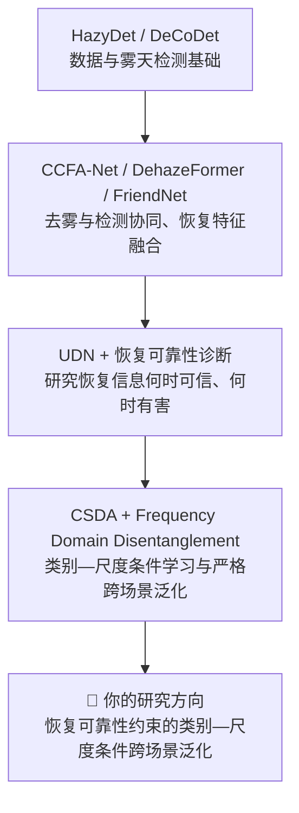

# 📚 文献地图 · 四层优先级

> [!abstract] 这份笔记解决什么
> 把「**要读哪些论文、按什么顺序读、每篇要回答什么问题**」固化成一张地图，
> 避免边读边散、读完不知道下一篇该读谁。

---

## 🗺️ 四层结构总览

| 层级 | 定位 | 篇数 | 状态 |
|---|---|---|---|
| **第一层** | 必须复现的基线（不读完没法开工） | 4 | 🔴 待读 2 · ✅ 已精读 2 |
| **第二层** | 支撑核心创新（决定你的方法能不能立住） | 4 | 🟡 待读 |
| **第三层** | 跨场景域泛化专项突破点 | 2（来自上两层） | 🟡 待深挖 |
| **第四层** | 补充理论与实验设计（不占主要时间） | 5 类 | ⚪ 随用随查 |

> [!warning] 原文的四层标题与正文三档优先级对不上
> 正文写的是「第一 / 第二 / 第三优先级」，开头又列了「四层」。
> 本笔记统一为：**四层 = 两档正文优先级（P0 / P1）+ 专项突破 + 补充层**，
> 避免同一篇论文出现两个编号。

---

## 🔴 第一层 · 必须复现的基线（4 篇）

> 决定你能否顺利完成**基线复现与研究问题验证**。
> 这层读完之前，**不要写任何新模块**。

### 1. CCFA-Net · 主基线 ✅ 已精读

*Cross-domain Collaborative and Foreground-aware for UAV Object Detection in Hazy Scenes*
ISPRS JPRS 2026 · [DOI](https://doi.org/10.1016/j.isprsjprs.2026.04.020) · [官方代码](https://github.com/XFCV26/CCFA-Net)

- **为什么必须读**：与你研究主题最接近的工作，已涉及联合去雾检测、原始雾图与恢复特征融合、多尺度前景感知。
- **精读重点**：CCDD / CFFM / MFAM 三个模块；损失函数；训练数据；**跨域实验究竟属于域适应还是严格域泛化**。
- 📍 本仓库已有：[[paper-notes/论文精读/1-CCFA-Net精读/00-索引 MOC|CCFA-Net 精读索引]]（22 篇 + 40 附件）· [[paper-notes/论文精读/1-CCFA-Net精读/01-论文精读/00-论文速览|论文速览]]
- 📥 **原文 PDF：无法自动下载**（Elsevier 非 OA，Unpaywall/OpenAlex 均 `is_oa: false`）。DOI [10.1016/j.isprsjprs.2026.04.020](https://doi.org/10.1016/j.isprsjprs.2026.04.020) → **你是作者之一，走图书馆 / 作者稿通道取**。
- ✅ 状态：已逐讲精读完毕

### 2. HazyDet / DeCoDet · 数据与检测基线 ✅ 已精读

*HazyDet: Open-Source Benchmark for Drone-View Object Detection with Depth Cues in Hazy Scenes*
TGRS 2026（预印本 2024）· [DOI](https://doi.org/10.1109/TGRS.2026.3701819) · [官方代码与数据](https://github.com/GrokCV/HazyDet)

- **为什么必须读**：你的实验必须建立在真实的雾天 UAV 检测数据上。HazyDet 覆盖合成雾与真实雾相关数据，DeCoDet 用深度线索 + 多尺度深度感知做检测。
- **精读重点**：数据构建、训练测试划分、伪深度误差、DeCoDet 检测头、尺度不变损失。
- 📍 本仓库已有：[[paper-notes/论文精读/3-HazyDet精读/00-索引 MOC|HazyDet 精读索引]]（10 篇，含实验速查卡）
- ✅ 状态：已精读完毕

### 3. DehazeFormer · 去雾对照 🔴 待读

*Transformer-Based Feature Learning for Image Dehazing*
TIP 2023 · [官方代码](https://github.com/IDKiro/DehazeFormer)

- **为什么必须读**：作为**独立去雾基线**，回答一个关键问题——「**图像变清晰是否一定有利于检测**」。
- **精读重点**：多尺度特征、Transformer 结构、去雾推理流程，以及**去雾输出与检测器的串联方式**。
- 📍 相关已有笔记：[[paper-notes/论文精读/0-公共基础知识/07-方向知识脉络/01-图像复原谱系-从DCP到DehazeFormer|图像复原谱系]]（含 DehazeFormer 段落）
- 🔴 状态：待精读 → 卡片 [[paper-notes/论文精读/6-新增待精读文献/01-DehazeFormer|01-DehazeFormer]]

### 4. Frequency Domain Disentanglement · 域泛化基线 🔴 待读

*Generalized UAV Object Detection via Frequency Domain Disentanglement*
CVPR 2023 · [CVPR 官方页面](https://openaccess.thecvf.com/content/CVPR2023/html/Wang_Generalized_UAV_Object_Detection_via_Frequency_Domain_Disentanglement_CVPR_2023_paper.html)

- **为什么必须读**：直接研究 UAV 检测在**未见真实场景**中的泛化，并在三个未见目标域上验证。
- **精读重点**：域不变频谱 / 域特定频谱、实例级对比损失、**严格未见域的实验设计**。
- 📍 相关已有笔记：[[paper-notes/论文精读/0-公共基础知识/09-域泛化与不变学习/01-域泛化机制精讲-MMD-GRL-IRM与偏移三分类|域泛化机制精讲]]
- 🔴 状态：待精读 → 卡片 [[paper-notes/论文精读/6-新增待精读文献/02-频率域解耦-FDD|02-频率域解耦-FDD]]

---

## 🟡 第二层 · 支撑核心创新（4 篇）

> 不一定全部复现，但**必须精读**。
> 决定你的创新能否从「模块拼接」升级为「**有明确科学问题的方法**」。

### 5. UDN · 恢复可靠性 ⭐ 对应方向一

*Uncertainty-Driven Dehazing Network* · AAAI 2022 · [论文 PDF](https://cdn.aaai.org/ojs/19973/19973-13-23986-1-2-20220628.pdf)

- **对应你的研究**：恢复可靠性估计。
- **精读重点**：必须区分四层概念——
  - 像素级不确定性
  - 图像恢复误差
  - 特征恢复不确定性
  - 下游检测任务的不确定性
- 🔑 **你的真正需求**：*恢复信息是否值得被检测器利用*，而不是「图像哪里不确定」。
- 🔴 状态：待精读 → 卡片 [[paper-notes/论文精读/6-新增待精读文献/03-UDN-不确定性驱动去雾|03-UDN]]

### 6. FriendNet · 感知友好去雾 ⭐ 对应方向一

*FriendNet: Detection-Friendly Dehazing Network* · 2024 · [论文](https://arxiv.org/abs/2403.04443)

- **对应你的研究**：感知友好去雾。
- **精读重点**：去雾损失与检测损失如何协同；**检测监督能否避免恢复网络生成对检测无益的细节**。
- ⚖️ 必做对照：与 CCFA-Net 对比，判断两者在**联合优化**和**特征融合**上的本质区别。
- > [!danger] ⚠️ **已撤稿**（arXiv:2403.04443 withdrawn，2025-04）
> 作者自述：*「理论框架存在根本缺陷，主要论断不成立」*。
> **只当反面教材读**（看 GFB/GAB/PFEB 结构），❌ 不要引用、❌ 不要复现。
- 🔴 状态：待精读（**仅作思路参考**） → 卡片 [[paper-notes/论文精读/6-新增待精读文献/04-FriendNet|04-FriendNet]]

### 7. CSDA · 类别—尺度条件学习 ⭐ 对应方向二

*Learning Category-Scale Joint Feature for Domain Adaptive Object Detection*
ICCV 2023 · [ICCV 官方页面](https://openaccess.thecvf.com/content/ICCV2023/html/Gao_CSDA_Learning_Category-Scale_Joint_Feature_for_Domain_Adaptive_Object_Detection_ICCV_2023_paper.html)

- **对应你的研究**：类别—尺度条件特征学习。
- **精读重点**：SGFF、SAFE，以及**类别对齐在不同目标尺度下可能出现的不一致**。
- > [!danger] 红线
> CSDA 是**域适应（DA）**方法。不能把它的损失搬进你的网络就宣称是域泛化创新。
> 必须研究：**在完全不访问目标域数据的前提下**，如何学到稳定的类别—尺度判别特征。
- 🔴 状态：待精读 → 卡片 [[paper-notes/论文精读/6-新增待精读文献/05-CSDA|05-CSDA]]

### 8. AOD-Net · 大气散射模型与经典去雾基线

*AOD-Net: All-in-One Dehazing Network* · ICCV 2017 · [ICCV 官方页面](https://openaccess.thecvf.com/content_iccv_2017/html/Li_AOD-Net_All-in-One_Dehazing_ICCV_2017_paper.html)

- **对应你的研究**：大气散射模型与传统去雾基线。
- **精读重点**：**快速阅读**即可，目的是理解雾图形成过程与经典去雾方法。
- 💡 **它的真正价值**：帮你解释**为什么恢复误差会随雾浓度、深度和目标尺度变化**——这正是你方向一的立论基础。
- 📍 相关已有笔记：[[paper-notes/论文精读/1-CCFA-Net精读/01-论文精读/01-第1讲-去雾物理模型与DCP|第 1 讲 · 去雾物理模型与 DCP]]
- 🔴 状态：待快速阅读 → 卡片 [[paper-notes/论文精读/6-新增待精读文献/06-AOD-Net|06-AOD-Net]]

---

## 🎯 第三层 · 跨场景域泛化专项突破点

> 从第一、二层里抽出的**两条必须打穿的主线**。

| 论文 | 在你体系里的位置 | 必须打穿的问题 |
|---|---|---|
| **FDD**（CVPR 2023） | 严格域泛化的**实验协议**来源 | 什么叫「真正未见场景」？训练/测试如何划分才不泄漏？ |
| **CSDA**（ICCV 2023） | 类别—尺度条件学习的**方法来源** | DA 的对齐思想怎么改造成 DG 可用（不碰目标域数据）？ |
| **DIDN**（ICCV 2021） | 域不变/域特定**解耦**的理论骨架 | 它依赖**域标签**训练（属 DA 范畴），不访问目标域时解耦还成立吗？ |
| **FPD**（Neurocomputing 2023） | 频域**伪域生成**、数据域多样化 | 频域扰动怎么造伪域？伪域与真实域的差距怎么验证？ |

> [!tip] 这一层是你**区别于 CCFA-Net 的护城河**
> CCFA-Net 已有跨域实验，你必须比它更严格：
> **不访问目标域 → 域不变特征 → 类别—尺度条件化 → 恢复可靠性约束**。

---

## ⚪ 第四层 · 补充理论与实验设计

> 随用随查，**不建议占用第一阶段的主要时间**。

| 主题 | 主要价值 | 建议阅读方式 | 本仓库已有 |
|---|---|---|---|
| **VisDrone / UAVDT 相关检测论文** | 小目标、多尺度检测、航拍背景干扰 | 重点看数据划分和 **AP_small** | [[paper-notes/论文精读/0-公共基础知识/07-方向知识脉络/08-遥感基础与数据集谱系\|遥感基础与数据集谱系]] |
| **FPN** | 多尺度特征融合基础 | 理解浅层细节与深层语义如何融合 | [[paper-notes/论文精读/0-公共基础知识/02-骨干网络与特征融合/06-ResNet与FPN通用结构及前辈工作综述\|ResNet 与 FPN 通用结构]] |
| **Focal Loss** | 类别不平衡、困难样本学习 | 理解小目标检测中的正负样本不平衡 | [[paper-notes/论文精读/0-公共基础知识/04-检测任务与评测\|检测任务与评测]] |
| **Domain Generalization Survey** | 域泛化理论与方法分类 | 建立 **DG / DA / OOD** 的概念边界 | [[paper-notes/论文精读/0-公共基础知识/07-方向知识脉络/03-域适应域泛化与测试时适应\|域适应域泛化与测试时适应]] |
| **Image Restoration for Perception** | 恢复任务与下游感知的关系 | 重点分析 **restoration-perception trade-off** | [[paper-notes/论文精读/0-公共基础知识/07-方向知识脉络/01-图像复原谱系-从DCP到DehazeFormer\|图像复原谱系]] |

---

## 📥 原文获取状态（2026-11-25 核对）

| 论文 | 开放获取 | 本地存档 | 备注 |
|---|---|---|---|
| CCFA-Net | ❌ Elsevier 非 OA | ❌ | 你是作者之一 → 走**图书馆 / 作者稿**通道 |
| HazyDet / DeCoDet | ✅ arXiv 2409.19833 | ✅ 20p | [[paper-notes/论文精读/3-HazyDet精读/00-索引 MOC\|3-HazyDet精读]] |
| DehazeFormer | ✅ arXiv 2204.03883 | ✅ 13p | [[paper-notes/论文精读/6-新增待精读文献/01-DehazeFormer\|01-DehazeFormer]] |
| FDD（CVPR 2023） | ✅ CVF | ✅ 10p | [[paper-notes/论文精读/6-新增待精读文献/02-频率域解耦-FDD\|02-FDD]] |
| UDN（AAAI 2022） | ✅ AAAI OJS | ✅ 8p | [[paper-notes/论文精读/6-新增待精读文献/03-UDN-不确定性驱动去雾\|03-UDN]] |
| FriendNet | ⚠️ **已撤稿**（仅 v1） | ✅ v1 13p | 只当反面教材 |
| CSDA（ICCV 2023） | ✅ CVF | ✅ 10p | [[paper-notes/论文精读/6-新增待精读文献/05-CSDA\|05-CSDA]] |
| AOD-Net（ICCV 2017） | ✅ arXiv 1707.06543 | ✅ 12p | [[paper-notes/论文精读/6-新增待精读文献/06-AOD-Net\|06-AOD-Net]] |
| DIDN（ICCV 2021） | ✅ CVF | ✅ 10p | [[paper-notes/论文精读/6-新增待精读文献/07-DIDN\|07-DIDN]] |
| FPD | ❌ 期刊非 OA | ✅ 同组 FIT 替代版 | 出处应为 **Neurocomputing 2023**，非 CVPR 2021 |

> [!tip] 全部原文 + 纯文本都在
> `paper-notes/论文精读/6-新增待精读文献/附件/` —— 每份 PDF 配一份 `.txt`（全文可检索、可摘抄）。
> 总目录见 [[paper-notes/论文精读/6-新增待精读文献/00-索引 MOC|新增待精读文献索引]]。

---

## 🔗 文献关系逻辑链

> 你的研究**不是**「去雾 + 小目标检测 + 域泛化」的简单组合，而是要建立下面这条链。

| 链条环节 | 承担论文 | 对应你的方向 |
|---|---|---|
| 数据与检测基础 | HazyDet / DeCoDet | — |
| 去雾与检测协同 | CCFA-Net / DehazeFormer / FriendNet | 方向一（可信度建模）的输入 |
| 恢复可靠性诊断 | UDN | **方向一**：恢复信息可信度建模 |
| 类别—尺度 + 严格泛化 | CSDA + FDD | **方向二**：恢复可靠性约束的类别—尺度条件跨场景泛化 |

---

## 📋 每篇论文应该怎样精读

> [!tip] 不要只记录网络结构
> 下面 9 项是**每篇都填一遍**的固定模板，缺一项就说明这篇没读透。

| 精读项目 | 需要回答的问题 |
|---|---|
| **研究问题** | 作者究竟解决了什么问题？ |
| **研究范式** | 属于检测、域适应、域泛化，还是联合恢复？ |
| **方法结构** | 输入、特征提取、关键模块、输出是什么？ |
| **核心机制** | 模块为什么有效？是否有理论或实验支撑？ |
| **损失函数** | 每一项损失解决什么问题？ |
| **数据集** | 训练和测试之间是否存在**场景泄漏**？ |
| **实验协议** | 是否真正测试了**未见场景**？ |
| **局限性** | 哪些问题仍然没有解决？ |
| **与我的研究关系** | 哪些可以复现？哪些可以改进？哪些**不能作为创新**？ |

---

## 🗓️ 五阶段阅读与执行排期

| 阶段 | 任务 | 交付物 | 状态 |
|---|---|---|---|
| **第 1 阶段** | 精读 HazyDet + DeCoDet | 搞清楚数据集、检测器、训练流程 | ✅ 已完成 |
| **第 2 阶段** | 精读 CCFA-Net | 画出整体网络结构图，逐模块理解代码 | ✅ 已完成 |
| **第 3 阶段** | 运行 DehazeFormer | 原始雾图 / 去雾图 / 联合检测三组对照实验 | ⬜ 待做 |
| **第 4 阶段** | 精读 UDN | 想清楚恢复不确定性如何转化为检测特征可靠性 | ⬜ 待做 |
| **第 5 阶段** | 精读 CSDA + FDD | 确定严格域泛化的实验协议与方法边界 | ⬜ 待做 |

### 待办清单

- [ ] 第 3 阶段：搭通 DehazeFormer 推理 + HazyDet 检测器串联
- [ ] 第 3 阶段：跑出「原始雾图 / 去雾图 / 联合检测」三组对照 AP
- [ ] 第 4 阶段：精读 UDN，产出笔记
- [ ] 第 4 阶段：设计「恢复扰动 → 特征一致性」的可靠性估计原型
- [ ] 第 5 阶段：精读 CSDA，整理 DA→DG 的改造清单
- [ ] 第 5 阶段：精读 FDD，抄下它的未见域划分协议
- [ ] 第 5 阶段：产出「严格域泛化实验协议」定稿

---

## 🧭 与本仓库既有内容的关系

| 本笔记涉及 | 仓库已有 | 处置 |
|---|---|---|
| CCFA-Net | [[paper-notes/论文精读/1-CCFA-Net精读/00-索引 MOC]]（22 篇） | ✅ 直接用，**不重读** |
| HazyDet / DeCoDet | [[paper-notes/论文精读/3-HazyDet精读/00-索引 MOC]]（10 篇） | ✅ 直接用，**不重读** |
| 域泛化机制 | [[paper-notes/论文精读/0-公共基础知识/09-域泛化与不变学习/01-域泛化机制精讲-MMD-GRL-IRM与偏移三分类]] | 📖 精读 FDD/CSDA 时**边读边补** |
| 域适应/域泛化谱系 | [[paper-notes/论文精读/0-公共基础知识/07-方向知识脉络/03-域适应域泛化与测试时适应]] | 📖 同上 |
| 去雾谱系 | [[paper-notes/论文精读/0-公共基础知识/07-方向知识脉络/01-图像复原谱系-从DCP到DehazeFormer]] | 📖 精读 DehazeFormer / AOD-Net 时**边读边补** |
| 研究方案 | [[UAV_Research_Plan_Refined_CCFA_TDRE]] · [[TVT_UAV_跨场景泛化检测_研究方案]] | 🔗 本地图是**方案的文献侧补充**，不重复 |
| 新增 6 篇 | — | 📝 新建 [[paper-notes/论文精读/6-新增待精读文献/00-索引 MOC\|6-新增待精读文献]] 卡片 |

> [!note] 本地图与研究方案的分工
> - **研究方案**回答「我要做什么、怎么做、怎么写论文」
> - **本文献地图**回答「我得读哪些论文、读到哪、每篇要榨出什么」
> - 二者共用同一套结论，**改动时两边同步**。

---

**返回** → [[00-索引 MOC]] ｜ [[00-总索引-五篇论文]]
